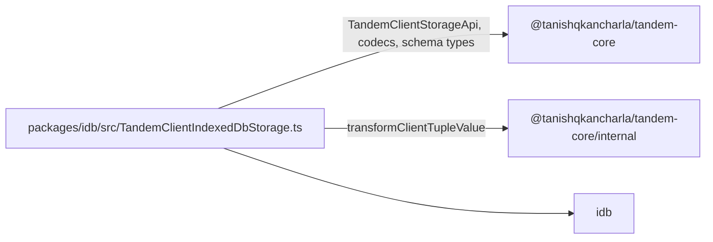

# Phase 2: Move IndexedDB storage into its own package

**Today**

[[packages/core/src/browser/TandemClientIndexedDbStorage.ts#TandemClientIndexedDbStorage]] lives in core and ships at `@tanishqkancharla/tandem-core/idb`. [[packages/core/tsconfig.browser.json]] checks it with DOM types. Core lists `idb` as a dependency and `fake-indexeddb` as a dev dependency, so every app that installs core installs `idb`. The tab benchmark in [[packages/core/benchmarks/tabs.ts]] and the contract run in [[packages/core/test/idb-storage.spec.ts]] are the only core files that touch IndexedDB.

**Proposed**

Create `packages/idb`, published as `@tanishqkancharla/tandem-idb`, and move the storage, its test, and the benchmark there. Core then has no browser code and no IndexedDB dependency. The package can depend on core without a cycle, because core tests use memory storage.

The storage's dependencies point one way. It takes public types from core's main entry and the shared codec helper from `/internal`, the entry [[packages/server/src/TandemServer.ts]] already imports from:



Today the storage imports the helper by relative path. It moves to `/internal`:

```callstack [TandemClientIndexedDbStorage.commit]
 TandemClientIndexedDbStorage.commit [[packages/core/src/browser/TandemClientIndexedDbStorage.ts#TandemClientIndexedDbStorage]]
-├── transformClientTupleValue # from ../clientStorage/clientTupleValues.js [[packages/core/src/clientStorage/clientTupleValues.ts#transformClientTupleValue]]
+├── transformClientTupleValue # from @tanishqkancharla/tandem-core/internal [[packages/core/src/internal.ts]]
 └── idb transaction.put / delete # write the encoded tuples
```

```ts
// packages/core/src/internal.ts gains one line
export { transformClientTupleValue } from "./clientStorage/clientTupleValues.js"
```

The new package looks like `packages/react`: one `src/` folder, a `dist/` build, and a project reference to core. Its tsconfig extends the root one, which already includes the DOM lib, so the storage needs no special config:

```text
packages/idb/
  package.json          @tanishqkancharla/tandem-idb, version matches core
  README.md
  tsconfig.json         extends ../../tsconfig.json, references ../core
  tsconfig.test.json    paths for core, core/internal, server, gatekeeper
  src/index.ts          export { TandemClientIndexedDbStorage, type TandemClientIndexedDbStorageArgs }
  src/TandemClientIndexedDbStorage.ts
  test/idb-storage.spec.ts
  benchmarks/tabs.ts
```

```json
{
	"name": "@tanishqkancharla/tandem-idb",
	"exports": {
		".": { "types": "./dist/index.d.ts", "import": "./dist/index.js", "default": "./dist/index.js" }
	},
	"dependencies": {
		"@tanishqkancharla/tandem-core": "workspace:*",
		"idb": "^8.0.4"
	},
	"devDependencies": {
		"fake-indexeddb": "^6.2.5"
	}
}
```

The test keeps running the shared contract. It imports the suite from core's test folder by relative path, the same way core tests reach the server source. The suite is not published, so the import works only inside the workspace:

```callstack [pnpm --filter @tanishqkancharla/tandem-idb test]
 vitest run --config ../../vitest.config.js
 └── packages/idb/test/idb-storage.spec.ts
     ├── install fake-indexeddb globals in beforeAll
-    ├── describeClientStorageContract # from ./clientStorageContract.js
+    ├── describeClientStorageContract # from ../../core/test/clientStorageContract.js [[packages/core/test/clientStorageContract.ts#describeClientStorageContract]]
     └── delete the globals in afterAll
```

The root [[vitest.config.js]] swaps its `@tanishqkancharla/tandem-core/idb` alias for one named `@tanishqkancharla/tandem-idb`, pointing at `packages/idb/src/index.ts`. Core's [[packages/core/tsconfig.test.json]] drops its `/idb` path and core drops `fake-indexeddb`.

The benchmark moves with the storage, because it measures tab coordination over IndexedDB. Its run command changes from `../packages/core/benchmarks/tabs.ts` to `../packages/idb/benchmarks/tabs.ts`, and its relative imports of core and server source gain one more `../core` step.

Publishing needs one more line, after core and before react, in [[.github/workflows/publish.yml]]. [[scripts/publish-smoke.mjs]] finds packages under `packages/` and orders them by dependencies, so it covers the new package without changes:

```callstack [Publish packages step]
 pnpm --filter @tanishqkancharla/tandem-core publish
+pnpm --filter @tanishqkancharla/tandem-idb publish
 pnpm --filter @tanishqkancharla/tandem-server publish
 pnpm --filter @tanishqkancharla/tandem-react publish
```

Core's package loses the browser group. `build` and `type-check` drop `tsconfig.browser.json`, and `src/browser/` and the `"./idb"` export go away:

```callstack [pnpm --filter @tanishqkancharla/tandem-core build]
 tsc # all of src [[packages/core/tsconfig.json]]
-tsc -p tsconfig.browser.json # src/browser [[packages/core/tsconfig.browser.json]]
```

The docs change the import and the install line wherever they name IndexedDB storage: [[docs/client.md]], [[docs/quickstart.md]], [[docs/migrations.md]], [[docs/overview.md]], [[website/public/setup.md]], [[packages/core/src/clientStorage/AGENTS.md]], and the package list in [[AGENTS.md]]. The core README loses its subpath table, since `/internal` is not for apps. The new package's README shows install and use:

```sh
pnpm add @tanishqkancharla/tandem-core @tanishqkancharla/tandem-idb
```

Files under `specs/` keep the old path. They record past designs.

Removing `/idb` breaks its import path. No released version or example app uses it.
