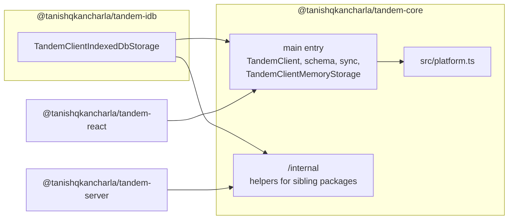

# tandem-core without environment code

## Problem overview

The [isomorphic tandem-core spec](../tandem-core-environment-layout/README.md) kept two environment-specific pieces inside core, each behind a subpath with its own source folder and tsconfig:

- `/idb` holds [[packages/core/src/browser/TandemClientIndexedDbStorage.ts#TandemClientIndexedDbStorage]]. It needs DOM types and the `idb` package.
- `/node` holds [[packages/core/src/node/JsonlLoggerSink.ts#JsonlLoggerSink]]. It needs `node:fs` and Node types.

That spec kept IndexedDB in core because core tests used it, so a separate package would have made a workspace cycle. Core tests now run on [[packages/core/src/clientStorage/TandemClientMemoryStorage.ts#TandemClientMemoryStorage]], so that reason is gone. Nothing in the repo uses `JsonlLoggerSink`, and an app can write a file sink against [[packages/core/src/utils/Logger.ts#LoggerSinkApi]] in a few lines.

Each piece still costs core a source folder, a tsconfig, a `tsc` pass in `build`, `type-check`, and `lint`, lint overrides, and a `check:globals` exclusion. Every core install also pulls in `idb`, whether the app uses IndexedDB or not.

## Solution overview

Delete the Node logger. Move IndexedDB storage into a new package, `@tanishqkancharla/tandem-idb`. Core keeps only shared code and one tsconfig:



Apps change one import:

```ts
-import { TandemClientIndexedDbStorage } from "@tanishqkancharla/tandem-core/idb"
+import { TandemClientIndexedDbStorage } from "@tanishqkancharla/tandem-idb"
```

The new package follows the rule the earlier spec set for new backends: a backend gets its own package when it ships an environment-only dependency. `idb` and DOM types qualify. A SQLite storage that takes its driver from the caller can still live in core.

## Goals

- Core has no `src/browser/`, no `src/node/`, and no environment subpath exports. One `tsconfig.json` checks all of `src/`.
- Core depends on neither `idb` nor `fake-indexeddb`.
- `@tanishqkancharla/tandem-idb` runs the same storage contract suite as memory storage.
- Docs, the website setup guide, and the publish workflow name the new package.

## Non-goals

- Renaming `TandemClientIndexedDbStorage`. The package name already says IndexedDB, but the class name says what it is in app code, where the import path is out of sight.
- A replacement file logger. Apps that want JSON lines write a sink; [phase 1](01-remove-node-logger.md) shows one.
- Changing [[packages/core/src/platform.ts]]. Feature detection for `EventSource`, tab coordination, and the visibility timer uses only universal JavaScript and stays in core.
- Publishing the storage contract suite. The IndexedDB package imports it from core's test folder inside the workspace.

## Phases

1. [Remove the Node logger](01-remove-node-logger.md)
2. [Move IndexedDB storage into its own package](02-idb-package.md)
3. [Shrink core's boundary checks](03-shrink-boundary-checks.md)

## References

- [[packages/core/package.json]]: core's exports, scripts, and dependencies.
- [[packages/core/tsconfig.browser.json]] and [[packages/core/tsconfig.node.json]]: the environment tsconfigs this spec deletes.
- [[packages/core/src/internal.ts]]: the entry sibling packages import helpers from.
- [[packages/core/src/clientStorage/clientTupleValues.ts#transformClientTupleValue]]: the codec helper both client storages share.
- [[packages/core/test/clientStorageContract.ts#describeClientStorageContract]]: the suite every client storage runs.
- [[.oxlintrc.json]], [[packages/core/AGENTS.md]], and [[.github/workflows/publish.yml]]: rules, guidance, and publishing that name the environment folders.
