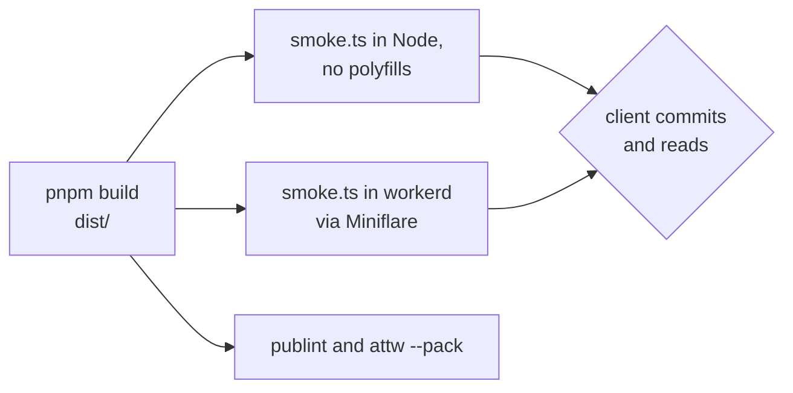

# Phase 7: Runtime smoke tests

Phases [4](04-environment-folders.md) through [6](06-lint-boundary.md) check source code. This phase checks the published build the way a consumer in another runtime loads it, using the memory storage from [Phase 3](03-memory-storage.md).

**Today**

Core tests run in one Node process with test setup installed. Until [PR #109](https://github.com/tanishqkancharla/tandem/pull/109), that setup included `--experimental-eventsource`. Nothing loads `dist/` the way a consumer would. That is how two crashes reached `main`: a `ReferenceError` from the global `EventSource`, and an unhandled rejection from IndexedDB storage under Node.

**Proposed**

A smoke script with no setup files and no polyfills imports the built package, creates a client, commits a record, and reads it back:

```ts [test/smoke/smoke.ts]
const { TandemClient, TandemClientMemoryStorage, collection, defineSchema, t } =
	await import("@tanishqkancharla/tandem-core")
const schema = defineSchema({ notes: collection({ id: t.id(), text: t.string() }) })
const client = new TandemClient({
	schema,
	clientStorage: new TandemClientMemoryStorage({ schema }),
})
await client.ready
const tx = client.transact()
tx.set("notes", { id: "1", text: "hello" })
await client.commit(tx)
assert(client.query({ collection: "notes" }).length === 1)
```

The same script runs in plain Node and in workerd, through Miniflare, which `tandem-server` and the Cloudflare example already use. CI also checks the package's exports with [`publint`](https://publint.dev) and [Are the Types Wrong](https://arethetypeswrong.github.io), which verify that every subpath resolves and that its types match its JavaScript:



```callstack [pnpm test in packages/core]
 vitest run # unit and integration tests, memory storage by default
+run(smoke.ts, node) # no setup files
+run(smoke.ts, workerd) # Miniflare
+publint() # CI only
+attw(--pack) # CI only
```

```changes

```
