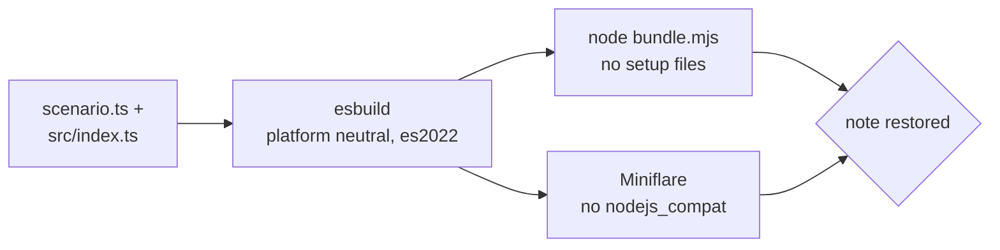

# ✅ Phase 7: Runtime smoke tests

Phases [4](04-environment-folders.md) through [6](06-lint-boundary.md) check source code. This phase runs core's main entry in other runtimes, using the memory storage from [Phase 3](03-memory-storage.md).

**Today**

Core tests run in one Node process with test setup installed. Until [PR #109](https://github.com/tanishqkancharla/tandem/pull/109), that setup included `--experimental-eventsource`. Nothing ran core the way a Workers or plain Node app would. That is how two crashes reached `main`: a `ReferenceError` from the global `EventSource`, and an unhandled rejection from IndexedDB storage under Node.

**Proposed**

[[3c39ec2:packages/core/test/runtime.spec.ts#L1-L76]] bundles a small scenario with core's main entry, the way a Workers or React Native bundler would, and runs it twice: in a plain Node process with no test setup, and in workerd through Miniflare without `nodejs_compat`. The scenario commits a note, recreates the client on the same named memory storage, and reads the note back:

```ts [test/runtime/scenario.ts]
export async function runScenario() {
	const first = new TandemClient({
		schema,
		clientStorage: new TandemClientMemoryStorage({ name: "notes", schema }),
	})
	await first.ready
	const seen: unknown[] = []
	first.subscribe({ collection: "notes" }, (notes) => seen.push(notes))
	const tx = first.transact()
	tx.set("notes", { id: "1", text: "hello" })
	await first.commit(tx)
	await first.flushClientStorage()
	await first.close()

	const second = new TandemClient({
		schema,
		clientStorage: new TandemClientMemoryStorage({ name: "notes", schema }),
	})
	await second.ready
	const restored = second.query({ collection: "notes" })
	await second.close()
	return { seen: seen.at(-1), restored }
}
```



```callstack [test/runtime.spec.ts]
 script = bundle(entry) # esbuild, platform neutral, target es2022 [[3c39ec2:packages/core/test/runtime.spec.ts#L18-L42]]
 result = execFile(node, script) # must also exit on its own [[3c39ec2:packages/core/test/runtime.spec.ts#L44-L60]]
 response = Miniflare({ script }).dispatchFetch("/") [[3c39ec2:packages/core/test/runtime.spec.ts#L62-L76]]
```

The bundle targets ES2022, as `tsc` does, so syntax such as `using` is lowered as in `dist/`. Node 22 cannot parse it otherwise. The Node process must exit by itself, which fails the test if a client leaks a timer.

Adding a top-level `indexedDB.open` read to `src/index.ts` failed both tests with `TypeError: Cannot read properties of undefined (reading 'open')`.

The spec proposed adding `publint` and Are the Types Wrong to CI. This phase leaves them out. The publish workflow's `scripts/publish-smoke.mjs` already packs each package, checks that every export target is in the tarball, and imports every subpath from a packed install.

```changes
3c39ec2
packages/core/test/runtime.spec.ts
packages/core/test/runtime/scenario.ts

ignore:
packages/core/AGENTS.md
packages/core/package.json
pnpm-lock.yaml
```
