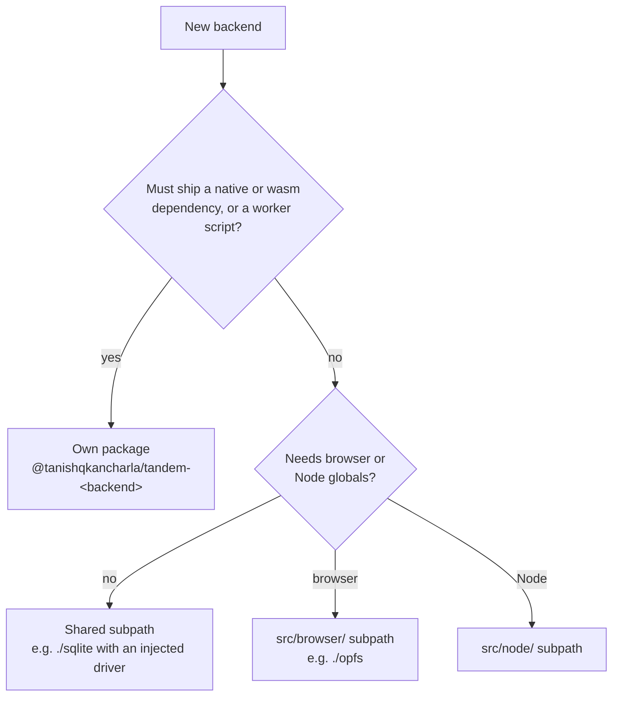

# Phase 8: Where new backends go

Earlier phases built the folders ([Phase 4](04-environment-folders.md)), the checks ([Phases 6](06-lint-boundary.md) and [7](07-runtime-smoke-tests.md)), and the client storage contract ([Phase 3](03-memory-storage.md)). This phase sets the rule for adding SQLite, OPFS, and other backends. It builds nothing by itself.

**Today**

Client storage comes in two kinds: memory and IndexedDB. Both run the client storage contract.

**Proposed**

A new backend takes its engine as an argument and stays in the shared group. It moves to an environment folder only when it needs browser or Node globals, and to its own package only when it must ship a runtime dependency:



SQLite takes a small structural driver, so one adapter serves `better-sqlite3`, `bun:sqlite`, `node:sqlite`, `expo-sqlite`, and wa-sqlite without depending on any of them:

```ts
export type TandemSqliteDriver = {
	exec(sql: string): void | Promise<void>
	all(sql: string, params: unknown[]): unknown[] | Promise<unknown[]>
	run(sql: string, params: unknown[]): void | Promise<void>
	transaction<T>(work: () => Promise<T>): Promise<T>
}

// import { TandemClientSqliteStorage } from "@tanishqkancharla/tandem-core/sqlite"
new TandemClientSqliteStorage({ driver, schema })
```

OPFS needs DOM and file-system types, so it lives in `src/browser/` behind `./opfs`. If it needs a dedicated worker script or a wasm SQLite build, it becomes its own package instead.

Each backend runs the client storage contract and gets a row in the core README's table of subpaths:

```callstack [Client storage contract runs]
 describeClientStorageContract("TandemClientMemoryStorage", open) [[packages/core/test/memory-storage.spec.ts]]
 describeClientStorageContract("TandemClientIndexedDbStorage", open) # fake-indexeddb [[packages/core/test/idb-storage.spec.ts]]
+describeClientStorageContract("TandemClientSqliteStorage", open) # node:sqlite
+describeClientStorageContract("TandemClientOpfsStorage", open) # Vitest browser mode
```

```changes

```
