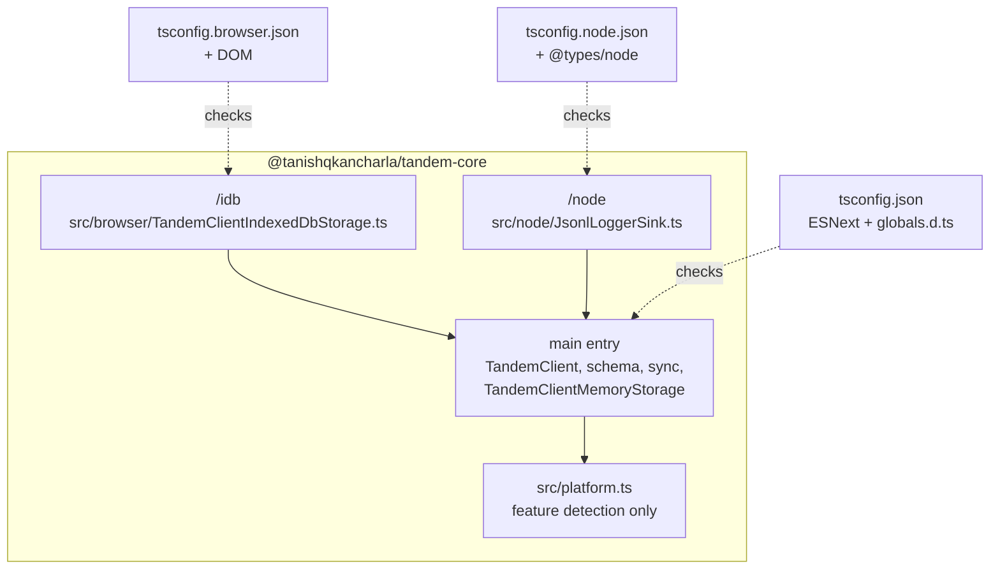

# Isomorphic tandem-core

## Problem overview

`@tanishqkancharla/tandem-core` should run unchanged in browsers, web workers, Node, Bun, Deno, Cloudflare Workers, and React Native. Most of it already does. A few pieces need one environment: IndexedDB storage, the Node file logger, and the defaults for `EventSource`, tab coordination, and the visibility timer. Nothing keeps those pieces apart from the rest, so a new browser or Node global can slip into shared code and still compile.

Three things hid such leaks:

- The root [[tsconfig.json]] gives every package the DOM lib.
- Core's tsconfig loaded `@types/node`, which declares `localStorage`, `navigator`, `BroadcastChannel`, `EventSource`, and `process`.
- `packages/core/test/fixtures.ts` imported `fake-indexeddb/auto`. With `isolate: false` in [[vitest.config.js]], every core test ran with an IndexedDB global, so no test could notice a runtime dependency on it.

## Solution overview

Keep one package. Make its main entry strictly isomorphic. Put each environment-specific piece behind its own subpath, named after what it holds: `/idb`, `/node`, and later `/opfs`.

```ts
import { TandemClient, TandemClientMemoryStorage } from "@tanishqkancharla/tandem-core"
import { TandemClientIndexedDbStorage } from "@tanishqkancharla/tandem-core/idb"
import { JsonlLoggerSink } from "@tanishqkancharla/tandem-core/node"
```

In the source, group files by the globals they may use:
- `src/browser/` gets DOM types;
- `src/node/` gets Node types;
- everything else gets only ECMAScript plus a short list of globals every runtime has.

Each group has its own tsconfig, so `tsc` rejects a leak. Lint rules and a runtime smoke test back that up. Environment entries may import the shared modules, but never the reverse:



Future backends take an injected driver instead of depending on one, so most of them stay in the shared group. A SQLite storage that accepts `better-sqlite3`, `bun:sqlite`, or `expo-sqlite` from the caller needs no environment split. `tandem-server` already works this way: its SQL storage takes Kysely dialects through [[packages/server/src/sql.ts]].

A backend gets its own package only when it must ship a heavy native or wasm dependency, or a worker script.

## Goals

- The main entry type-checks with only ECMAScript and the universal globals it uses, and runs without polyfills in Node and workerd.
- Each environment-specific piece has one subpath, one source folder, and one tsconfig.
- `tsc`, oxlint, and a runtime smoke test each reject browser or Node code in the shared group.
- Core tests use in-memory storage by default; IndexedDB runs only in its own tests.

## Non-goals

- Package `exports` conditions (`"browser"`, `"node"`, `"worker"`, `"react-native"`) that swap implementations. The storage backends take different options, so one declaration file cannot describe them. Vitest resolves Node conditions while apps ship the browser variant, and each bundler resolves conditions differently.
- A separate package per storage backend. It adds publishing overhead, and it creates a workspace cycle, because core tests use client storage.
- Building SQLite or OPFS storage. This spec only fixes where they go.
- Fixing the unhandled `client.ready` rejection when storage fails at startup. It needs its own change.

## Phases

1. [Type-check core without DOM types](01-core-without-dom.md), [PR #110](https://github.com/tanishqkancharla/tandem/pull/110)
2. [Rename `/indexeddb` to `/idb`](02-idb-subpath.md)
3. [In-memory client storage](03-memory-storage.md)
4. [Environment folders and tsconfigs](04-environment-folders.md)
5. [Feature detection in one module](05-platform-module.md)
6. [Lint rules for the boundary](06-lint-boundary.md)
7. [Runtime smoke tests](07-runtime-smoke-tests.md)
8. [Where new backends go](08-new-backends.md)

## References

- [[packages/core/package.json]]: subpath exports.
- [[packages/core/tsconfig.json]], [[packages/core/tsconfig.browser.json]], [[packages/core/tsconfig.node.json]], and [[packages/core/src/globals.d.ts]]: what each group may use.
- [[packages/core/src/clientStorage/TandemClientStorage.ts#TandemClientStorageApi]]: the storage interface every backend implements.
- [[packages/core/src/clientStorage/TandemClientMemoryStorage.ts#TandemClientMemoryStorage]] and [[packages/core/src/browser/TandemClientIndexedDbStorage.ts#TandemClientIndexedDbStorage]]: the two client storages.
- [[packages/core/test/clientStorageContract.ts#describeClientStorageContract]]: the suite every client storage runs.
- [[packages/core/src/platform.ts]]: the only module in shared code that reads runtime globals.
- [[packages/core/src/node/JsonlLoggerSink.ts#JsonlLoggerSink]]: the Node-only logger.
- [[.oxlintrc.json]] and [[packages/core/AGENTS.md]]: the rules and how they are enforced.
- [[packages/core/test/runtime.spec.ts]]: the Node and workerd smoke tests.
- [PR #108](https://github.com/tanishqkancharla/tandem/pull/108) and [PR #109](https://github.com/tanishqkancharla/tandem/pull/109): the IndexedDB subpath and the injectable `EventSource`.
