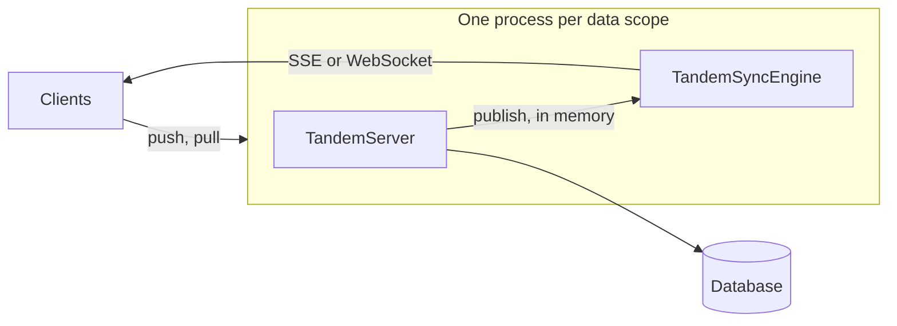
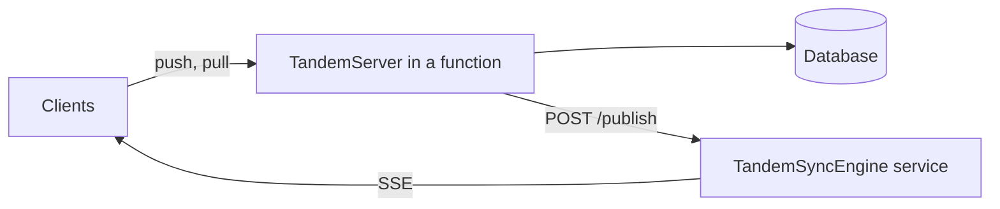
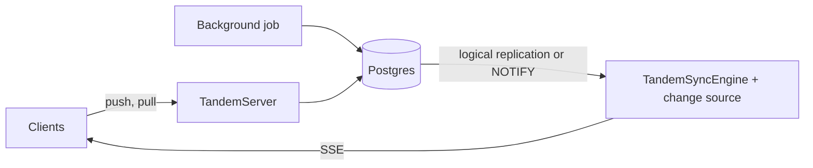
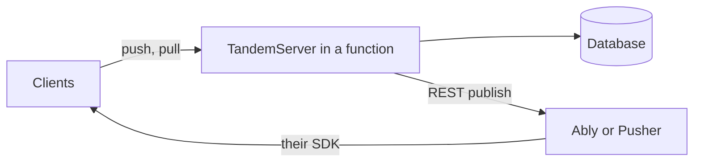

# Target architecture and deployment modes

[How Tandem syncs today](01-how-tandem-syncs-today.md) showed one `TandemServer` process holding records, views, connections, and a commit counter. This page splits those jobs and shows how the pieces combine in each deployment.

## Who owns what

| Piece | Owns | Keeps state between requests? |
| --- | --- | --- |
| Client (`TandemClient`) | Local database, outbox, cookie, subscriptions | Yes, on the device |
| Server (`TandemServer`) | Mutators, authorization, reads, pull diffs | No; everything lives in the database |
| Database | Records, client acknowledgements, commit counter, optional stored views | Yes |
| Sync engine (`TandemSyncEngine` or a hosted service) | Live connections and channel memberships | Only in memory; clients rebuild it by reconnecting |

A **channel** is a string naming a set of records that change together, such as `todos` or `workspace:42`. The server names the channels a pull read and the channels a commit wrote; the sync engine pokes every connection in a written channel. [Phase 5](10-channels.md) defines channels in full.

The sync engine never needs the database. If it restarts, clients reconnect, receive `ready`, and pull, which is how a dropped event stream recovers today.

## The one message flow every mode shares

Whatever carries the poke, the order is the same: commit, publish, poke, pull.

```services
service Client
  state channels = none
service Server "TandemServer (stateless)"
service DB "App database"
  state revision = 41
service Engine "Sync engine"
  state todosSubscribers = 0

start "A client subscribes, and later hears about a commit"
  > The pull tells the client which channels its window reads. The client joins them on its live connection. After any later commit to those channels, the server publishes, the sync engine pokes, and the client pulls.

step "The client connects to the sync engine"
  Client -> Engine: open live connection
  Engine -> Client: ready
    > The client pulls on every ready, as today.
step "The client pulls"
  Client -> Server: pull(cookie, scanWindow)
  Server -> DB: read window and acknowledgement
  Server -> Client: patch, revision 41, live: { channels: [todos], token }
    > The server decides the channels, so it also decides what the client may hear about.
step "The client joins its channels"
  Client -> Engine: setChannels([todos], token)
  Client.channels = todos
  Engine.todosSubscribers = 1
step "Another client's push commits a todo"
  Server -> DB: commit records, acknowledgement, revision
  DB.revision = 42
step "The server publishes after the commit"
  Server -> Engine: publish({ channels: [todos], revision 42 })
    > After the commit, so a poked client never pulls an older state.
step "The sync engine pokes subscribers, and they pull"
  Engine -> Client: poke
  Client -> Server: pull(cookie, scanWindow)
```

## Deployment modes

### Mode 1: stateful server acting as the sync engine

One long-lived process per data scope runs the server and an in-process `TandemSyncEngine`. Publishing is a function call. This is today's model, so Node servers, Durable Objects, and Rivet actors keep it. Only writes made through that process reach clients live.



### Mode 2: serverless server with an external sync engine

The server runs per request on Vercel, Netlify, or Lambda. After each commit it publishes over HTTP to a sync engine that holds the connections: Tandem's Node service ([Phase 7](12-standalone-sync-engine.md)), a Durable Object, or a Rivet actor. Clients get the sync engine's URL and a signed token in each pull response.



### Mode 3: database change feed

A sync engine reads the database's change feed, so any write, including a background job or a manual SQL fix, pokes clients. The server may still publish, which gives faster pokes and live payloads for its own writes. Postgres supports this through logical replication or triggers with `LISTEN`/`NOTIFY` ([Phase 9](14-postgres-change-feed.md)). D1 has no change feed; MySQL has a binlog, which is out of scope for now.



### Mode 4: hosted pub/sub (Ably, Pusher)

The server publishes to Ably or Pusher channels through their REST APIs, and clients subscribe with their SDKs. The app runs no long-lived process at all. Vercel recommends this for realtime on its platform. Pokes carry no records by default, since Pusher limits messages to 10 KB and both services bill per message ([Phase 8](13-hosted-pub-sub.md)).



### No sync engine

Clients pull on their fallback timer and after their own pushes. This already works and stays supported for small apps and tests.

## Comparison

| Mode | Long-lived process | External writes live? | Live text appends | Server state between requests |
| --- | --- | --- | --- | --- |
| 1. Stateful server | Yes, per data scope | Only through the process | Yes | Optional (memory views) |
| 2. Serverless + sync engine | The sync engine only | No | After [Phase 2](07-database-revisions.md) | None |
| 3. Change feed | The sync engine only | Yes | For server writes | None |
| 4. Ably or Pusher | None | No | Off by default | None |

## Rejected: pulls through the sync engine

Tanishq's notes ask whether, in the serverless case, pulls should go through the sync engine, which would then track subscriptions. That is the Zero and Replicache model: the sync engine holds each client's view, reads the database, and computes diffs.

This plan keeps pulls on the server, for three reasons:

- **Auth stays in one place.** The server already authorizes pushes and validates scan windows; a sync engine that reads records would need the same rules and the same schema.
- **Ably and Pusher cannot answer pulls.** Mode 4 needs a sync engine that only pokes, so the contract must allow one.
- **Subscription tracking does not need pulls.** The pull response tells the client its channels, and the client joins them on its live connection. The sync engine learns subscriptions without seeing a query.

The cost is that a stateless server must compute diffs without memory, which [Phase 6](11-stateless-pulls.md) handles, and that pokes are as coarse as channels. A sync engine that also reads the database can be added later behind the same client contract.
