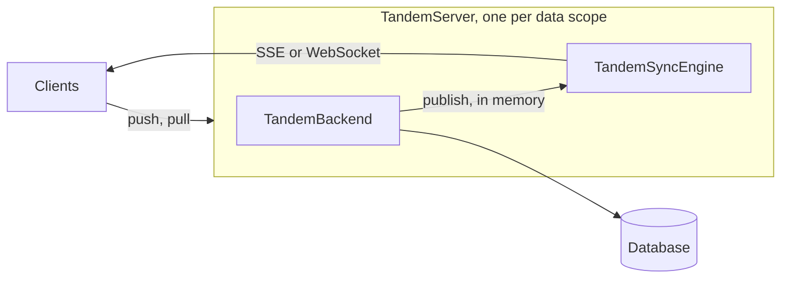
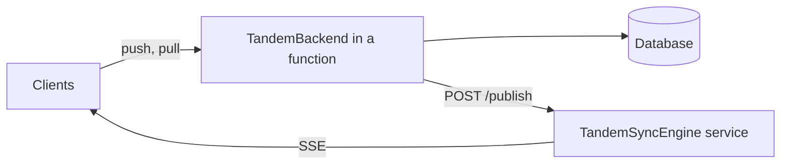
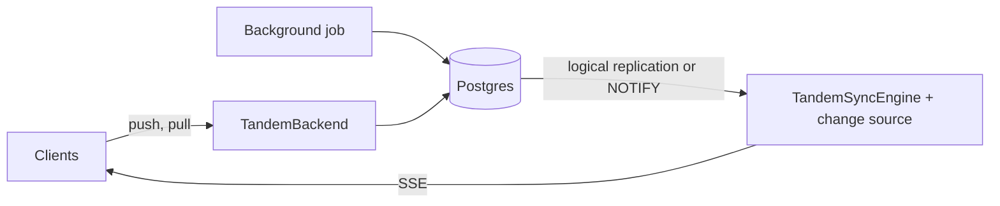
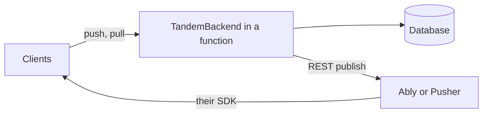

# Target architecture and deployment modes

[How Tandem syncs today](01-how-tandem-syncs-today.md) showed one `TandemServer` process holding records, views, connections, and a commit counter. This page splits those jobs, walks through push and pull in the new design, and shows how the pieces combine in each deployment.

## Three pieces, and one bundle

| Piece | Owns | Keeps state between requests? |
| --- | --- | --- |
| `TandemClient` | Local database, outbox, cookie, subscriptions | Yes, on the device |
| `TandemBackend` | Mutators, authorization, reads, pull diffs | No; everything lives in the database |
| `TandemSyncEngine`, or a hosted service | Live connections and channel memberships | Only in memory; clients rebuild it by reconnecting |
| Database | Records, client acknowledgements, optional stored views | Yes |

`TandemBackend` is the stateless piece that used to be called `TandemServer`; the cover explains the [name](README.md#naming-the-stateless-piece). The name `TandemServer` now means the bundle: a `TandemBackend` and a `TandemSyncEngine` in one long-lived process, with publishing as a function call. Apps pick by host:

- **Serverless** (Vercel, Netlify, Lambda): use `TandemBackend` directly, with an external sync engine or none.
- **Serverful** (a Node server, a Durable Object, a Rivet actor): use `TandemServer`, which works like today's server.

```ts
// Serverless
const backend = new TandemBackend({ schema, relations, storage, mutators, publisher: ablyPublisher({ rest }) })

// Serverful: the same backend arguments, plus the engine's options
const server = new TandemServer({ schema, relations, storage, mutators, pokeInterval: 50 })
server.backend // the TandemBackend inside
server.engine // the TandemSyncEngine inside, which event stream routes connect to
```

A **channel** is a string naming a set of records that change together, such as `todos` or `room:42`. The backend names the channels a pull read and the channels a commit wrote; the sync engine pokes every connection in a written channel. [Phase 5](10-channels.md) defines channels in full.

The sync engine never needs the database. If it restarts, clients reconnect, receive `ready`, and pull, which is how a dropped event stream recovers today.

## Push

1. The client pushes its pending mutations to the backend.
2. The backend checks each mutation ID against `tandem_clients` and skips duplicates. It then runs `authorize` and the mutator, and commits the records and the new `lastMutationId` in one transaction.
3. The backend maps the records the commit wrote or removed to channels, and publishes them. With a change feed, the sync engine maps the changed rows itself, using the same channel function.
4. The sync engine looks up the connections in those channels and pokes each one. That is a set lookup per channel.
5. The client that pushed pulls right away, without waiting for a poke ([Phase 3](08-pull-after-push.md)). Every other poked client pulls.

The sync engine never sees mutations, only the channels of the records they changed. A mutation is a mutator name and its arguments: what it writes depends on app code and on the database, so only the backend knows the writes, and only after running it.

**Why channels, not exact matching.** Deciding exactly which clients a write affects means checking each written record against each client's queries. Filters are cheap to check, but `limit`, `orderBy`, and relation includes are not: a new record can push another out of a client's top 50, and a change to a parent row can change a child query's results. That is incremental view maintenance, the job Zero and Electric are built around. Channels are coarse but cost a set lookup. A poke to a client whose data did not change costs one pull that returns an empty patch. A finer filter can come later, inside the sync engine, without changing the backend or the client.

## Pull, and where it goes

1. The client pulls from the backend with its cookie and scan window.
2. The backend checks the window against the caller's read access, reads the records and `lastMutationId`, and diffs them against the client's stored view, if the app keeps views ([Phase 6](11-stateless-pulls.md)).
3. It returns the patch, the acknowledgement, and a **grant**: the window's channels, signed.
4. The client hands the grant to its live connection, which joins those channels.
5. If the grant added channels, the client pulls once more.

The extra pull closes a gap. A commit can land after the backend read the window and before the sync engine added the client to the new channel; no one pokes the client for it. Today's server avoids the gap because it records a client's reads inside the same queued pull. The second pull returns an empty patch unless something landed in that gap, and it happens only when channels change, such as on connect or when the user opens a new view.

So the backend is X, the piece that serves pulls. Its pull records nothing about subscriptions in the database: the grant carries the channels to the sync engine through the client, and the sync engine holds them in memory. The reasons are in [Why the backend serves pulls](#why-the-backend-serves-pulls).

```services
service Client
  state channels = none
service Backend "TandemBackend (stateless)"
service DB "App database"
  state todos = 3 rows
service Engine "Sync engine"
  state todosSubscribers = 0

start "A client subscribes, and later hears about a commit"
  > The pull returns the channels the client's window reads. The client joins them on its live connection and pulls once more to cover the moment before it joined. After any later commit to those channels, the backend publishes, the sync engine pokes, and the client pulls.

step "The client connects to the sync engine"
  Client -> Engine: open live connection
  Engine -> Client: ready
    > The client pulls on every ready, as today.
step "The client pulls"
  Client -> Backend: pull(cookie, scanWindow)
  Backend -> DB: read window and acknowledgement
  Backend -> Client: patch, grant { channels: [todos], token }
    > The backend decides the channels, so it also decides what the client may hear about.
step "The client joins its channels, then pulls again"
  Client -> Engine: setChannels([todos], token)
  Client.channels = todos
  Engine.todosSubscribers = 1
  Client -> Backend: pull(cookie, scanWindow)
    > Catches a commit that landed between the first read and the join. Usually an empty patch.
step "Another client's push commits a todo"
  Backend -> DB: commit records and acknowledgement
  DB.todos = 4 rows
step "The backend publishes after the commit"
  Backend -> Engine: publish({ channels: [todos] })
    > After the commit, so a poked client never pulls an older state.
step "The sync engine pokes subscribers, and they pull"
  Engine -> Client: poke
    > The poke carries no data.
  Client -> Backend: pull(cookie, scanWindow)
```

## Other details the flow needs

- **Reads after the commit.** A poked client's pull must see the commit. A backend that reads from a lagging replica can return the old state, and nothing pokes the client again. Pulls must read from the primary, or from a replica that has caught up to the commit.
- **Lost pokes.** Publishing happens after the commit and can fail. Clients still pull on a fallback timer, every 60 seconds by default, and on every reconnect.
- **Grant expiry.** Grants are short-lived, so a client that stays connected for a long time needs a fresh one. Every pull returns a new grant when the old one is near expiry.
- **Rejections.** A refused mutation is acknowledged with no effect, and the client's next pull rolls back its optimistic write, as today.

## Deployment modes

### Mode 1: TandemServer, one process per data scope

`TandemServer` runs the backend and the sync engine in one process. Node servers, Durable Objects, and Rivet actors use it. Only writes made through that process reach clients live, unless storage reports others.



### Many Durable Objects: one room per object

A video editor with one Durable Object per room fits mode 1: each object runs a `TandemServer` for its room. Single-writer per room comes free, and a room's object sleeps when no one is in it. Four things need care:

1. **One `TandemClient` per room.** A client has one remote ([[packages/core/src/TandemClient.ts#TandemClient]]), and the backend requires each client's mutation IDs to arrive in order, one after another ([[packages/server/src/TandemServer.ts#TandemServer.applyPush]]). A client that pushed to two rooms' objects would leave gaps in each room's sequence and get mutation-gap errors. So a page that shows two rooms opens two clients, each with its own client ID and local store.
2. **Data outside the room.** User profiles, the project list, and permissions belong to no one room. Keep them in a separate scope: a backend outside the objects, or one more object. Mutations that touch two rooms, such as moving a clip between projects, need a backend that can write both, so they belong to that outer scope.
3. **Shared storage.** If every room's object writes one D1 or Postgres database, each object only sees its own room's commits. Scope tables or rows by room, and write a room's rows only through its object. Otherwise two objects can race on the same row ([blocker 1](05-engineering-blockers.md#1-mutators-stop-being-serial)), and neither pokes the other's clients. Durable Object SQLite avoids this, since each object owns its database.
4. **Fast writes.** Dragging a clip can commit dozens of times a second. Each commit pokes every viewer, and each poke costs a pull of the viewer's whole window. Throttle commits on the client while dragging, and keep each room's window small. The sync engine's `pokeInterval` caps pokes per connection.

None of these blocks the design. Points 1 and 2 belong in the Durable Object guide, and point 1 may justify a client that holds several remotes later.

### Mode 2: serverless backend with an external sync engine

The backend runs per request on Vercel, Netlify, or Lambda. After each commit it publishes over HTTP to a sync engine that holds the connections: Tandem's Node service ([Phase 7](12-standalone-sync-engine.md)), a Durable Object, or a Rivet actor.



### Mode 3: database change feed

A sync engine reads the database's change feed, so any write, including a background job or a manual SQL fix, pokes clients. The backend may still publish, which pokes clients sooner for its own writes. Postgres supports this through logical replication or triggers with `LISTEN`/`NOTIFY` ([Phase 9](14-postgres-change-feed.md)). D1 has no change feed; MySQL has a binlog, which is out of scope for now.



### Mode 4: a hosted service (Ably, Pusher)

The backend publishes to Ably or Pusher channels through their REST APIs, and clients subscribe with their SDKs. The app runs no long-lived process at all. Vercel recommends this for realtime on its platform. Because pokes carry no data, message size limits never matter, and each commit costs one small message per subscriber ([Phase 8](13-hosted-pub-sub.md)).



### No sync engine

Clients pull on their fallback timer and after their own pushes. This already works and stays supported for small apps and tests.

## Comparison

| Mode | Uses | Long-lived process | External writes live? |
| --- | --- | --- | --- |
| 1. One process per scope | `TandemServer` | Yes, per data scope | Only through the process |
| 2. Serverless + sync engine | `TandemBackend` + `TandemSyncEngine` service | The sync engine only | No |
| 3. Change feed | `TandemBackend` + `TandemSyncEngine` with a change source | The sync engine only | Yes |
| 4. Ably or Pusher | `TandemBackend` + a hosted publisher | None | No |

Every mode delivers data the same way, by pull, so a client behaves identically in all four. Only the poke's carrier differs.

## Why the backend serves pulls

The alternative is pulls through the sync engine, which would then track subscriptions: the Zero and Replicache model, where the sync engine holds each client's view, reads the database, and computes diffs. This plan keeps pulls on the backend, for four reasons:

- **Auth stays in one place.** The backend already authorizes pushes and checks scan windows; a sync engine that reads records would need the same rules, schema, and relations.
- **Ably and Pusher cannot answer pulls.** Mode 4 needs a sync engine that only pokes, so the contract must allow one.
- **The sync engine stays free of the database.** It can restart, scale, or be a hosted service without database credentials or connection pools.
- **Subscriptions need no database writes.** Recording each client's window in the database on every pull would add a write per pull and leave stale rows for clients that went away. The grant carries the channels to the sync engine through the client instead.

The cost is that a stateless backend must compute diffs without memory, which [Phase 6](11-stateless-pulls.md) handles, and that pokes are as coarse as channels. A sync engine that also reads the database can be added later behind the same client contract.
