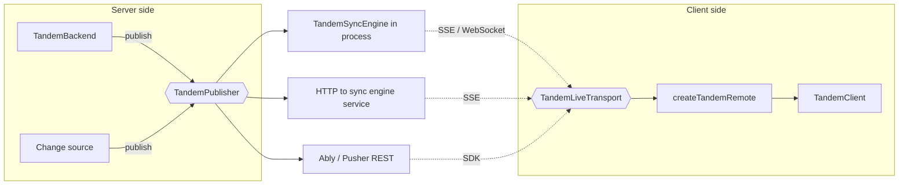

# Library API

[Target architecture](02-target-architecture.md) described four deployment modes. This page shows the interfaces that let one server, one client, and one sync engine run in all of them. Every name here is planned unless it links to source.

## Two seams

The flexibility comes from two small interfaces, one on each side of the sync engine:

- **`TandemPublisher`**, on the server side: "these channels changed". The in-process sync engine, an HTTP client for Tandem's sync engine service, Ably, Pusher, and a change feed all fit behind it.
- **`TandemLiveTransport`**, on the client side: "open a connection, join these channels, call `poke`". SSE, WebSocket, Ably, Pusher, and Rivet events all fit behind it.



## Server side

`TandemBackend` takes today's server arguments plus four optional ones. Without them it is a backend with no sync engine: clients see changes on their own pushes and fallback pulls. `TandemServer` takes the same arguments minus `publisher`, and wires in its own `TandemSyncEngine` ([Phase 4](10-extract-sync-engine.md)).

```ts
export type TandemBackendArgs<Schema, Relations, Mutators, RequestContext> = {
	schema: RuntimeSchemaDefinition<Schema>
	relations: Relations
	storage: TandemBackendStorageApi<Schema>
	mutators?: Mutators
	hooks?: (request: RequestContext | undefined) => ServerMutatorHooks<Schema, Relations, Mutators>
	/** Where commits are announced. Omit for no live updates. */
	publisher?: TandemPublisher
	/** How records and pulls map to channels. Defaults to one channel per collection. */
	channels?: TandemChannels<Schema, RequestContext>
	/** Where pulls store each client's view. Defaults to none: every pull is a reset. */
	views?: TandemViewStore
	/** Signs the live grant in pull responses, for sync engines outside this process. */
	live?: TandemGrantSigner
}
// [!note publisher] Phase 4 adds it; until then, today's in-process poke code stays.
// [!note views] Phase 6. A long-lived process passes a memory store to keep today's small pulls.
// [!note live] Phase 7 (a shared secret) and Phase 8 (Ably and Pusher tokens).
```

A publish names only channels. Pokes carry no data ([Phase 2](08-remove-live-payloads.md)), so the contract needs no schema:

```ts
export type TandemCommitEvent = {
	channels: string[]
}

export interface TandemPublisher {
	/** Called after the commit is durable. Failures are logged, never undo the commit. */
	publish(event: TandemCommitEvent): Promise<void>
}
```

Channels default to collection names, which reproduces today's rule that a client hears about commits to collections its window reads. An app with tenants adds a key:

```ts
export type TandemChannels<Schema extends AnySchema, RequestContext> = {
	/** Channels a written or removed record belongs to. */
	record?: (record: ScanWindowRecord<Schema>) => string[]
	/** Channels a pull's window reads. Also the channels the client may join. */
	pull?: (args: { scanWindow: ScanWindow<Schema>; context?: RequestContext }) => string[]
}

const channels: TandemChannels<AppSchema, Session> = {
	record: ({ collection, value }) => [`${collection}:${value.workspaceId}`],
	pull: ({ context }) => ["todos", "lists"].map((c) => `${c}:${context!.workspaceId}`),
}
// [!note record] A removed record has only its key, so the server reads its last value before removing it.
```

The pull response gains a `live` grant: the channels, and a token the sync engine checks.

```ts
export type PullResponse<Schema extends AnySchema> = {
	cookie: Cookie
	patch: Patch<Schema>
	lastMutationId: MutationId
	live?: TandemLiveGrant
}

export type TandemLiveGrant = {
	channels: string[]
	/** Signed by the server; opaque to the client. */
	token?: string
	/** Where to connect, when the sync engine is not same-origin. */
	url?: string
}
```

## Sync engine

`TandemSyncEngine` is the in-memory core every Tandem-run sync engine shares. It implements `TandemPublisher`, so `TandemServer` passes it straight to its backend:

```ts
export class TandemSyncEngine implements TandemPublisher {
	constructor(args: {
		/** Checks a grant's token. Omit when the engine runs in the backend's process. */
		verify?: (token: string, clientId: ClientId) => Promise<string[] | Error>
		/** At most one poke per connection per interval, in milliseconds. @default 50 */
		pokeInterval?: number | TimerApi
	})
	publish(event: TandemCommitEvent): Promise<void>
	connect(args: { clientId: ClientId; poke: () => void }): TandemSyncConnection
}

export type TandemSyncConnection = {
	setChannels(grant: TandemLiveGrant): Promise<void | Error>
	close(): void
}
```

[[packages/server/src/TandemEventStream.ts#createTandemEventStreamResponse]] then takes a `TandemSyncConnection` source instead of a `RemoteApi`. A WebSocket response gets the same treatment, which Durable Objects need for hibernation ([Phase 10](16-first-class-adapters.md)).

A change feed is a publisher source:

```ts
export interface TandemChangeSource {
	/** Starts reading and calls publish for each change. Returns a stop function. */
	start(publisher: TandemPublisher): Promise<() => Promise<void>>
}
```

## Client side

The client keeps `RemoteApi` ([[packages/core/src/sync/SyncEngine.ts#RemoteApi]]) as its internal contract. Apps stop hand-writing remotes and compose one from a request transport and a live transport:

```ts
export type TandemLiveTransport = {
	open(args: {
		clientId: ClientId
		/** Called on ready and on every poke. Takes nothing: the client pulls. */
		poke: () => void
	}): Promise<TandemLiveConnection | RemoteRequestError>
}

export type TandemLiveConnection = {
	setChannels(grant: TandemLiveGrant): Promise<void>
	close(): Promise<void>
}

const remote = createTandemRemote({
	schema,
	url: "/api/tandem", // push and pull
	live: tandemEventSource({ url: "/api/tandem/events" }),
	// or: ablyLive({ client: ablyRealtime }), pusherLive({ client: pusher }), rivetLive({ actor })
})
```

`createTandemRemote` implements `RemoteApi`. `connect` opens the live transport. `pull` forwards the response's `live` grant to the open connection when it changes. A successful `push` pulls at once, which [Phase 3](09-pull-after-push.md) moves into the client so no sync engine has to poke the pusher.

```callstack [createTandemRemote.pull]
+response = remote.pull({ clientId, cookie, scanWindow })
+├── response = POST url { action: "pull", args } # with the MutationApi codec
+├── if response.live differs from the last grant:
+│   ├── await connection.setChannels(response.live) # join and leave channels
+│   └── if channels were added: queue another pull # see Phase 5
+└── return response
```

## Packages

| Package or entry | Contents | Runs in |
| --- | --- | --- |
| `@tanishqkancharla/tandem-core` | `createTandemRemote`, `TandemLiveTransport`, `tandemEventSource` | Any runtime, after #112 |
| `@tanishqkancharla/tandem-backend` (today's `tandem-server`) | `TandemBackend`, `TandemPublisher`, `TandemChannels`, view stores, `handleTandemRequest` | Any runtime |
| `@tanishqkancharla/tandem-backend/sql` | SQL storage and metadata migrations | Any runtime |
| `@tanishqkancharla/tandem-server` | `TandemServer`: a backend and a sync engine in one process | Any long-lived runtime |
| `@tanishqkancharla/tandem-sync` (new) | `TandemSyncEngine`, event stream and WebSocket responses, `tandemSyncEngineClient` publisher | Any runtime |
| `@tanishqkancharla/tandem-sync/node` | Standalone sync engine HTTP server | Node |
| `@tanishqkancharla/tandem-sync/postgres` | Postgres change source | Node |
| `.../ably`, `.../pusher` | Publishers (backend) and live transports (client) | Any runtime |
| `.../cloudflare`, `.../next`, `.../rivet` | Adapters from [Phase 10](16-first-class-adapters.md) | Their hosts |

Each package matches a class. A separate `tandem-sync` package keeps the sync engine free of storage code, since it can deploy apart from the backend; `tandem-server` depends on both. The hosted-service adapters can start as subpaths and move to their own packages if their SDKs weigh on installs; they would be optional peer dependencies.
