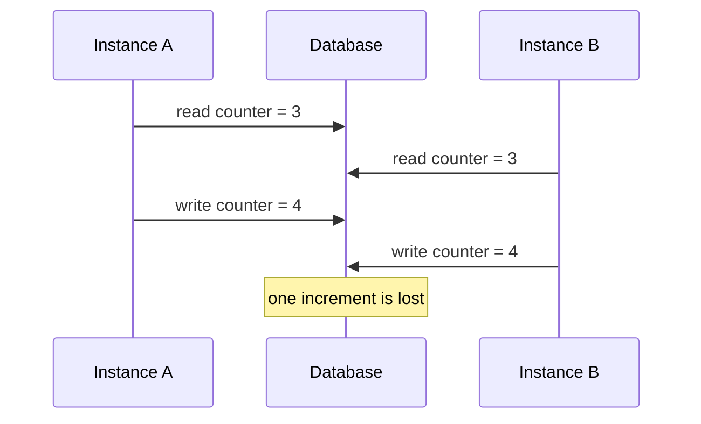

# Engineering blockers

[Database metadata](04-database-metadata.md) moved the server's state into tables. That is the easy part. This page lists what makes a stateless server and a separate sync engine hard, roughly from most to least work, and which phase deals with each.

## 1. Mutators stop being serial

Today every push, pull, and commit on an instance runs through one queue ([[packages/server/src/TandemServer.ts#TandemServer.run]]). Mutators read through a `tuple-database` transaction whose conflict checks see only that process ([[packages/server/src/TandemServerTransaction.ts#TandemServerTransaction]]), and storage commits a batch with no interactive transaction ([[packages/server/src/storage/TandemServerStorage.ts#TandemServerStorageApi]]). With two stateless instances, two mutators can read the same record and both write it, and two retries of one push can both pass the acknowledgement check and apply a mutation twice.

Options:

1. **Lock the scope's revision row.** Open an interactive transaction, bump `tandem_revisions` first, then run the mutator and write. The row lock serializes commits per scope, exactly like today's queue, and reads after the lock see every earlier commit. Works on Postgres and MySQL. The storage API gains a `transaction(fn)` method.
2. **Optimistic commit with retry.** Read the revision at the start, run the mutator, and commit a batch that sets the revision to the read value plus one. A trigger aborts the batch when the stored revision moved on, and the server reruns the mutator. Works on D1 and other batch-only SQLite hosts. Mutators must stay free of side effects outside `afterCommit`, which they already are.
3. **Single writer.** Keep one process per scope: a Durable Object, a Rivet actor, or one Node server. This is mode 1 and needs nothing new.

Recommendation: 1 for Postgres and MySQL, 3 for D1, and 2 only if D1 users ask for stateless servers. [Phase 6](11-stateless-pulls.md) adds the transaction method and drops the queue where storage supports it.

## 2. SQL pulls read whole tables

[[packages/server/src/storage/TandemServerSqlStorage.ts#TandemServerSqlStorage.scan]] reads every row of a collection's table and filters in memory. A long-lived server pays that once per pull; a serverless function also pays cold connections and has tighter memory limits. Before serverless is a fair default, scan windows need to compile `where`, `orderBy`, and `limit` into SQL. This is separate work with its own spec; this plan only flags it.

## 3. Revisions are per instance

A `Revision` is `{ server: instanceId, commit }`, and the client drops live records whose `server` differs from the pull's ([[packages/core/src/Database.ts#Database.applyPull]]). Across instances, every pull from a different instance would discard live text. [Phase 2](07-database-revisions.md) numbers commits in the database and sets `server` to the scope.

## 4. The pusher depends on a poke

Only a pull removes acknowledged mutations from the outbox, so the server pokes the pusher after each push ([[packages/server/src/TandemServer.ts#TandemServer.emitLivePokes]]), and the Cloudflare remote pokes itself too ([[examples/cloudflare/apps/server/src/remote.ts#createRemote]]). A sync engine fed by channels does not know who pushed. [Phase 3](08-client-side-poke-rules.md) makes the client pull after its own successful push.

## 5. Live appends need each client's view

The server sends text appends live only when the client has the record at the exact prior value and no query filters, orders, or joins on the appended field ([[packages/server/src/TandemServer.ts#TandemServer.liveAppends]]). That needs per-client views and read dependencies, which a channel fan-out does not have. The client knows its own queries and values, so [Phase 3](08-client-side-poke-rules.md) moves both checks there. The `after` revision also depends on `lastWrites`, an in-memory map; with database revisions, `after` becomes the commit's own revision minus one, which is conservative but correct.

## 6. Publishing is not atomic with the commit

If the server crashes after the commit and before the publish, no one is poked. Clients still see the change on their fallback pull, every 60 seconds by default. A change feed (mode 3) closes the gap. A transactional outbox table would too, but it adds a writer and a reader for little gain over the change feed, so this plan leaves it out.

## 7. Long connections on serverless and Durable Objects

Vercel and Lambda functions cap request duration, so they cannot hold event streams; that is why mode 2 exists. A Durable Object holding SSE streams stays awake and billed; hibernatable WebSockets let it sleep between messages. [Phase 10](15-first-class-adapters.md) adds a WebSocket transport for that reason.

## 8. Authenticating to the sync engine

The browser `EventSource` cannot send headers, so a token travels in the query string or a cookie. Query-string tokens show up in access logs, so grants should expire within minutes, and the client refreshes them on each pull. The fetch-based event reader considered in the event source options spec would lift the limit later.

## 9. Channels of removed records

A custom `record` channel function needs the record's value, but a remove carries only its key. [[packages/server/src/TandemServer.ts#TandemServer.commitTransaction]] already reads previous values for sets; it must read them for removes too. One extra read per removed record.

## 10. Testing

`dst/` drives one in-process server today. It needs several server instances over one storage, a sync engine as its own actor, publish loss and delay as faults, and a sync engine crash. Without that, convergence would hide lost pokes, because the fallback pull repairs them. The checks must assert that a poke arrives within a bound after each commit, not only that clients converge. Each phase below says what it adds.

## 11. Naming

Core's client loop is already `SyncEngine` ([[packages/core/src/sync/SyncEngine.ts#SyncEngine]]), and the docs call it "the sync engine". [Phase 4](09-extract-sync-engine.md) renames it `TandemClientSync`, so "sync engine" means only the new piece.
