# Design questions, explained

The [cover](README.md#design-questions-to-confirm) lists thirteen design questions. This page draws each one: the recommendation beside its main alternative, so the trade is visible. It uses the pieces from [Target architecture](02-target-architecture.md): the client, `TandemBackend`, the sync engine, and the database.

## 1. How does a commit pick which clients to poke?

Something must match "what this commit changed" against "what each client watches" without running queries, since the sync engine has no schema or data. Both sides describe themselves with keys: a pull names the keys of its scan window, a commit names the keys of the records it wrote, and the sync engine pokes clients whose keys overlap.

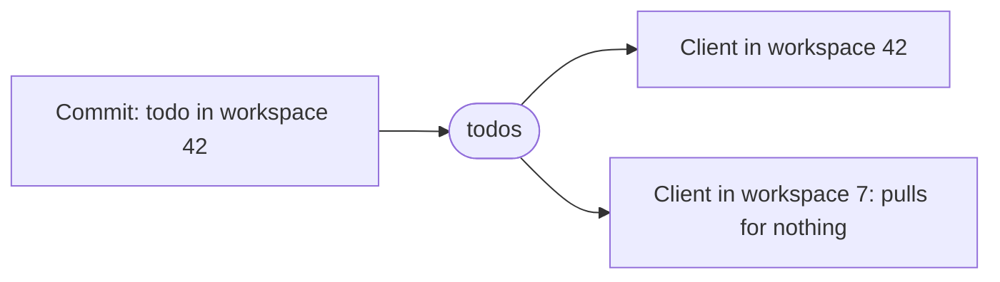

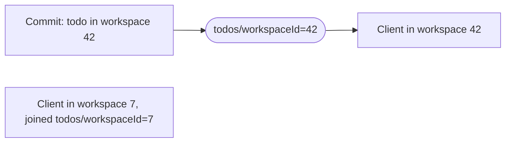

Who writes the keys is the real question:

| Option | Who writes keys | Cost |
| --- | --- | --- |
| Collection keys only | Tandem: the collection name | Extra pokes and pulls in multi-tenant apps |
| Channel functions (the spec today) | The app: `channels.pull` and `channels.record` | A concept apps must learn, and must keep in step with their queries |
| Derived keys | Tandem: from a scan window's equality filters, and from a record's values for fields the schema marks, such as `workspaceId` | A new schema option, since schemas declare no indexes today; a filter on an unmarked field falls back to the collection key |

Recommendation: derived keys, kept inside Tandem, so apps see only "a publisher" and "a live transport". Channel functions can come later as an override. Either way, a key that is too coarse costs extra pulls, never missed changes.

## 2. Who serves pulls?

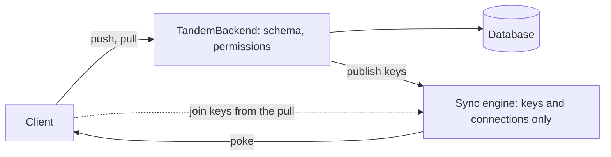

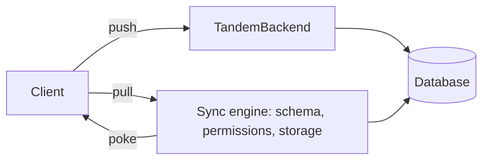

Recommendation: the backend. The sync engine then holds only keys and connections, so Ably, Pusher, or a small Durable Object can play the role. Serving pulls from the sync engine copies the schema, permissions, and database access into a second service.

## 3. How does the sync engine learn about commits?

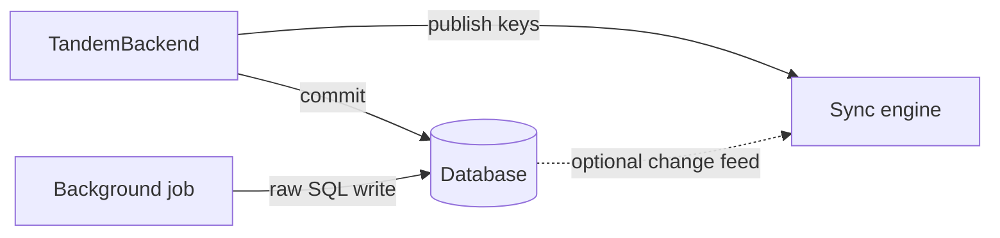

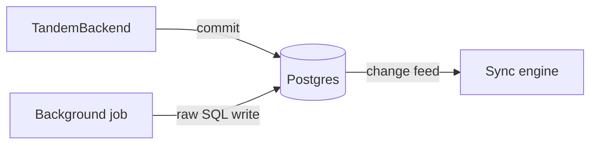

Recommendation: publish from the backend, which works on every database, and add the change feed for apps that write outside Tandem. A feed-only design catches every write but only works on Postgres.

## 4. Is a lost publish acceptable?

The commit and the publish are two steps. A crash between them leaves a committed change that nobody is poked about.

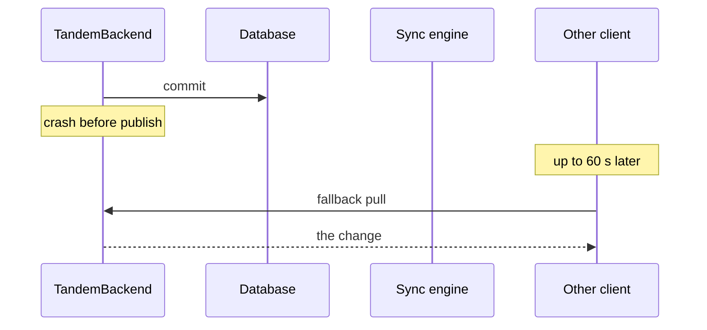

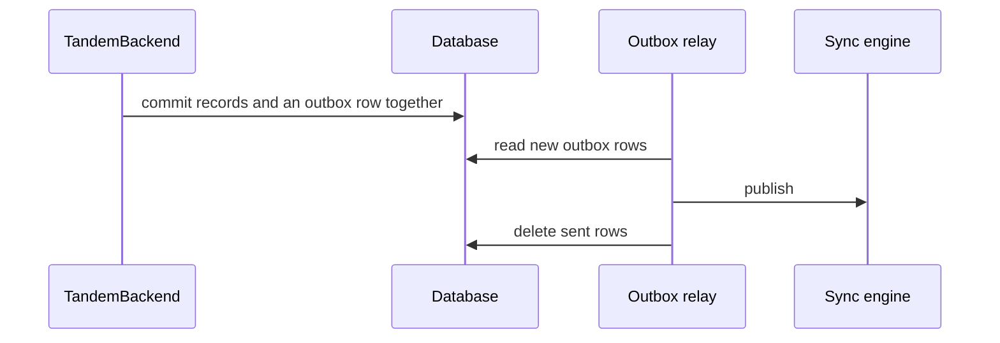

Recommendation: accept the delay. Crashes are rare, the fallback pull repairs them, and the change feed from question 3 closes the gap for apps that need it. The outbox adds a table, a relay process, and cleanup.

## 5. How do several backend instances keep mutators serial?

Today one process runs one mutator at a time per scope. With several stateless instances, two mutators can read the same rows at once.

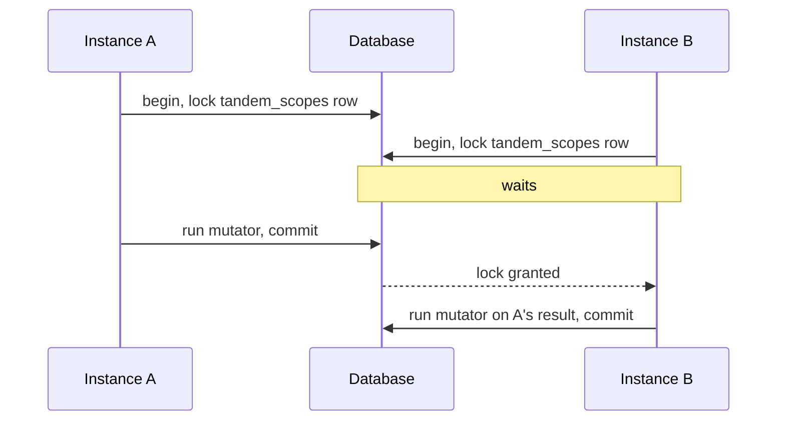

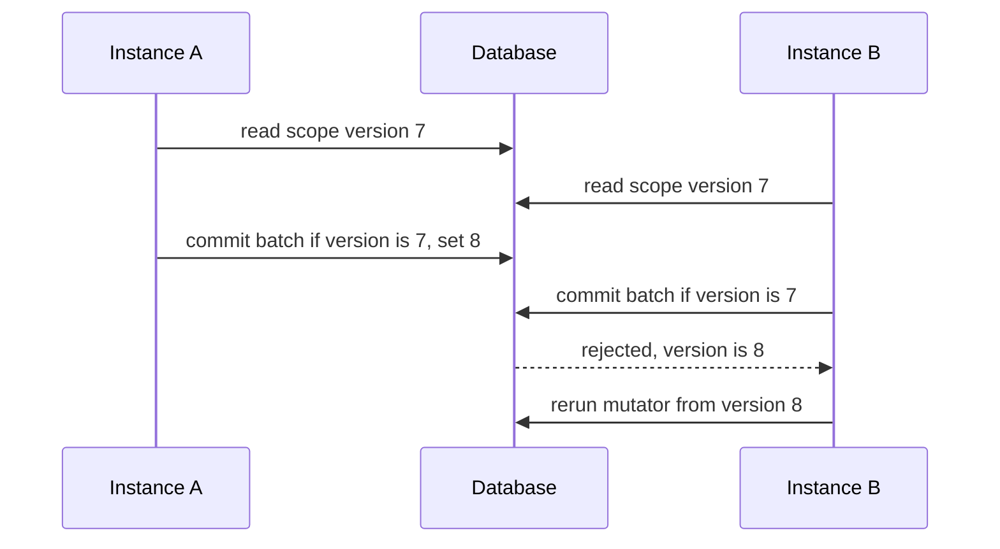

Recommendation: lock the row where the database has interactive transactions (Postgres, SQLite in a Durable Object), and run a single writer where it does not. Optimistic retry also works on D1, which is batch-only, at the cost of a version column and reruns under contention.

## 6. How do stateless pulls stay small?

Today the server keeps each client's last view in memory and returns a diff. A stateless backend has no memory between requests.

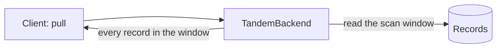

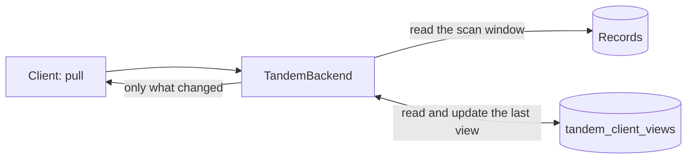

Recommendation: ship resets first, since they need no new table and are correct by construction, then add the view table for apps with large windows. Requiring the view table from the start adds a write to every pull.

## 7. How do clients prove to the sync engine what they may join?

Without a check, any client could join any key and learn when another workspace changes.

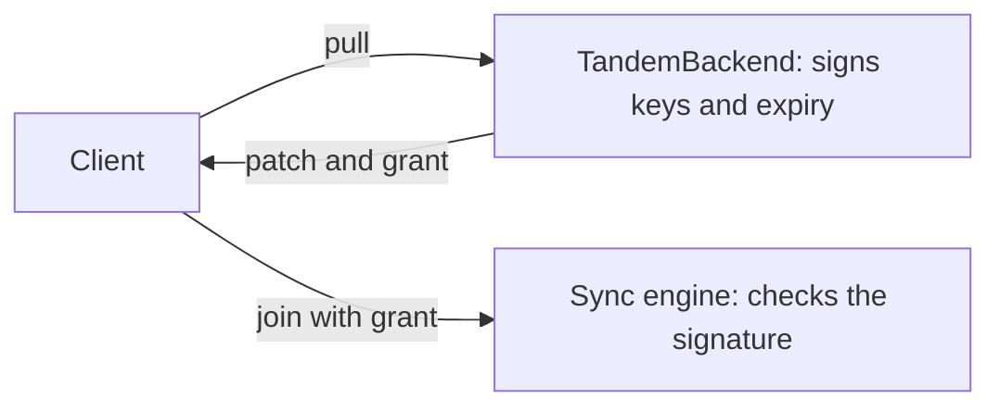

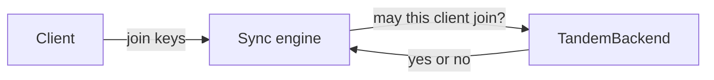

Recommendation: a short-lived grant signed with a secret both sides share, so Tandem's sync engine checks it without a network call. Ably accepts the same shape, a token listing the channels a client may join. Pusher uses the call-back shape instead, so its adapter serves Pusher's auth endpoint from the backend. A call back on every join needs the backend reachable from the sync engine and adds a request per join.

## 8. What covers a commit that lands while a client joins?

The backend reads the window, then the client joins the window's keys. A commit between the two is published before the client listens.

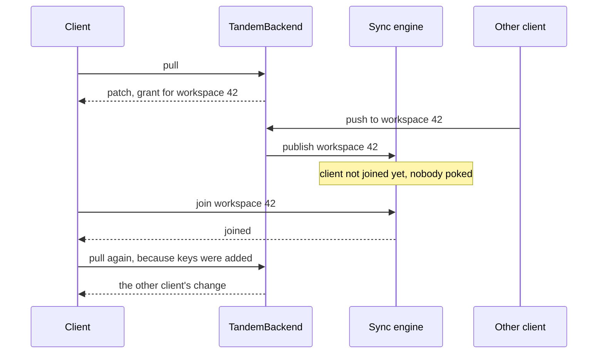

The alternative keeps recent publishes for a few seconds and replays them to a client that joins. Ably can do this with channel rewind, but Pusher cannot, and Tandem's sync engine would have to keep history. Recommendation: the second pull, which works the same with every sync engine. It costs one request only when a client's keys grow, and usually returns nothing.

## 9. Is one client per Durable Object room acceptable?

A client numbers its mutations in one sequence for one remote, and a server rejects a mutation whose number skips ahead. So one client cannot spread its mutations over several rooms.

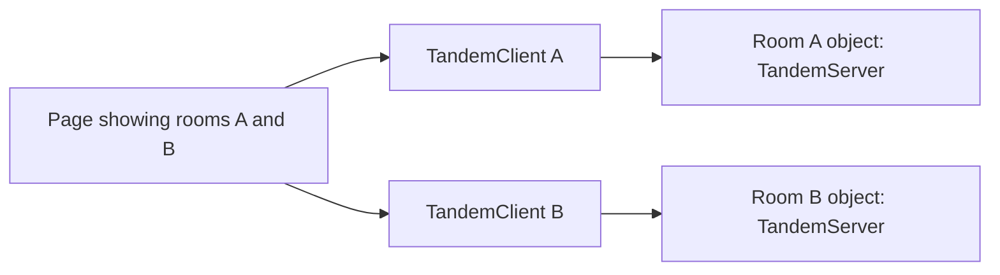

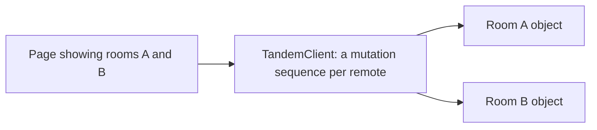

Recommendation: one client per room, which works with no core changes. One client with several remotes needs per-remote outboxes and sequences, and a rule for a mutation that touches two rooms.

## 10. Which Postgres change feed ships first?

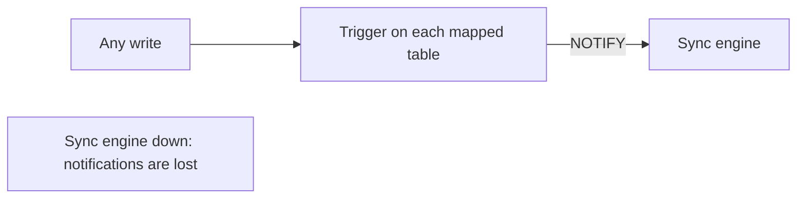

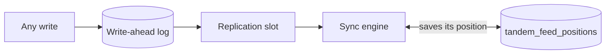

Recommendation: triggers first. They work on every hosted Postgres with ordinary permissions, and a lost notification only delays clients until their fallback pull. Logical replication resumes after downtime but needs a replication role, and an abandoned slot keeps log files until the disk fills.

## 11. What happens to `TandemServer.subscribe`?

`subscribe` runs a query on the server and reruns it after commits. It only sees commits from its own process.

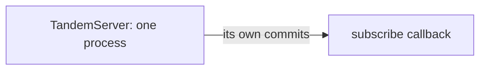

```mermaid [Alternative: fed from the sync engine]
flowchart LR
    ab1["Backend instance 1"] -->|"publish"| ae["Sync engine"]
    ab2["Backend instance 2"] -->|"publish"| ae
    ae -->|"poke"| aq["subscribe: rerun the query"]
```

Recommendation: keep it on `TandemServer`, where one process sees every commit, and leave it off `TandemBackend`. Feeding it from the sync engine makes the backend a sync engine client, which can come later if an app needs it.

## 12. Kysely or fumadb for the metadata tables?

```mermaid [Recommended: Kysely]
flowchart LR
    rs["tandem-backend/sql"] --> rk["kysely: already a dependency"]
```

```mermaid [Alternative: fumadb]
flowchart LR
    as["tandem-backend/sql"] --> ak["kysely"]
    as --> af["fumadb"]
    af --> az["zod"]
    af --> ac["commander"]
    af --> acl["clack"]
```

Recommendation: Kysely. The SQL storage already depends on it, and four metadata tables do not need fumadb's schema and migration layer.

## 13. What are the packages?

```mermaid [Recommended: one package per class]
flowchart LR
    rserver["tandem-server: TandemServer"] --> rbackend["tandem-backend: TandemBackend"]
    rserver --> rsync["tandem-sync: TandemSyncEngine"]
    rbackend --> rcore["tandem-core"]
    rsync --> rcore
```

```mermaid [Alternative: one server package]
flowchart LR
    aserver["tandem-server"] --> asub1["tandem-server/sync"]
    aserver --> acore["tandem-core"]
```

Recommendation: three packages, so a standalone sync engine installs no storage code and a serverless backend installs no connection code. One package with subpaths is simpler to publish but puts storage and connection dependencies in every install.
