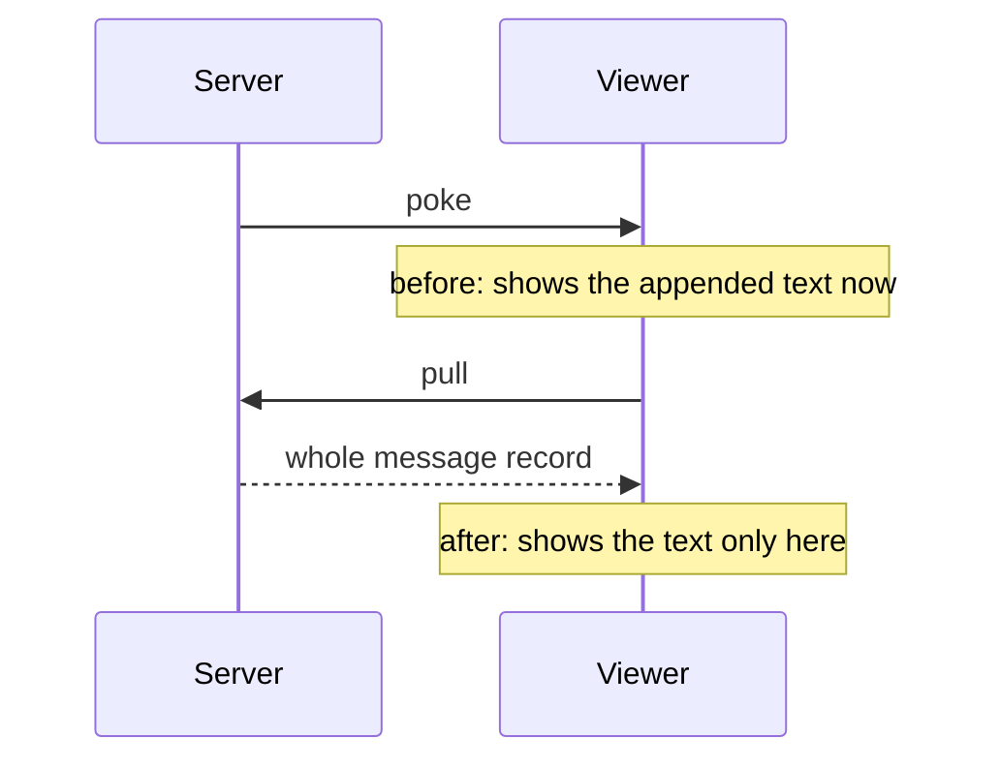

# Phase 2: Make pokes carry no data

[Phase 1](07-durable-client-acks.md) made acknowledgements durable. This phase deletes the parts of the protocol that tie a client to one server process: poke payloads, live text appends, and revisions. After it, a poke only means "pull now", which is all a channel fan-out, Ably, or Pusher can carry cheaply.

**Today**

A poke may carry records or text appends ([[packages/core/src/sync/SyncEngine.ts#PokePayload]]). The client shows them before its pull and checks them against revisions, which name the server instance that numbered the commit ([[packages/core/src/sync/SyncEngine.ts#Revision]]). Streamed agent text appears token by token. To decide when an append is safe, the server keeps each client's view, its read dependencies, and the last write of 10,000 records in memory.

**Proposed**

A poke has no body. The client pulls, and the pull is the only way data arrives. Streamed text then updates once per pull instead of between pulls, and each pull resends the whole changed record. Nothing else changes for users. This removes the main reasons the server needs memory, and makes every later phase smaller.

## What goes

```diff
 export type ClientApi<Schema extends AnySchema = AnySchema> = {
 	clientId: ClientId
-	poke: (payload?: PokePayload<Schema>) => Promise<void>
+	poke: () => Promise<void>
 }

 export type PullResponse<Schema extends AnySchema> = {
 	cookie: Cookie
 	patch: Patch<Schema>
 	lastMutationId: MutationId
-	revision?: Revision
 }
```

| Layer | Removed |
| --- | --- |
| Core types | `PokePayload`, `PokeAppendOp`, `PokeApi.codec`, `Revision`, `AppendableField` |
| Client | `Database.applyPoke` and the live-record map in [[packages/core/src/Database.ts#Database]]; live-record handling in `applyPull`; `SyncEngine.deferPull`, `livePullDelay`, and `livePullMaxDelay` ([[packages/core/src/sync/SyncEngine.ts#SyncEngine]]); payload forwarding in the tab protocol |
| Event source | Payload decoding in [[packages/core/src/sync/TandemEventSource.ts#connectTandemEventSource]] and its `schema` argument |
| Server | `deriveAppends`, `appendedFields`, `safelyEqual`, `liveAppends`, `lastWrites`, `instanceId`, `commitCount`, `livePokeInterval`, and [[packages/server/src/LivePayloadBuffer.ts#LivePayloadBuffer]] |
| Event stream | `payloadFrame` and the `schema` argument of [[packages/server/src/TandemEventStream.ts#createTandemEventStreamResponse]] |
| Tests | [[packages/server/test/Append.spec.ts]], [[packages/server/test/LivePokeBatching.spec.ts]], [[packages/core/test/sync/live.spec.ts]], payload cases elsewhere, and the append operations in `dst/` |
| Docs | Live records and appends in `docs/sync.md`, `docs/server.md`, `docs/agent-chat.md`; [[specs/append-and-batching.md]] becomes history |

The server's poke loop keeps only the per-collection filter:

```callstack [emitLivePokes]
 TandemServer.emitLivePokes(changes) [[packages/server/src/TandemServer.ts#TandemServer.emitLivePokes]]
 └── for each connected client:
     ├── if no collection it reads changed and it did not push: skip
-    ├── appends = liveAppends(client, changes)
-    ├── if appends: buffer them, throttle per livePokeInterval
-    └── else: mark collections invalidated, pokeNow(client)
+    └── poke(client) # no payload
```

## The cost: streamed text

The agent-chat example streams model output by committing each chunk. Today viewers see appends within 50 ms and pull a few times a second. Without payloads:



Pokes during a pull queue one more pull ([[packages/core/src/sync/SyncEngine.ts#SyncEngine.queuePull]]), so a viewer pulls back to back while text streams: one update per pull round trip, around 100 to 300 ms, which still reads as streaming. Each pull resends the whole message, so a 4 KB answer streamed in 20 pulls costs about 40 KB per viewer instead of 4 KB. If that matters later, field-level diffs in pull patches would fix it without bringing back server-side views or revisions.

The agent-chat end-to-end test that counts appends ([[examples/agent-chat/apps/server/test/AgentChat.e2e.spec.ts]]) changes to assert that viewers see intermediate text across several pulls.

```changes

```
