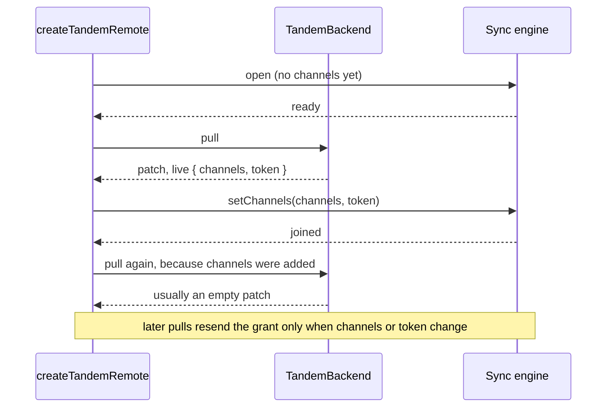

# Phase 5: Channels in pull responses and publishes

[Phase 4](09-extract-sync-engine.md) made the sync engine a separate object, but the backend still tells it which client reads what. This phase makes channels the whole contract: the backend names a pull's channels in its response, the client joins them, and each commit names the channels it wrote. After this, a sync engine needs nothing from the backend except publishes.

**Today**

Subscriptions live on the server: `readPull` stores each connected client's read dependencies ([[packages/server/src/TandemServer.ts#TandemServer.readPull]]), and only collection names decide who is poked. A multi-tenant app's client is poked for every commit to `todos`, in every workspace.

**Proposed**

A pull response carries `live: { channels, token }`. The client's live connection joins those channels. Apps that want tenant-level pokes give the backend a channel function, so a client in workspace 42 hears only about workspace 42.

## Channel functions

By default a record's channel is its collection name, and a pull's channels are the collections its window reads, which matches today's filtering. Apps override both together:

```ts
const server = new TandemBackend({
	// ...
	channels: {
		record: ({ collection, value }) => [`${collection}:${value.workspaceId}`],
		pull: ({ context }) => [`todos:${context.workspaceId}`, `lists:${context.workspaceId}`],
	},
})
// [!note pull] Runs after the app's own read checks, so a client is never granted a channel it cannot read.
```

The two must agree: a record in channel `todos:42` reaches only clients granted `todos:42`. A test helper, `checkTandemChannels(server, fixtures)`, pulls each fixture's window and checks that every record it returns maps to a granted channel.

## Pull and commit

```callstack [readPull]
 TandemBackend.readPull({ clientId, cookie, scanWindow }, context) [[packages/server/src/TandemServer.ts#TandemServer.readPull]]
 ├── records = executeScanWindowAsync(...)
-├── dependencies = scanWindowDependencies(scanWindow) # kept per client
+├── channels = options.channels.pull?.({ scanWindow, context }) ?? collections read
+├── token = sign({ clientId, channels, expires }) # only when a sync engine verifies tokens
 └── return { cookie, patch, lastMutationId, live: { channels, token } }
```

```callstack [commitTransaction]
 TandemBackend.commitTransaction(tx, options) [[packages/server/src/TandemServer.ts#TandemServer.commitTransaction]]
 ├── previous = before-images of set and removed records # removes are new
+├── channels = union of channels.record(before) and channels.record(after) per write
 └── publisher?.publish({ channels })
```

A record that moves between workspaces publishes to both, so the old workspace's clients pull and drop it.

## Client

`createTandemRemote` ([Library API](03-library-api.md#client-side)) forwards each new grant to its live connection. The client loop needs no change: `RemoteApi.pull` hides the grant. For an app that writes its own remote, `connectTandemEventSource` ([[packages/core/src/sync/TandemEventSource.ts#connectTandemEventSource]]) returns a handle with `setChannels`.



The second pull closes a gap that today's server does not have. A commit can land after the backend read the window and before the sync engine added the client to a new channel, and no one would poke the client for it. Today's server records a client's reads inside the same queued pull, so the gap cannot open. `createTandemRemote` queues one more pull whenever a grant adds channels:

```callstack [createTandemRemote.pull]
+response = POST url { action: "pull", args }
+├── added = response.live.channels minus the channels already joined
+├── await connection.setChannels(response.live) # resolves once joined
+├── if added is not empty: queue another pull # covers commits between the read and the join
+└── return response
```

Tests: a backend test with two workspaces checks that a commit in one pokes only that workspace's client. `dst/` generates channel functions with tenant keys and asserts no client is poked for a channel it was not granted, and every client is poked for every commit in its channels. It also delays `setChannels` against concurrent commits, and checks that a client sees each such commit without waiting for its fallback pull.

```changes

```
