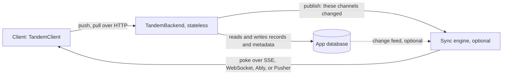

# Split Tandem into a client, a stateless backend, and an optional sync engine

A plan for running Tandem's server without state, so it fits serverless hosts, and moving the job of telling clients about changes into a separate, optional sync engine. Nothing here is built yet.

## Problem

`TandemServer` does three jobs in one object, and two of them need a long-lived process:

1. It runs mutations and writes the database. This needs no state between requests.
2. It answers pulls with a diff against what each client last saw. It keeps that view in memory, per client.
3. It holds every client's event stream and pokes clients after each commit. It keeps the connections, what each client reads, and a per-instance commit counter in memory.

So every request and event stream for one data scope must reach the same process. The docs say so: "Route that scope to one owner" ([[docs/existing-api-server.md]]). That works on a Node server or a Durable Object, but not on Vercel, Netlify, or Lambda, where each request may reach a fresh instance and long connections are costly. It also means only writes made through that process reach clients live: a background job that writes the database directly pokes no one.

## Solution overview

Split the three jobs into three pieces with narrow contracts:

- **Client.** Unchanged in spirit. It pushes and pulls through the backend, and opens a live connection to whatever sync engine the app uses. The client's `RemoteApi` already separates `connect` from `push` and `pull` ([[packages/core/src/sync/SyncEngine.ts#RemoteApi]]), which is the seam this plan uses.
- **Backend (`TandemBackend`).** Runs mutations and pulls per request, keeping everything it needs between requests in the database: client acknowledgements and, if the app wants small pulls, each client's view. After a commit it publishes the names of the channels that changed.
- **Sync engine (`TandemSyncEngine`).** Holds live connections and pokes the clients subscribed to a channel. A poke carries no data; it only tells the client to pull. The sync engine does not read records or answer pulls. It can run inside the backend's process (today's model), as Tandem's own Node service, as a Durable Object or Rivet actor, or as a hosted service such as Ably or Pusher. A database change feed can feed it too.

`TandemServer` becomes the bundle of a backend and a sync engine in one long-lived process. Serverless apps use `TandemBackend` directly; Node servers, Durable Objects, and Rivet actors use `TandemServer`.

The pages explain the parts in order:

1. [How Tandem syncs today](01-how-tandem-syncs-today.md): push, pull, the event stream, what the database holds, and the integrations.
2. [Target architecture and deployment modes](02-target-architecture.md): push and pull step by step, `TandemServer` as a bundle, and one Durable Object per room.
3. [Library API](03-library-api.md): the interfaces that let one codebase run in every mode.
4. [Database metadata](04-database-metadata.md): the tables the backend and sync engine need, and why Kysely rather than fumadb.
5. [Engineering blockers](05-engineering-blockers.md).
6. Ten migration phases, one commit-sized step per page:
   1. [Store client acknowledgements in the database](06-durable-client-acks.md)
   2. [Make pokes carry no data](07-remove-live-payloads.md)
   3. [Pull after push](08-pull-after-push.md)
   4. [Split TandemServer into TandemBackend and TandemSyncEngine](09-extract-sync-engine.md)
   5. [Channels in pull responses and publishes](10-channels.md)
   6. [Run TandemBackend without state between requests](11-stateless-pulls.md)
   7. [Run the sync engine as its own service](12-standalone-sync-engine.md)
   8. [Ably and Pusher as sync engines](13-hosted-pub-sub.md)
   9. [Feed the sync engine from Postgres](14-postgres-change-feed.md)
   10. [Adapters for Durable Objects, Next.js, and Rivet](15-first-class-adapters.md)

Phases 1 to 3 stand on their own in today's single-process deployments: they fix duplicate mutations after a restart, delete the live payload code, and stop pending mutations from waiting for a poke. Phases 4 to 6 are the split itself. Phases 7 to 10 add modes and hosts, in any order.

## Assumptions

These are design choices whose answers change the plan. Each is my recommendation, not a decision; the page that relies on it says so.

| Question | Assumed answer | Main page |
| --- | --- | --- |
| Do pulls go through the sync engine? | No. Pushes and pulls go to the backend; the sync engine only pokes. Pulls record nothing about subscriptions in the database. | [Target architecture](02-target-architecture.md#why-the-backend-serves-pulls) |
| How does the sync engine learn about changes? | The backend publishes the channels of the records each commit wrote; a database change feed is an optional second source. | [Library API](03-library-api.md) |
| Where is subscription tracking? | Channels. The backend names a pull's channels and each commit's channels; the sync engine fans out by channel. | [Phase 5](10-channels.md) |
| How do pulls stay small without in-memory views? | Stateless pulls start as resets; a view table keeps them small for apps that want it. | [Phase 6](11-stateless-pulls.md) |
| fumadb or Kysely for metadata tables? | Kysely, which the SQL adapters already use. | [Database metadata](04-database-metadata.md#fumadb-or-kysely) |
| Do pokes carry data? | No. Tanishq approved dropping poke payloads, live text appends, and revisions. | [Phase 2](07-remove-live-payloads.md) |
| How do clients authenticate to the sync engine? | A short-lived token the backend signs, listing the client and its channels. | [Phase 7](12-standalone-sync-engine.md) |
| What is the new connection-holding piece called? | `TandemSyncEngine`. The client's existing `SyncEngine` class becomes `TandemClientSync`. | [Phase 4](09-extract-sync-engine.md) |
| What is the stateless piece called? | `TandemBackend`, chosen. `TandemServer` becomes the backend and sync engine bundled in one process. | [Naming](#naming-the-stateless-piece) |
| How do concurrent stateless instances keep mutators serial? | A lock on the scope's row in `tandem_scopes` inside a database transaction where the database supports one; a single writer (Durable Object, Rivet actor, one Node process) where it does not. | [Blockers](05-engineering-blockers.md#1-mutators-stop-being-serial) |

## Naming the stateless piece

"Server" suggests a process that stays up and holds connections. The stateless piece does neither: it runs per request and keeps nothing between requests. Only the sync engine holds connections. Tanishq chose `TandemBackend` from these options:

| Name | For | Against |
| --- | --- | --- |
| `TandemBackend` (chosen) | Says where it runs, the app's backend, not how. Pairs with `TandemClient` and `TandemSyncEngine`. Works as a package name, `@tanishqkancharla/tandem-backend`. | "Backend" is broad; the docs must say it is a library inside the app's backend, not a service. |
| `TandemBackendApi` | Says it is the API the client calls. | In this codebase an `Api` suffix names interface types (`RemoteApi`, `ClientApi`, `TandemServerStorageApi`, `RngApi`), so a class with that name reads as an interface. |
| `TandemHandler`, with `createTandemHandler` | Says it handles one request at a time, which suits serverless. | Undersells it: the object also runs server-owned mutations (`mutate`), queries, and transactions outside any request. |
| `TandemApi` | Short. | Same `Api` suffix clash, and vaguer than the others. |

With `TandemBackend`, the related names follow: `TandemServerTransaction` becomes `TandemBackendTransaction`, `TandemServerStorageApi` becomes `TandemBackendStorageApi`, the HTTP entry point is `handleTandemRequest(backend, request)`, and `TandemServer` names the bundle of a backend and a sync engine in one process. [Phase 4](09-extract-sync-engine.md) makes the split; pages before it describe today's `TandemServer`.

## Goals

- `TandemBackend` handles push and pull on any host that runs a request handler, including serverless functions, with no state kept between requests.
- Apps choose how clients hear about changes: a sync engine in the same process (`TandemServer`), Tandem's sync engine service, a hosted pub/sub service, or a database change feed.
- A deployment that runs everything in one process keeps working with no new moving parts.
- Durable Objects, Next.js, and Rivet each get a small, documented adapter.
- `dst/` can run the stateless backend across several instances, with faults and crashes, through the public API.

## Non-goals

- Pulls through the sync engine, or a sync engine that reads records and computes diffs (the Zero and Electric model). [02](02-target-architecture.md#why-the-backend-serves-pulls) explains why.
- Keeping today's protocol or storage layout compatible. Tandem is unreleased.
- Poke payloads, live text appends, and revisions. Pokes carry no data; [Phase 2](07-remove-live-payloads.md) removes them and explains what streamed text loses.
- A hosted Tandem service.
- Non-SQL databases for metadata.

## Prerequisites

[PR #112](https://github.com/tanishqkancharla/tandem/pull/112), which makes tandem-core's main entry isomorphic, is still open. This plan assumes it lands first: a sync engine and live transports must run in Node, Workers, and Rivet without browser globals, and the platform module it adds is where a WebSocket or fetch-based event source would read its runtime values.

## References

- [[packages/server/src/TandemServer.ts]]
- [[packages/server/src/TandemEventStream.ts]]
- [[packages/server/src/storage/TandemServerStorage.ts]]
- [[packages/server/src/storage/TandemServerSqlStorage.ts]]
- [[packages/core/src/sync/SyncEngine.ts]]
- [[packages/core/src/sync/TandemEventSource.ts]]
- [[examples/cloudflare/apps/server/src/index.ts]]
- [[docs/server.md]], [[docs/existing-api-server.md]], [[TODO.md]]
- [PR #112: Make tandem-core's main entry isomorphic](https://github.com/tanishqkancharla/tandem/pull/112)
- [fumadb](https://github.com/fuma-nama/fumadb), [Kysely migrations](https://kysely.dev/docs/migrations)
- [Vercel: publish and subscribe for realtime](https://vercel.com/guides/publish-and-subscribe-to-realtime-data-on-vercel), [Ably](https://ably.com/docs), [Pusher Channels](https://pusher.com/docs/channels/)
- [Rivet actors](https://rivet.dev/docs/actors), [Cloudflare Durable Objects](https://developers.cloudflare.com/durable-objects/)
