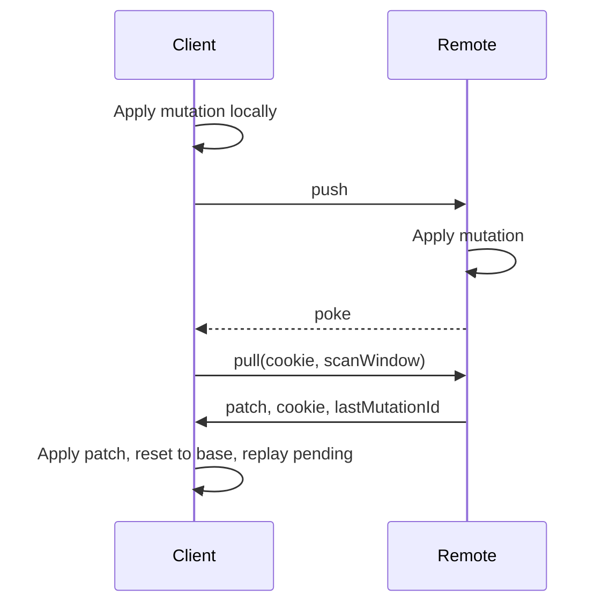

# How sync works

This page covers what happens between a `TandemClient` and its remote. The sync engine only runs when the client has a `remote`.

## Records and tuples

Each client stores records as ordered tuples: `["record", collection, ...idParts]`. A scalar ID contributes one part. A compound ID contributes each of its parts in order, so a transaction can scan by ID prefix.

## Mutations

`commit` turns a transaction into a mutation: an ID and a list of operations. The ID is a per-client counter: 1 for a client's first mutation, then one more for each commit.

```ts
type Mutation = {
	id: MutationId
	ops: (
		| { type: "set"; collection: string; value: Record }
		| { type: "remove"; collection: string; id: Id }
	)[]
}
```

A `set` carries the whole record, not a field-level diff. A `remove` is recorded even when the client doesn't have the record. Operations carry no previous value, because the client never undoes a mutation. See [Rebase](#rebase).

## Scan windows

A scan window is the list of queries the client currently subscribes to, encoded for the wire. `subscribe` adds a query, and `destroy` removes it. Each pull sends the scan window, and the remote returns only records inside it.

So a client does not receive another client's writes until it subscribes to a query that covers them. Calling `pullFromRemote()` runs a pull with the current scan window.

The same applies to a client's own writes. Once a pull confirms a write that no subscription covers, the record disappears locally, because the remote never sends it back.

## The sync loop

### Local write

1. `commit` applies the mutation to the local database right away.
2. Subscriptions re-run and the UI updates.
3. The mutation joins the list of pending mutations and is queued for push. For each record it writes that no pending mutation already writes, the client first saves the committed value as that record's base: the server's latest value as far as the client knows.

### Push

The sync engine batches queued pushes and pulls on an interval (`syncInterval`, 150 ms by default). A push sends pending mutations with the client ID:

```ts
await remote.push({ clientId, mutations })
```

If the push fails, the client drops that batch from its pending mutations and rebuilds their records from the base, and the `commit` promise rejects. While disconnected, the client skips pushes and sends pending mutations after `connect`.

### Pull

A pull asks for changes since the last cookie, limited to the scan window:

```ts
const { cookie, patch, lastMutationId } = await remote.pull({
	clientId,
	cookie,
	scanWindow,
})
```

- `patch` lists records to `set` and to `remove`.
- `cookie` is an opaque marker the client sends back on its next pull.
- `lastMutationId` is the last mutation from this client that the remote has applied, on every pull. It is `0` until the remote applies one.

### Poke

`connect` gives the remote a `poke` function. Calling it makes the client pull. The remote decides when to poke, for example over a WebSocket, SSE, or a polling timer. A poke is only a hint: it carries no data, and missing one delays a pull rather than losing changes. `connectTandemEventSource` pulls on every stream (re)connection, and fallback pulls check for missed updates every 60 seconds by default.

### Rebase

The client applies each pull in one local transaction:

1. Apply the patch, and update the base of any record it mentions.
2. Drop pending mutations up to and including `lastMutationId`, since the remote has applied them. This happens even when the patch is empty.
3. Reset each record that has a base to its base value.
4. Re-apply the remaining pending mutations, one operation at a time, in order.

The client then forgets the base of records that no pending mutation writes. Subscribers see only the final state. Queries always read the optimistic value: the server's value with every pending mutation applied.



## Conflicts

Conflicts resolve as last write wins per record, in the order the remote applies pushes. Say clients A and B both edit todo `1`:

1. A sets `{ text: "Buy milk", complete: true }`.
2. B sets `{ text: "Buy oat milk", complete: false }`.
3. The remote applies A, then B. Its record is B's value.
4. After both clients pull and their mutations are acknowledged, both have B's value.

A's `complete: true` is lost because B's `set` replaced the whole record. Until A's pull acknowledges its mutation, A keeps replaying its own value on top of each patch.

## Client storage

With `clientStorage`, the client loads from storage on startup (`client.ready`) and writes changes back in batches (`clientStorageWriteInterval`, 120 ms by default). `flushClientStorage()` writes immediately.

## Multiple tabs

Tabs of one origin share IndexedDB. Two clients writing the same store would reuse one client ID and mutation counter, so the remote would skip one tab's writes as duplicates. Clients that share named `clientStorage` therefore elect a leader instead. In a browser document this happens automatically when the client has a `remote`.

- The leader tab holds a [Web Lock](https://developer.mozilla.org/en-US/docs/Web/API/Web_Locks_API) named after the storage. It owns the persisted replica, its client ID, and the connection to the remote.
- Every tab, the leader included, keeps an in-memory replica with its own client ID, so queries, transactions, and local edits stay synchronous. Tabs talk to the leader over a `BroadcastChannel` with direct commands, not a second sync engine.
- `commit` applies the edit to the tab's replica at once and sends the mutation to the leader. The leader commits it to its replica and records the tab's mutation ID in the same transaction, skipping a mutation it already holds. While the tab wants the remote, `commit` resolves when the remote has accepted the write, as in a single tab; while it does not, `commit` resolves once the leader has saved it. `flushClientStorage` resolves once the leader has saved the tab's writes and does not wait for the remote.
- After each change the leader publishes the records each tab subscribes to, and every tab replays its own unacknowledged edits over that view. Writes in one tab reach the others without a remote round trip, so tabs stay in step while offline.
- If the leader cannot save a write, `commit` rejects and the tab keeps the edit. It sends it again before its next commit, on `flushClientStorage`, on `connect`, and to the next leader.
- Browsers delay timers in hidden tabs. While its tab is hidden, the leader skips its `syncInterval` and `clientStorageWriteInterval` waits and runs on the next task instead, so a background leader does not slow the tab in use.
- A tab's first view holds the leader's whole replica, so `ready` restores persisted data as a single tab does, and transactions still throw before it resolves.
- When the leader closes or crashes, its lock is released and a waiting tab loads the replica from storage and takes over. It keeps syncing every tab's saved queries, and tabs resend their unanswered writes to it in order.

The leader stays connected to the remote while any tab wants it: `connect` and `disconnect` change only this tab's wish, and `autoConnect` sets it initially. `pullFromRemote`, `flushClientStorage`, and `clear` act on the leader's replica. `close()` hands leadership on after saving. Pass `tabs: false` to give one client the storage to itself, or `tabs: { environment }` to coordinate somewhere other than a browser document, such as a worker or a test with `InMemoryTabs` from `@tanishqkancharla/tandem-core/internal`.

## Next steps

- [Server](server.md): a `RemoteApi` implementation you can use directly
- [Custom remotes](custom-remote.md): what a remote must guarantee
