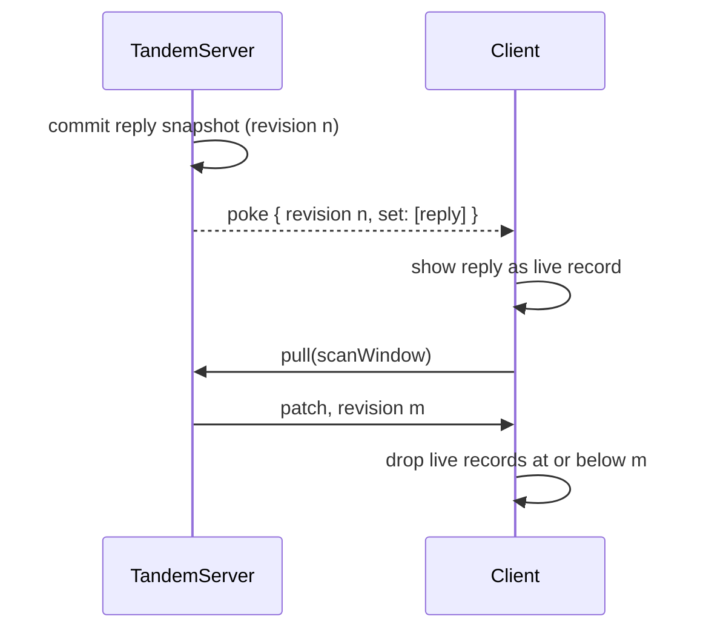
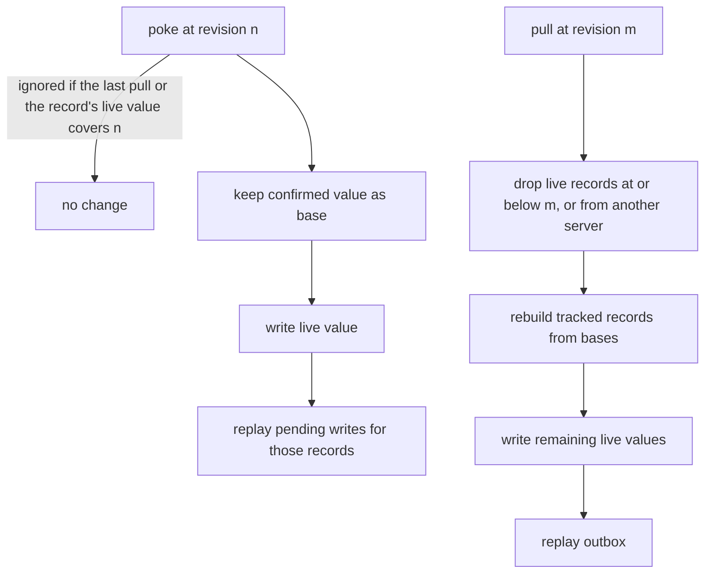

# Live records for streaming agent chat

## Problem overview

A streaming agent chat on Tandem should need no app-level stream, no version field, and no special client API. The server saves the assistant reply record repeatedly as it generates, and every client subscribed to the thread should see the text grow through its ordinary `client.subscribe` or `useTandemQuery`.

Before this work, every server commit cost each connected client a bare poke, then a pull round trip that returned its whole scan window. Streamed text arrived late and in coarse steps, and every client pulled after every commit, whether or not the commit touched its view.

```callstack
 TandemServer.commitTransaction [[packages/server/src/TandemServer.ts#TandemServer.commitTransaction]]
 └── emitPokes   # poke() every connected client, no data
 SyncEngine poke handler
 └── queuePull → TandemServer.pull → whole scan window
```

An earlier design (Mochael/tandem#5 and #6) added a public `client.preview(collection, value, { version })` fed by an app-level stream. It made the app own a stream, a version field, and the rules for when to drop a preview. This spec supersedes it.

## Solution overview

Pokes carry the records each commit changed inside the client's view, tagged with the commit's server revision. The client shows them at once as a live layer and still pulls. Each pull reports the revision its read reflects and replaces every live record at or below it.



A pull that read the server before commit n reports a revision below n, so the newer live record stays. One rule, "a pull at revision m reflects the server at or after m", covers updates, deletes, reset snapshots, and records that left the view.

## Goals

- Every server commit reaches each client that can see it in one hop, in order, without moving backwards.
- No new client API: plain queries and subscriptions show live records.
- Pokes never carry a record, or name an ID, that a pull with the client's window would not return.
- Live records are never pushed and do not survive a restart as server state.

## Non-goals

- Multi-process servers. Revisions number one instance's commits, like cookies.
- Sending unchanged records that enter a view because of a commit (a shifted `limit` page, new children of an included parent). The pull every poke starts delivers them.
- Replacing the pull. Every poke still queues one, so acknowledgement and full-window consistency are unchanged.

## Implementation

### ✅ Phase 1: Number commits and send changed records in view

**Today**

The server poked every connected client after every write commit, with no data. Pulls reported no revision.

**Proposed**

Number commits per server instance and poke each client with the changed records inside the scan window of its latest pull. Skip clients whose view the commit did not touch, except the client that pushed, which must pull its acknowledgement.

```changes
070d459..e8de672
```

The revision is in memory, like cookies. Its `server` field is a random instance ID, so a restarted server starts a new sequence instead of reusing small numbers a client already passed:

```ts
type Revision = { server: string; commit: number }

type PokePayload<Schema> = {
	revision: Revision
	set?: PatchSetOp<Schema>[] // full records after the commit
	remove?: PatchRemoveOp<Schema>[] // records the client knew that left its view
}

type ClientApi<Schema> = {
	clientId: ClientId
	poke: (payload?: PokePayload<Schema>) => Promise<void>
}
```

The types live in [[070d459..e8de672:packages/core/src/sync/SyncEngine.ts#L54-L88]]. A bare `poke()` still means "pull".

After a commit, still inside the server's run queue, the server reads what changed and evaluates it per client:

```callstack
 TandemServer.commitTransaction [[070d459..e8de672:packages/server/src/TandemServer.ts#L492-L533]]
+├── read removed records first   # their stored ids, in the client's form
 ├── transaction.commit
+├── commitCount += 1              # revision { server: instanceId, commit }
+└── emitLivePokes [[070d459..e8de672:packages/server/src/TandemServer.ts#L536-L564]]
+    ├── bare poke if the client has not pulled yet
+    ├── readLivePayload [[070d459..e8de672:packages/server/src/TandemServer.ts#L566-L600]]
+    │   ├── selectScanWindowRecordsAsync [[070d459..e8de672:packages/core/src/query/executeQuery.ts#L586-L622]]
+    │   ├── remove only records the client knows   # synced by its last pull, or sent live since
+    │   └── return undefined when nothing in view changed
+    └── bare poke for the pusher, or when a commit touches a collection read under an offset
 TandemServer.connect
+└── forget the client's view when its last connection closes [[070d459..e8de672:packages/server/src/TandemServer.ts#L235-L248]]
 TandemServer.readPull
+├── store a copy of the window it read, only while connected [[070d459..e8de672:packages/server/src/TandemServer.ts#L471-L476]]
+└── return revision [[070d459..e8de672:packages/server/src/TandemServer.ts#L484]]
```

Membership reuses the query engine instead of a second matcher. Windows of plain filters match the changed records directly. Includes, limits, and offsets depend on other records, so those windows run in full and are intersected with the changed records:

```ts
function selectScanWindowRecordsAsync(db, relations, scanWindow, candidates) {
	const queries = normalizeScanWindow(scanWindow, relations)
	const relevant = candidates.filter(({ collection }) => readsCollection(queries, collection))
	if (!relevant.length) return []
	if (queries.every((query) => !query.with && query.limit === undefined && query.offset === undefined))
		return relevant.filter(({ collection, value }) =>
			queries.some((query) => query.collection === collection && query.where.every((clause) => matchesWhere(value, clause))),
		)
	const inWindow = new Set((await executeScanWindowAsync(db, relations, scanWindow)).map(recordId))
	return relevant.filter((record) => inWindow.has(recordId(record)))
}
```

An offset page can shift when a record before it changes, even one the client never saw. Naming that record would leak it, so [[070d459..e8de672:packages/core/src/query/executeQuery.ts#L624-L634]] lists the collections read under an offset, and a commit that touches one of them gets a bare poke.

The SSE helpers carry the payload as the poke event's JSON data. `PokeApi.codec(schema)` ([[070d459..e8de672:packages/core/src/sync/SyncEngine.ts#L146]]) applies collection codecs to poke records, as `MutationApi.codec` does for pushes, and both helpers take an optional `schema`:

```callstack
 createTandemEventStreamResponse
+├── payloadFrame [[070d459..e8de672:packages/server/src/TandemEventStream.ts#L28-L40]]   # event: poke, data: JSON
+└── poke(payload) [[070d459..e8de672:packages/server/src/TandemEventStream.ts#L70-L81]]   # stalled reader: one bare poke, payloads dropped
 connectTandemEventSource
+└── onPoke → readPayload [[070d459..e8de672:packages/core/src/sync/TandemEventSource.ts#L24-L37]]   # undecodable data: bare poke
```

DST and Gatekeeper events forward payloads (`events.on<Payload>`), JSON round-tripped. The todo example passes `schema` to both SSE helpers. In this phase the client still ignores payloads.

### ✅ Phase 2: Show live records on the client

**Today**

A client pulled on every poke and showed server changes only once the pull returned.

**Proposed**

Apply a poke's records in the same tick as an in-memory live layer. A live record replaces the record's confirmed server value; pending local writes replay on top. The next pull at or after its revision replaces it.

```changes
d8e8c7b
```

A live record keeps the confirmed value underneath as a base, reusing the bases pending writes already use. A base with `lastWrittenBy: 0` means only a live record needs it:



```callstack
 SyncEngine poke handler [[d8e8c7b:packages/core/src/sync/SyncEngine.ts#L309-L324]]
+├── Database.applyPoke   # current identity, while connected
 ├── queuePull
+└── wait for the live checkpoint too   # a failed pull must not leave storage work behind
 Database.applyPull [[d8e8c7b:packages/core/src/Database.ts#L401-L454]]
 ├── apply patch, update tracked bases
+├── drop live records the pull's revision covers
 ├── restore tracked records from bases
+├── write remaining live values
 ├── replay outbox
-└── drop acknowledged bases
+└── drop acknowledged bases without a remaining live record
 Database initialize
+└── rebuildRestoredRecords [[d8e8c7b:packages/core/src/Database.ts#L509-L539]]   # saved live values are not server state
```

The comparisons are small. `isCoveredBy` decides whether a poke is stale, and `isLaterCommit` decides whether a live record outlives a pull ([[d8e8c7b:packages/core/src/Database.ts#L102-L121]]):

```ts
// A poke at `revision` adds nothing if the latest pull, or the record's live value, is the same server at or after it.
const isCoveredBy = (revision, than) =>
	than !== undefined && revision.server === than.server && revision.commit <= than.commit

// A live record survives a pull only if it is a later commit of the same server.
const isLaterCommit = (revision, than) => revision.server === than.server && revision.commit > than.commit
```

Retiring a live record falls back to its base, which holds the confirmed value the pull just updated, or explicit absence. Deletes, reset snapshots, and records that left the view need no special case, so the earlier preview code's tombstone set and reset bookkeeping are gone.

Live values reach client storage like other record writes. Hydration rebuilds each tracked record from its base and pending operations, writes only records that differ, and drops bases with no pending writer. A restart therefore shows the last pulled records with pending writes.

DST now makes server writes, mostly to server-owned records, and checks after every step that each client's server-owned records only move forward through server history ([[d8e8c7b:dst/DstWorld.ts#L427-L453]]).

### ✅ Phase 3: Guide and reference test

**Today**

`docs/agent-chat.md` existed only on the earlier preview branch. It described an app-level stream, a `seq` field, and `client.preview`.

**Proposed**

Rewrite the guide around plain subscriptions, and back it with an end-to-end test using the AI SDK's mock model.

```changes
d8e8c7b..46f0769
```

The guide's rules:

1. One writer per record. The server writes assistant messages under reply IDs the push handler keeps clients from writing.
2. The server saves the reply about every 100 ms with `status: "streaming"`, then `"complete"`, `"stopped"`, or `"error"` from its own model loop.
3. The stop button sets `stopRequested` on a client-owned `runs` record. A `server.subscribe` on it aborts the model.
4. Startup marks leftover `"streaming"` replies as `"error"`. A heartbeat in `updatedAt` lets clients treat a stale reply as failed.

The server uses AI SDK v7 `streamText`, then `toUIMessageStream`, then `readUIMessageStream`, and stores `UIMessage` parts on the record:

```callstack
 push (transport)
 ├── isClientWrite [[d8e8c7b..46f0769:examples/agent-chat/apps/server/test/AgentChat.e2e.spec.ts#L64-L69]]   # drop, do not reject
 ├── TandemServer.push
 └── streamReply [[d8e8c7b..46f0769:examples/agent-chat/apps/server/test/AgentChat.e2e.spec.ts#L171-L250]]
     ├── claim the reply record
     ├── server.subscribe runs → AbortController.abort
     ├── streamText → toUIMessageStream → readUIMessageStream
     ├── save the newest parts every interval
     └── save the final status
 startup
 └── failInterruptedReplies [[d8e8c7b..46f0769:examples/agent-chat/apps/server/test/AgentChat.e2e.spec.ts#L72-L83]]
```

The test lives in a private example package, `examples/agent-chat/apps/server`, because `ai` pulled React into `tandem-server`'s dependency tree and split `tuple-database` into two copies. The library packages do not depend on `ai`.

Rejecting a forbidden write with `invalid-request` turned out to leave the client stuck: Tandem keeps a failed mutation pending and resends it with every later push. The guide drops forbidden operations instead, so the mutation is acknowledged and the next pull shows the server's record.

## Limitations

- Revisions are per instance. A client whose pokes and pulls reach different processes drops live records at every pull from another instance.
- A view lasts until the client's next pull or until its last connection closes. A transport that revokes access must close that client's connections; pokes are then bare until a pull it authorizes.
- Windows with includes, limits, or offsets run in full for each connected client on every commit that touches their collections, inside the server's run queue.

## References

- `docs/agent-chat.md`, `docs/sync.md#live-records`, `docs/server.md#connect-clients`, `docs/custom-remote.md`
- `packages/server/test/LivePokes.spec.ts`, `packages/server/test/LiveEventStream.spec.ts`, `packages/core/test/sync/live.spec.ts`
- Superseded: Mochael/tandem#5 and #6
- Follow-up: [append-and-batching.md](append-and-batching.md) adds `append`, poke batching, and pull deferral, and moves the guide's reply loop from a save timer to appends
