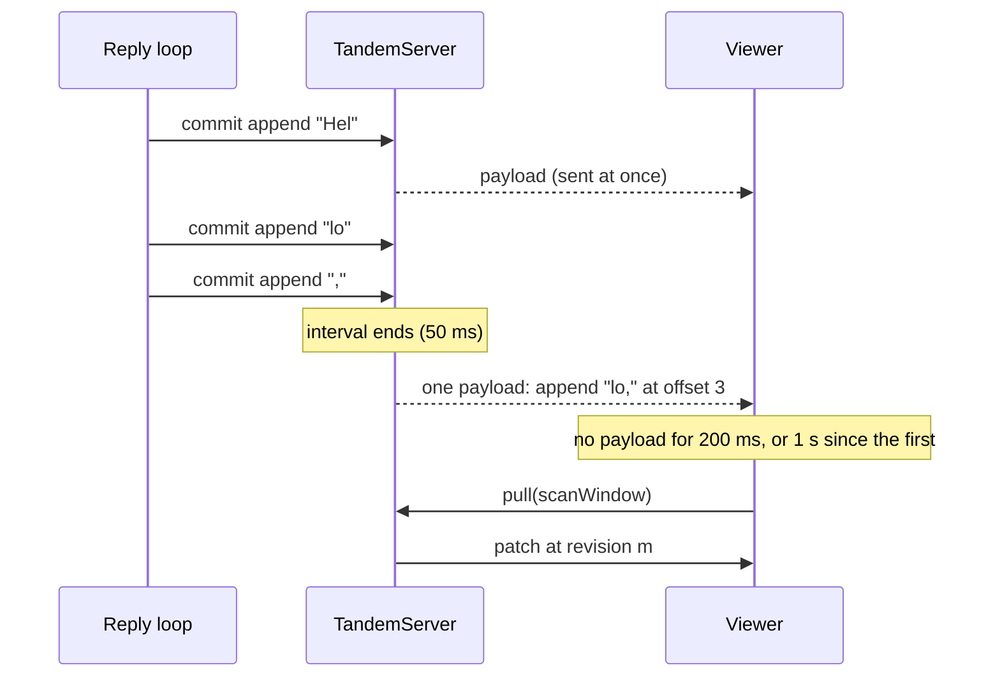
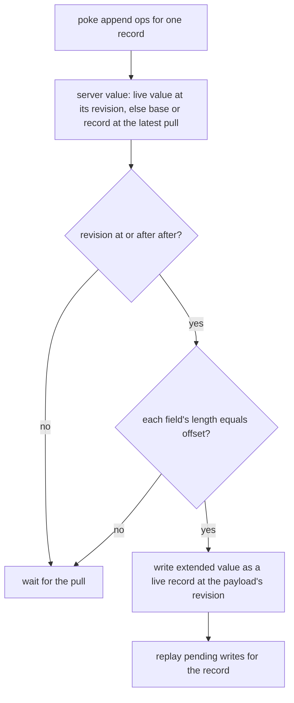
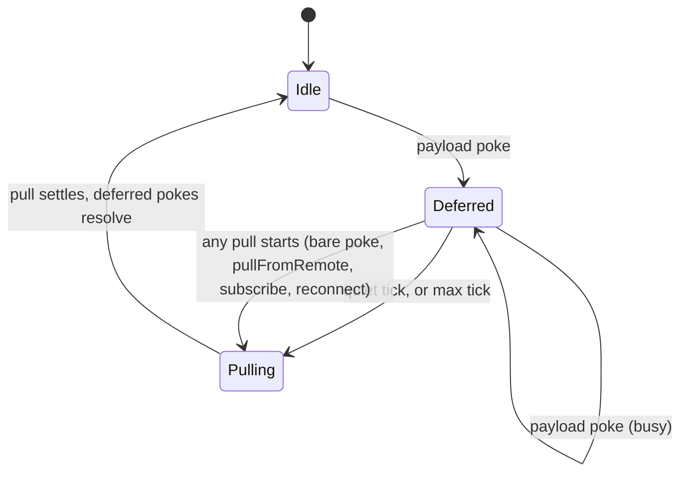

# Append and stream-friendly sync batching

Current implementation: app-defined shared mutators use `get` and `set`; server commits infer compact append pokes from final record changes. The original phased design below records the historical built-in transaction append, which was removed in the custom-mutations follow-up.

## Problem overview

[Live records](agent-chat-streaming.md) made every server commit reach each viewer in one hop. The agent chat guide then saved the whole reply snapshot about every 100 ms. Each save resent the full text, and every save made each viewer pull its whole scan window.

```callstack
 reply loop timer (100 ms)
 └── tx.set("messages", { ...reply, parts })   # the whole text again
     └── TandemServer.commitTransaction [[packages/server/src/TandemServer.ts#TandemServer.commitTransaction]]
         └── emitLivePokes                     # one payload per viewer per save
 SyncEngine poke handler
 ├── Database.applyPoke
 └── queuePull → TandemServer.pull             # one full-window pull per save
```

A reply of a few thousand tokens therefore cost every viewer hundreds of full-record payloads and as many pulls, and the app owned a throttling timer.

## Solution overview

Two engine changes, and a guide that uses them:

1. A shared get/set mutator extends a string field; the server infers compact append pokes when the committed record differs only by lossless string growth. Live pokes carry only the appended text, with the field's previous length and the revision from which the record held the value it extends.
2. The server merges a client's live payloads over a short interval, and the client defers the pull that confirms them until payloads stop arriving, or at most a second.



The reply loop commits every delta. Neither the app nor the viewer pays per token.

## Goals

- Appending a token sends the token, not the record, to viewers that have the record.
- A client never shows text the server did not have, even after lost pokes.
- Records a client has not seen never leak through appends.
- Bursts cost each viewer about 20 payloads and one pull per second.
- Bare pokes, reconnects, and the pusher's acknowledgement are never delayed.
- Both batching layers are invisible to app code apart from optional configuration.

## Non-goals

- A built-in append operation. Shared mutators record set operations and retain the bounded pending-replay limitation.
- Field paths. `append` extends top-level string fields; the guide stores each `UIMessage` part as its own record.
- Reply status, heartbeats, crash cleanup, stop, and server write hooks. They stay app code in `docs/agent-chat.md`.
- Additional mutator composition or a new rebase engine.

## Implementation

### Historical Phase 1: Built-in append

**Today**

A server transaction could `set`, `update`, or `remove`. Every changed record went to viewers whole.

**Proposed**

Add `append` to server transactions, apply it inside the run queue at commit, and send viewers that already have the record only the appended text. The client applies it only on top of the exact value it extends.

```changes
954f2de..84e0752
```

The payload names fields whose type is `string` ([[954f2de..84e0752:packages/core/src/transaction/Transaction.ts#L125-L159]]):

```ts
type PokeAppendOp<Schema> = {
	collection: string
	id: Id
	field: string
	/** The field's length before the append. */
	offset: number
	text: string
	/** A revision from which the record held the value the append extends. */
	after: Revision
}

type PokePayload<Schema> = {
	revision: Revision
	set?: PatchSetOp<Schema>[]
	remove?: PatchRemoveOp<Schema>[]
	append?: PokeAppendOp<Schema>[]
}
```

The types live in [[954f2de..84e0752:packages/core/src/sync/SyncEngine.ts#L76-L98]].

`tx.append` only stages text. The transaction reads the record at commit, inside the server's run queue, so appends from concurrent transactions all land. Later writes in the same transaction keep their order: a `set` or `remove` drops earlier appends to the record, and an `update` drops appends to the fields it assigns.

```callstack
 TandemServerTransaction.append [[954f2de..84e0752:packages/server/src/TandemServerTransaction.ts#L238-L257]]
+└── stage text per record and field   # no read yet
 TandemServer.commitTransaction [[954f2de..84e0752:packages/server/src/TandemServer.ts#L511-L577]]
+├── TandemServerTransaction.applyAppends [[954f2de..84e0752:packages/server/src/TandemServerTransaction.ts#L290-L340]]
+│   ├── read each record through the transaction   # sees its own staged writes
+│   ├── reject a non-string value
+│   └── return appends to records the transaction did not otherwise write
 ├── read removed records
 ├── transaction.commit
+├── attach after = the record's last write     # before recording this commit
+├── recordLastWrites [[954f2de..84e0752:packages/server/src/TandemServer.ts#L590-L601]]
 └── emitLivePokes
     └── readLivePayload [[954f2de..84e0752:packages/server/src/TandemServer.ts#L634-L689]]
+        └── append op if the record is in view and known, else set
```

`after` is the commit that last wrote the record. The record held one value from then until the append, so any copy the client has from that commit or later is the value the append extends. The server keeps the last write of the 10,000 most recently written records; an older record gets the commit at which the map last forgot an entry, which is later than its real last write and only makes clients more conservative.

```ts
const after = {
	server: instanceId,
	commit: lastWrites.get(recordId) ?? forgottenWritesThrough,
}
```

A first version sent the revision of the last payload that carried the record, or the client's latest pull, and required equality. The server resets that per-client state at each pull, so a client whose pull response was still in flight rejected every append until its next pull. The agent chat reference test caught it as text that froze and a final status shown next to stale text.

The client turns an accepted append into an ordinary live record, so retirement by pull is unchanged:



```ts
function extendServerValue(server, appends) {
	if (server.value === undefined) return
	let value = server.value
	for (const { after, field, offset, text } of appends) {
		if (!isCoveredBy(after, server.revision)) return
		const current = value[field] ?? ""
		if (typeof current !== "string" || current.length !== offset) return
		value = { ...value, [field]: current + text }
	}
	return value
}
```

A review then found two more cases. A client reconnecting over two connections can receive an older payload after a newer one, so `applyPoke` skips appends that a value from the payload's commit or later already covers, as it does for sets. And another process's write, reported through storage `subscribe`, did not move the last-write bookkeeping; a notification now forgets it, so appends wait for a pull read after that write. The server ignores notifications for its own commits.

With `after`, the offset check never fails for `TandemServer`. It stays as a cross-check for custom remotes that send appends.

`PokeApi.codec` passes the appended text through the collection codec as a partial record, as `MutationApi.codec` does for update payloads ([[954f2de..84e0752:packages/core/src/sync/SyncEngine.ts#L228-L265]]). Any codec with `decode(encode(x)) = x` round-trips the fragment. A codec that rejects it fails the payload, and the SSE helpers fall back to a bare poke.

DST gains a `serverAppend` event on server-owned and shared records. The `movedBackwards` check already requires every value a client shows to be a server value no older than the last one shown, so a wrongly accepted append fails the run.

### ✅ Phase 2: Batch pokes and defer confirming pulls

**Today**

Each commit sent each viewer its own payload, and each payload made the viewer pull.

**Proposed**

Merge a client's payloads on the server over `livePokeInterval` (50 ms), and let the client defer the confirming pull while payloads keep arriving, up to `livePullMaxDelay` (1 s).

```changes
84e0752..bb91b2a
```

The server buffers each commit's changes per client and throttles with a leading edge: the first payload after a quiet interval goes out at once, later ones merge until the interval ends.

```callstack
 TandemServer.emitLivePokes [[84e0752..bb91b2a:packages/server/src/TandemServer.ts#L633-L666]]
-├── readLivePayload → pokeClient(payload)
+├── bufferLiveChanges [[84e0752..bb91b2a:packages/server/src/TandemServer.ts#L669-L720]]
+│   └── LivePayloadBuffer.add [[84e0752..bb91b2a:packages/server/src/LivePayloadBuffer.ts#L76-L79]]
+├── pusher or offset window: flushLivePayload, then a bare poke   # never delayed
+└── scheduleLivePayload [[84e0752..bb91b2a:packages/server/src/TandemServer.ts#L726-L742]]
+    ├── flushLivePayload now if the client's interval is quiet [[84e0752..bb91b2a:packages/server/src/TandemServer.ts#L744-L750]]
+    └── flush again at each interval end until one ends empty
 TandemServer.readPull
+└── client.buffer.clear()   # the pull returns every buffered change
```

Merging works per record, in commit order ([[84e0752..bb91b2a:packages/server/src/LivePayloadBuffer.ts#L137-L152]]):

```ts
function merge(earlier, later) {
	if (later.type !== "append" || earlier?.type !== "append")
		// After a buffered set, the client never saw the value an append extends.
		return later.type === "append" && earlier ? { type: "set", op: later.op } : later
	const fields = chainFields(earlier.fields, later.fields) // contiguous offsets
	return fields
		? { type: "append", op: later.op, fields, after: earlier.after }
		: { type: "set", op: later.op }
}
```

A merged payload's revision is the latest commit merged into it. A record created and deleted within one interval, and never sent, is forgotten instead of named.

The pusher now always gets a bare poke, even when its commit changed records in its view. Before, the payload alone made it pull; with deferral that would delay its acknowledgement by up to a second.

On the client, a payload poke shows its records at once and joins one deferral:

```callstack
 SyncEngine poke handler [[84e0752..bb91b2a:packages/core/src/sync/SyncEngine.ts#L395-L415]]
 ├── Database.applyPoke
-├── queuePull
+├── deferPull [[84e0752..bb91b2a:packages/core/src/sync/SyncEngine.ts#L475-L502]]   # payload pokes
+│   ├── quiet loop: pull after a livePullDelay tick with no new payload
+│   └── pull at the first livePullMaxDelay tick
 └── queuePull                                   # bare pokes, unchanged
 SyncEngine.pull [[84e0752..bb91b2a:packages/core/src/sync/SyncEngine.ts#L504-L511]]
+├── take the deferral before the request       # this pull reads every commit already poked
 ├── pullFromRemote
+└── settle the deferred pokes, whatever the outcome
```



Both delays accept a `TimerApi`. DST drives the client's delays with its gated timer and the server's interval with a `serverTick` event, and counts appends that merged text from several commits.

### ✅ Phase 3: Guide and reference test

**Today**

The guide kept `UIMessage` parts on the message record and saved the whole snapshot from a 100 ms timer, with a 5 s heartbeat folded into the same save logic.

**Proposed**

Store each part as its own record. Commit every `readUIMessageStream` snapshot: grown text as an append, any other change as a set of that part. Keep a plain heartbeat for the stale check.

```changes
bb91b2a..d2894c1
```

```callstack
 push (transport)
 ├── isClientWrite [[bb91b2a..d2894c1:examples/agent-chat/apps/server/test/AgentChat.e2e.spec.ts#L122-L131]]   # reply messages and their parts are the server's
 ├── TandemServer.push
 └── streamReply [[bb91b2a..d2894c1:examples/agent-chat/apps/server/test/AgentChat.e2e.spec.ts#L264-L342]]
     ├── claim the reply record
     ├── heartbeat: set the reply whole every 5 s   # the server is its only writer
     ├── server.subscribe runs → AbortController.abort
     ├── streamText → toUIMessageStream → readUIMessageStream
-    ├── a timer saves the newest parts every 100 ms
+    ├── saveParts per snapshot [[bb91b2a..d2894c1:examples/agent-chat/apps/server/test/AgentChat.e2e.spec.ts#L137-L157]]
+    │   ├── tx.set("parts", next)                    # final text that grew
+    │   └── tx.set("parts", part)                     # tool and state changes
     └── set the final status
```

The heartbeat sets the reply record from the server's in-memory copy instead of using `update`. `TandemServerTransaction.update` reads the record when called, so a heartbeat update could commit a stale `"streaming"` after the final status.

The reference test's long reply ([[bb91b2a..d2894c1:examples/agent-chat/apps/server/test/AgentChat.e2e.spec.ts#L472-L514]]) streams 300 tokens to two viewers with 15 ms pull latency. Each viewer's text only grows and converges on the final reply; each sees about 29 payloads and one or two pulls in 1.4 s. The suite passed 20 consecutive runs.

## Limitations

- Shared named mutators append through get/set on both client and server.
- The last-write map holds 10,000 records per server instance. Appends to records written longer ago wait for clients' pulls if the clients have not pulled since the map forgot them.
- Appends assume the server learns of every write. Another process's write that storage does not report through `subscribe` can let a client extend replaced text until its next pull.
- A collection codec that renames fields makes append payloads fail encoding, so those appends fall back to a bare poke.
- When an append is rejected (after a lost poke) while other records in the same payload apply, the client can briefly show records from different moments until the pull.
- Merged payloads add up to 50 ms of latency during bursts, and confirmation pulls up to 1 s. Both are configurable.
- A model error drops `readUIMessageStream` snapshots still queued, so a failed reply's saved text can end a few tokens early.

## References

- `docs/server.md#append-text`, `docs/sync.md#live-records`, `docs/sync.md#poke`, `docs/custom-remote.md`, `docs/agent-chat.md`
- `packages/server/test/Append.spec.ts`, `packages/server/test/LivePokeBatching.spec.ts`, `packages/core/test/sync/live.spec.ts`, `packages/server/test/LiveEventStream.spec.ts`
- `specs/agent-chat-streaming.md` (live records)

## Current append derivation

`TandemServer.commitTransaction` reads each changed record's committed before image in the serialized queue. It compares that image with the transaction's final set write. Plain data objects and arrays are compared structurally; values with uncertain semantics, such as Map, Set, or class instances, force a full set. Removed keys, changed metadata, replacements, shrinking text, and record creation also force a full set. Every inferred suffix must round trip through its collection codec as a string; otherwise the commit sends the full record. The existing live buffer still merges consecutive deltas and uses the record's previous revision guard. Concurrent named get/set calls run in commit order, while pre-created raw transactions do not have append-specific conflict handling.
