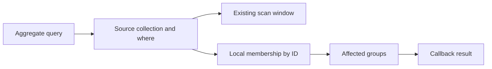

# Client callback aggregations

## Problem overview

Collection queries return rows. Callers computing statistics currently need to read and reduce every result themselves, and changes to one workspace can cause work for every workspace.

```callstack
 TandemClient.subscribe [[packages/core/src/TandemClient.ts#TandemClient.subscribe]]
 └── Database.subscribe [[packages/core/src/Database.ts#Database.subscribe]]
     └── executeQuerySync [[packages/core/src/query/executeQuery.ts#executeQuerySync]]
```

## Solution overview

An aggregate query supplies a synchronous callback and optional `groupBy` keys. The client subscribes to the ordinary collection/where source window, retains matching records by ID, and recomputes callbacks for groups touched by each committed record change. No callback crosses the sync or tab protocol.



## Goals

- Typed one-shot and subscribed callbacks through client and React, including scalar ungrouped results.
- Grouped object results merged with group keys, with explicit collision errors.
- Local optimistic, remote, rebase, reset, and tab updates with atomic publication.
- Recompute only changed groups after ordinary commits.

## Non-goals

Backend callback execution, aggregate wire protocol, built-in reducers, pagination, projection, relations, and order semantics for aggregate inputs.

## Implementation

### ✅ Phase 1: Core query and materialization

**Today**

`Database.subscribe` re-executes the full query after relevant tuple changes.

**Proposed**

Add aggregate query types and a per-subscription member/group index. Re-read only changed record IDs after a transaction, then publish changed groups.

```changes
3d7c238
```

```callstack
 TandemClient.subscribe [[3d7c238:packages/core/src/TandemClient.ts#L312-L328]]
+├── aggregateSource # keep callback local [[3d7c238:packages/core/src/query/aggregateQuery.ts#L22-L48]]
 └── Database.subscribe [[3d7c238:packages/core/src/Database.ts#L772-L809]]
+    └── subscribeAggregate # publish changed groups after a commit [[3d7c238:packages/core/src/query/aggregateQuery.ts#L50-L157]]
```

```ts
for (const changedId of commit.recordIds) {
	removePreviousMembership(changedId)
	addCurrentMembershipIfMatching(changedId)
	markOldAndNewGroupsDirty(changedId)
}
for (const group of dirtyGroups) recompute(group)
publishIfChanged()
```

### Phase 2: React and documentation

**Today**

`useTandemQuery` serializes the whole query as its effect key, so callback functions disappear and changed closures can become stale.

**Proposed**

Keep the current callback in a ref and key the subscription by serializable source and grouping parameters. Publish callback changes from local data without reopening the remote subscription.

```callstack
 useTandemQuery [[packages/react/src/TandemClientProvider.tsx#useTandemQuery]]
+├── retain current callback # inline closures stay current
 └── TandemClient.subscribe [[packages/core/src/TandemClient.ts#TandemClient.subscribe]]
```

### Phase 3: Simulation and integration

**Today**

DST checks subscribed record views, but has no independent aggregate oracle.

**Proposed**

Exercise aggregate subscriptions through the public client API with fault and crash seeds; compare each result with an independently computed statistic.

```callstack
 DstSimulation [[dst/DstSimulation.ts]]
+└── check aggregate view # compare against independent source calculation
```

## References

- [[packages/core/src/query/Query.ts]]
- [[packages/core/src/Database.ts]]
- [[packages/react/src/TandemClientProvider.tsx]]
- [[dst/DstSimulation.ts]]
