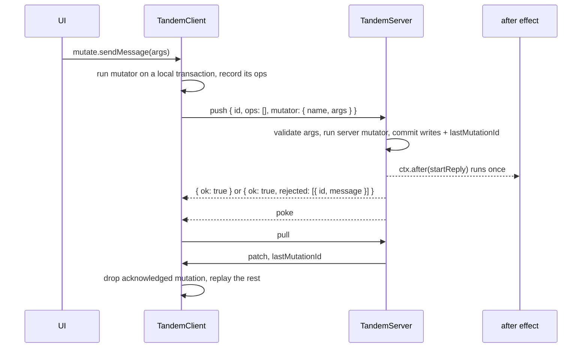
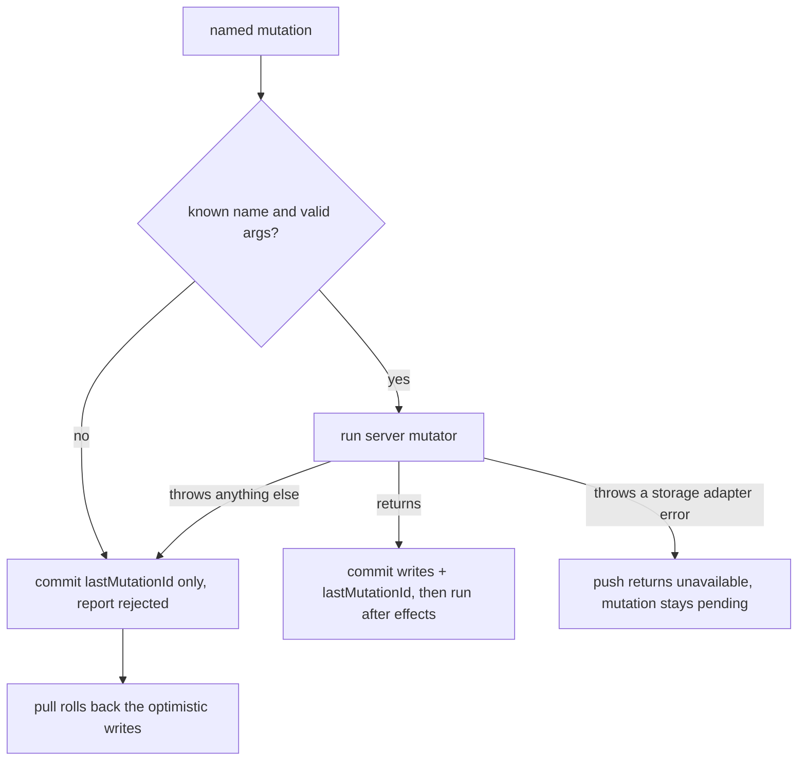

# Custom mutations

Status: exploratory draft for discussion. The prototype is additive: `transact` and `commit` behave as before, and every existing test passes unchanged.

## Problem overview

Clients write generic operations: `set`, `remove`, and field `update` on records. `TandemServer.push` applies them one by one without knowing what the user meant ([[packages/server/src/TandemServer.ts#applyMutationOperation]]). The [agent chat guide](../docs/agent-chat.md) shows what that costs an app:

- The server cannot run code when a user sends a message. The app wraps `push`, digs through the raw operations for new user messages, and starts a reply for each.
- Authorization is shape-based. The wrapper keeps an operation only if its collection, `role`, and ID suffix look like something a client may write.
- A forbidden operation must be dropped, not rejected. An error response leaves the mutation pending, and every later push from that client fails with it.
- Starting a reply exactly once needs an app-level claim: a retried push looks like "record X was set" again, so the reply loop first checks whether the reply exists.
- The stop button cannot ask the server to do anything, so the client writes a `runs` record and the server subscribes to it.

```callstack
 ChatServer.remote().push [[examples/agent-chat/apps/server/test/AgentChat.e2e.spec.ts#L125-L142]]
 ├── filter each mutation's ops with isClientWrite [[examples/agent-chat/apps/server/test/AgentChat.e2e.spec.ts#L63-L69]] # drop, never reject
 ├── TandemServer.push [[packages/server/src/TandemServer.ts#TandemServer.push]]
 │   └── applyMutationOperation # writes whatever survived the filter
 └── for each surviving user message set → startReply
     └── streamReply [[examples/agent-chat/apps/server/test/AgentChat.e2e.spec.ts#L171-L196]]
         ├── claimTx.get(replyId) # a retried push must not start a second reply
         └── subscribe to runs where id = replyId # the stop button writes this record
```

The [roadmap](../docs/roadmap.md) lists "Tag mutations with intents" and intent-based conflict handling. Named mutations are one way to get both.

## Solution overview

A custom mutation, or named mutator, is a function defined once and called by name: `client.mutate.sendMessage({ messageId, threadId, text })`. The client runs it at once against its local database, so the UI updates optimistically. The push carries the name and JSON arguments, not the writes. The server runs the same mutator, or a server override of it, inside a transaction, where it can check the session, reject the call, and schedule work for after the commit.



A server refusal is acknowledged with no effect, so it never blocks later pushes, and the next pull rolls the optimistic writes back. The call's promise rejects with `MutationRejectedError`.

The agent chat, before and after. Today the app filters operations in the transport and claims replies in the reply loop:

```ts
const isReplyId = (id: string) => id.endsWith(":reply")
function isClientWrite(op: MutationOp<ChatSchema>) {
	if (op.collection === "runs") return op.type !== "remove"
	return op.type === "set" && op.value.role === "user" && !isReplyId(op.value.id)
}

push: async (args) => {
	const mutations = args.mutations.map((mutation) => ({
		...mutation,
		ops: mutation.ops.filter(isClientWrite),
	}))
	const response = await tandem.push({ ...args, mutations })
	if ("error" in response) return response
	for (const { ops } of mutations)
		for (const op of ops)
			if (op.type === "set" && op.collection === "messages") startReply(op.value)
	return response
}

async function streamReply(userMessage: Message) {
	const claimTx = tandem.transact()
	if (await claimTx.get("messages", replyId(userMessage.id))) return claimTx.cancel()
	claimTx.set("messages", emptyReply(userMessage))
	await tandem.commit(claimTx)
	const runs = await tandem.subscribe({ collection: "runs", where: { id } }, ([run]) => {
		if (run?.stopRequested) controller.abort()
	})
	// ... stream the model
}

// Client
const tx = client.transact()
tx.set("messages", { id, threadId, role: "user", parts, status: "complete", updatedAt })
await client.commit(tx)
const stopTx = client.transact()
stopTx.set("runs", { id: replyId(id), stopRequested: true })
await client.commit(stopTx)
```

With mutators, one shared module defines what sending and stopping do, the server adds authorization and effects, and the transport passes the session's mutators:

```ts
// Shared by client and server
export const chatMutators = defineMutators(schema, {
	sendMessage: {
		args: z.object({ messageId: z.string(), threadId: z.string(), text: z.string().min(1) }),
		run: (tx, { messageId, threadId, text }) => {
			const updatedAt = Date.now()
			tx.set("messages", { id: messageId, threadId, role: "user", parts: [{ type: "text", text }], status: "complete", updatedAt })
			tx.set("messages", { id: replyId(messageId), threadId, role: "assistant", parts: [], status: "streaming", updatedAt })
		},
	},
	stopReply: { args: z.object({ messageId: z.string() }), run: () => {} },
})

// Server: built per request, closing over its session
const mutators = tandem.serverMutators(chatMutators, {
	sendMessage: async (tx, args, ctx) => {
		if (!session.threads.includes(args.threadId)) throw new Error(`No access to ${args.threadId}`)
		if (await tx.get("messages", args.messageId)) throw new Error(`Message ${args.messageId} exists`)
		await chatMutators.sendMessage.run(tx, args, ctx)
		ctx.after(() => startReply(replyId(args.messageId), args.threadId))
	},
	stopReply: async (tx, { messageId }, ctx) => {
		const reply = await tx.get("messages", replyId(messageId))
		if (!reply || !session.threads.includes(reply.threadId)) throw new Error(`No reply to ${messageId}`)
		ctx.after(() => controllers.get(reply.id)?.abort())
	},
})
push: (args) => tandem.push(args, { mutators }) // refuses raw set/update/remove by default

// Client
await client.mutate.sendMessage({ messageId, threadId, text })
await client.mutate.stopReply({ messageId })
```

What disappears: the operation filter and the reply-ID suffix rule, the scan for new messages, the claim check, the drop-don't-reject guidance, the `runs` collection and the server's subscription to it. The reply record now commits in the same transaction as the user message, and the per-client mutation ID makes the `after` effect run once.

What remains: the reply loop, its save timer, startup recovery of replies a crash left `"streaming"` (unchanged, so the new example omits it), the `replyId` naming convention, an existence check on both the message and reply IDs, and an in-memory map from reply ID to `AbortController`. Line counts barely change: the developer-experience review's rewrite was about 258 lines of app code before and 276 after. The code that goes away is the subtle part. The full example is [[c412c04:examples/agent-chat/apps/server/test/AgentChatMutators.e2e.spec.ts#L1-L452]].

## Research

How six systems answer the same questions. Notes with quotes and source links are in the [research notes](#research-notes) below.

| System | Replay | Determinism | Server failure | Side effects | Auth | Types | Versioning | Offline |
| --- | --- | --- | --- | --- | --- | --- | --- | --- |
| Replicache | Re-runs pending mutators on the pulled state | Replay-safe; IDs passed as args | App must still bump `lastMutationID`; not bumping blocks; client learns only through pulled state | Your code | Push handler checks auth and that the client ID is the user's | Name and JSON args | Rename on any signature change; `schemaVersion`; unknown name runs as a no-op | Yes, hours to days |
| Zero 1.x | Re-runs on rebase; server re-executes by name | Not stated; IDs as args in examples | Skipped, `lastMutationID` bumped, error stored with it; client reverts; `.server` promise reports it | Transactional outbox, or post-commit tasks | `ctx` from the auth token | `defineMutator(validator, fn)` shared | Expand/contract deploys; unknown mutator errors | No offline writes |
| Convex | Re-runs the optimistic update only; mutations run only on the server | Server mutations must be deterministic | Promise rejects; queue not blocked | `scheduler.runAfter` commits with the mutation, exactly once | `ctx.auth` | `v` validators, codegen | None documented | In-memory queue |
| LiveStore | Re-materializes events after rebase | Materializers pure; data in the event | No server execution; a throwing materializer halts | None | `validatePayload` / `onPush` | Event schemas | Versioned event names; `unknownEventHandling` | Full |
| TanStack DB / Electric | None: optimistic rows held until the server's txid syncs back | None | Handler throws, optimistic state rolls back; no retry | Your API | Your API | Collection schemas | Your API | Offline package with a named-function outbox |
| PowerSync | None: CRUD upload queue | None | A 4xx blocks the FIFO queue; docs say return 2xx | Your API | JWT and your API | CRUD plus `_metadata` | Your API | Full |

Takeaways:

1. Two schools. Replicache, Zero, and Convex send intent and re-execute it on the server. LiveStore and PowerSync replicate recorded effects. Tandem today is in the second school; named mutators move the server side to the first.
2. A permanent failure must never block the queue. Replicache: "the server must still mark the mutation as processed by updating the `lastMutationID`. Otherwise, the client will keep trying to send the mutation and be blocked forever." Zero does this automatically. Only infrastructure errors should leave a mutation unacknowledged.
3. Commit the acknowledgement with the effects. Replicache requires that a mutation's effects and its `lastMutationID` "must be revealed atomically"; that is what makes server execution and post-commit hooks exactly-once across retries.
4. Persist the error with the acknowledgement. Zero stores the error result in the same transaction as the `lastMutationID` bump, so a lost response does not lose it. Replicache ignores the push response body entirely.
5. Code that runs twice takes its IDs and randomness from its arguments (Replicache, LiveStore).
6. Durable side effects belong in an outbox or transactional scheduler (Zero, Convex). A post-commit hook is fire-and-forget.
7. Let client and server implementations differ. Zero's `tx.location` and a server-only context carry auth and server-computed values.
8. Versioning is convention: names only grow, a changed signature gets a new name, deploy servers first, and pick an explicit policy for unknown names.

Fit with Tandem's base-plus-pending model: the server half fits directly, because `TandemServer.push` already applies a client's mutations in ID order inside a transaction with `lastMutationId`. Re-running mutator code on rebase (Replicache, Zero) fits less well today, because `Database.applyPull` is one synchronous tuple transaction ([[packages/core/src/Database.ts#Database.applyPull]]) and shared mutators read asynchronously. Replaying the operations the client mutator recorded fits exactly, because that is what rebase already does. Convex's and TanStack DB's "hold optimistic state until confirmed" model also matches: Tandem drops a pending mutation only when a pull acknowledges it.

## Design

Each question below gets a recommendation and the alternatives considered. Prototype names are in code; they are proposals, not settled API.

### 1. Defining and calling mutators

Recommendation: `defineMutators(schema, { name: { args, run } })` in core, imported by both sides. `args` is a [Standard Schema](https://standardschema.dev) validator (zod 4, valibot, arktype) or a parse function `(input: unknown) => Args`; it types `run` and `client.mutate.name`. `run(tx, args, ctx)` gets a `MutatorTransaction<Schema>`: `get` and `scan` return promises, `set` and `remove` stage writes, `update` returns a promise. The client wraps its synchronous `Transaction`; `TandemServerTransaction` already has this shape. `ctx.location` is `"client"` or `"server"`.

```ts
export type MutatorDefinition<Schema extends AnySchema, Args = Json> = {
	args: StandardSchemaV1<Json, Args> | ((input: unknown) => Args)
	run: (tx: MutatorTransaction<Schema>, args: Args, ctx: MutatorContext) => unknown
}
```

The client validates arguments before running and the server validates again, because the server cannot trust the client's check. The raw JSON input is what persists and travels, so a validator's transforms apply on each side.

Alternatives:

- Tandem's `Codec` for arguments, encoded by `MutationApi.codec`. Rejected: a decode failure at the transport is an invalid-request error, which blocks the queue. Validating inside the server's push path lets one bad mutation be rejected and acknowledged.
- Separate client and server functions per mutator, with no shared body. Rejected as the default, since most mutators should share their optimistic write. Overrides cover the rest.
- Synchronous mutators. They would make rebase re-execution easy (question 3), but the server reads storage asynchronously, so shared code would need two calling conventions.

A parse function needs its parameter annotated (`(input: unknown) =>`), or TypeScript cannot infer the arguments. Standard Schema objects infer without help. `client.mutate` takes the validator's output type; with zod `.default()` or `.transform()` the call-site type is stricter or wrong, since the raw input is what is sent.

The client receives the shared mutators at construction and must be ready before a call:

```ts
const client = new TandemClient({ schema, remote, mutators: chatMutators })
await client.ready
await client.mutate.sendMessage({ messageId, threadId, text })
```

An explicit type needs all three generics: `TandemClient<ChatSchema, {}, typeof chatMutators>`.

### 2. Generic operations

Recommendation: keep `transact` and `commit`. Both kinds share one outbox and one mutation ID sequence, so their order is preserved. A push that carries `mutators` rejects generic mutations by default, the same way a failed mutator is rejected: acknowledged, reported, rolled back. `allowOps: true` opts back in. Defaulting the other way would leave every record writable to an app that moved its checks into mutators and forgot the flag. Generic writes stay useful for data the client owns outright (drafts, preferences) and for server-side code, which keeps `tandem.transact()`.

Alternatives: make everything named, with `set`/`update`/`remove` as built-in mutators the server authorizes like any other. That unifies the wire format and the server path, and is worth doing before release (phase 7). Or remove generic writes from clients entirely, which is simpler but forces a mutator for every trivial write.

Migration: none is needed before release. Apps that keep generic writes change nothing. Apps that adopt mutators delete their push filter and pass `{ mutators }`.

### 3. Client replay

Recommendation for now: replay recorded operations. `client.mutate` runs the mutator once, against a draft transaction, and commits the operations it recorded exactly as `commit` does today. The outbox keeps those operations at `["outbox", id]`, unchanged, and adds `["mutator", id] = { name, args }`. A pull rebuilds tracked records from their bases and replays the recorded operations, as today. A restart restores both tuples, so a pending named mutation is pushed by name after reconnect. Functions are never stored.

The call copies its arguments through JSON first, so later changes to the caller's object cannot change what is pushed, and non-JSON arguments fail at the call. If a pull or another call writes a record the mutator read while it awaited, the commit conflicts; nothing has been pushed yet, so the client reruns the mutator on the new state, up to three times.

Determinism: not required for convergence, because the server's result replaces the optimistic one when the pull acknowledges it. It matters for UX: if the client and server disagree, the UI jumps once. IDs, and anything else the server must reproduce, should come from arguments.

The cost is intent while pending. If client A bumps a counter from 3 to 4 and a pull brings B's bump (server value 4), A replays "set 4" instead of re-running "add 1", and shows 4 until its own mutation is acknowledged and the server's 5 arrives. Field-level `update` already limits this to the fields a mutator writes.

Alternative, later: re-run mutator code on rebase (Replicache, Zero). That needs mutators the client can run synchronously inside `applyPull`, or an asynchronous rebase that holds off local commits. Phase 8 sketches the synchronous option. Supporting both means storing the recorded operations anyway, as a fallback for a client whose code no longer has the mutator.

### 4. Server execution

Recommendation: `tandem.push(args, { mutators })`, where the transport builds the mutators for the request's session with `tandem.serverMutators(shared, overrides)`. Each named mutation runs in its own `TandemServerTransaction`, which also stages `lastMutationId`, and commits once through the existing commit path, so live pokes carry the resulting records as before. A server override receives `TandemServerTransaction` (with `query`) and `ServerMutatorContext`:

```ts
export type ServerMutatorContext = MutatorContext & {
	location: "server"
	clientId: ClientId
	mutationId: MutationId
	after(effect: () => unknown): void
}
```

Auth lives in the closure: a `mutators(session)` function that calls `tandem.serverMutators` captures who is calling, so the context needs no app-specific generic. This is Zero's `createServerMutators(authData)` pattern.

Alternatives: constructor `mutators` plus a typed `context` value per push, which adds a `Context` generic to `TandemServer`; or `tx.location` branches inside the shared module, which ships server-only imports (the AI SDK, secrets) to the browser.

Cost: an in-process remote that calls `tandem.push(args)` without mutators rejects every named mutation as unknown.

Server mutators run inside the server's serial run queue, which orders every push, pull, and commit. Two rules follow, both documented rather than enforced in the prototype:

- A server mutator must not await `tandem.commit`, `push`, or `pull`. They queue behind the push that is waiting on them, and the server deadlocks.
- A server mutator should not await external I/O such as a fetch or a model call. Every client's sync waits for it. Put that work in `ctx.after`.

### 5. Side effects after commit

Recommendation: `ctx.after(effect)` queues `effect` during the mutator. After the mutation's writes and `lastMutationId` commit and its pokes go out, the server calls each effect in order, without awaiting it, and logs any failure. A failed mutator's effects are discarded.

Exactly once across retries comes from the existing dedupe: `applyPush` skips any mutation at or below the stored `lastMutationId`, and that value commits atomically with the mutator's writes, so a retried push never runs the mutator or its effects again. The run queue serializes pushes within a process.

```ts
for (const mutation of mutations) {
	if (mutation.id <= lastMutationId) continue // retried: already applied, effects already ran
	// run mutator; commit writes + lastMutationId together; then run its effects
}
```

Durability: at most once. A crash between commit and effect loses the effect, and so does a storage commit that reports failure after it actually became durable (an ambiguous timeout): the server drops the effects and the retry is skipped. Work that must finish should be a record the mutator writes in its transaction, finished by startup recovery. The chat already does this: the reply record commits with the message, and startup marks stale `"streaming"` replies as failed. A durable job queue (phase 9) would make this generic.

Alternatives: run effects before responding and await them (slow pushes, and a long reply would hold the client's push); or a durable outbox from the start (more machinery than the prototype needs).

Multiple processes: the dedupe read happens before the transaction, outside it. With several server processes sharing storage, two could both pass the check. Reading `lastMutationId` inside the mutation's transaction, with storage that detects the conflict, closes this (open question 5).

### 6. Failure semantics

Recommendation: acknowledge with no effect. If a server mutator throws, or the name is unknown, or the arguments fail validation, the server cancels the mutator's writes, commits only `lastMutationId`, pokes the pusher, and adds `{ id, message }` to `PushResponse.rejected`. The client's `mutate` (or `commit`) promise rejects with `MutationRejectedError`, and the next pull rolls back its optimistic writes, exactly as dropped operations roll back today.

A storage failure is not a refusal. The server marks every error its storage adapter throws; if the mutator's error has one in its cause chain, the push returns `unavailable` and the mutation stays pending, so a later push retries it. Every other error is a refusal, including a malformed query inside the mutator. The first prototype treated any `TandemServerError` as storage, and the design review showed a bad query then blocked the client forever. A mutator that catches a storage error and rethrows a new error without `cause` turns a temporary failure into a refusal.



What the `mutate` promise means today, which the design review flagged as the weakest part of the prototype:

| Outcome | Meaning |
| --- | --- |
| Resolves | The push carrying it got a response without a rejection for it, or no push was attempted (disconnected, or `clear()` ran). Offline, it resolves without a server verdict. |
| Rejects with `MutationRejectedError` | The server refused it. It is acknowledged and the next pull rolls it back. |
| Rejects with any other error | The push failed in transit. The server may have applied it; the mutation stays pending and a later push resends it, which the server skips if it was applied. Do not retry the call with new arguments. |

The report is best effort: a lost response loses the message, though never the rollback. Phase 6 persists the rejection with the acknowledgement so a pull delivers it, and lets the promise settle on acknowledgement rather than on the push response.

A client mutator that throws writes nothing and pushes nothing; `mutate` rejects with that error.

Alternatives: return an error and keep the mutation pending (today's behavior for errors, which blocks the client); halt the client like LiveStore; or have the server mark failures but send no message (Replicache).

### 7. Wire protocol and codecs

Recommendation for the prototype: `Mutation` gains an optional `mutator: { name, args }`. A named mutation travels as `{ id, ops: [], mutator }`; the server ignores `ops` when `mutator` is set. `PushResponse`'s success case gains `rejected?: { id, message }[]`. `MutationApi.codec` checks that a mutator has a string name and passes JSON arguments through, so transports need no mutator definitions.

An older server, or a push wrapper that rebuilds mutations as `{ id, ops }`, silently acknowledges a named mutation with no effect: the call resolves and the next pull undoes the write. Before release, make `Mutation` a discriminated union (`{ id, ops } | { id, name, args }`) and update push wrappers (phase 7). The optional field only exists so the existing agent chat test compiles unchanged.

Field-level updates are unaffected: the client records whatever operations the mutator made, including `update` payloads, and replays them. Live pokes are unaffected: they carry the records each commit changed, whatever made the commit, including the reply records an `after` effect saves.

The authorization boundary moves. With `allowOps: false` the only client-reachable writes are mutator bodies running on the server, with the session in scope. With generic operations allowed, every client can still write any record, so mutators alone authorize nothing.

### 8. Versioning

Recommendation: mutator names are the contract.

- Arguments change compatibly (new optional fields) or get a new name (`sendMessage2`). Old names stay on the server while old clients may hold them in their outbox, which for offline clients can be days.
- Deploy servers before clients. A client newer than the server gets "Unknown mutator" rejections: acknowledged, rolled back, and reported, so it never wedges.
- An older client whose outbox names a mutator the new server dropped also gets a rejection. That loses the user's write, so removal should wait out the offline window.
- Phase 10 adds an optional mutators version on push, so a server can answer "update needed" instead of rejecting one by one (Replicache's `VersionNotSupported`, Zero's `onUpdateNeeded`).

### 9. Deterministic simulation and tests

Recommendation: drive named mutators through `dst/` with an intent-sensitive mutator and a server-only rule. The prototype adds `bumpPriority`: the client adds one to a todo's priority; the server refuses server-owned and done todos and records an `after` effect per applied mutation. Checks that convergence alone would not catch:

- Two clients bump the same todo offline; the server ends at +2. Replaying recorded updates would give +1.
- A refused bump rolls back and the client's later writes still apply.
- No `after` effect runs twice under lost requests, lost responses, and client crashes (`effectRepeated` violation). Breaking the server's retry dedupe for named mutations makes seed 5 fail this check.
- Pinned runs cover a crash with a bump pending in client storage, and a lost response to the push carrying a bump.

Random runs bump about 6 to 8 times per 300 steps, so the sweeps alone rarely line a crash or lost response up with a pending bump; the pinned runs cover those. Random runs also cannot yet tell a server that acknowledged a bump with no effect from one that applied it. A ledger check (effects equal applied bumps, priority equals the start plus accepted bumps) would close that gap.

Tests drive public APIs only: `client.mutate`, `client.commit`, `tandem.push` options, and client storage restarts. No test reads internal tuples.

## Goals

- One definition per mutator, typed end to end, optimistic on the client and authoritative on the server.
- Server mutators that can authorize with the session and schedule effects after commit.
- Failed mutators never block a client's later pushes, and the caller learns why.
- Effects run at most once per mutation, even when pushes are retried.
- Existing apps keep working without changes.

## Non-goals

- Re-running mutator code on client rebase (phase 8 is a sketch).
- Durable effects and job queues (phase 9).
- Mutator return values sent back to the client.
- Multi-process exactly-once (open question 5).

## Implementation

### ✅ Phase 1: Named mutators on the client

**Today**

Clients only commit transactions of generic operations, and the outbox stores those operations. The server cannot tell what a mutation was for.

**Proposed**

Add `defineMutators` and `client.mutate`. A call runs the mutator optimistically, commits the operations it recorded, and persists its name and arguments beside them so pushes and restarts carry the intent. A push response can reject a mutation, which rejects its call.

```changes
f7f2045
```

`client.mutate.sendMessage(args)` validates, runs the mutator on a draft transaction, and commits through the existing path with the call attached:

```callstack
 TandemClient.mutate.<name> [[f7f2045:packages/core/src/TandemClient.ts#L136-L144]]
+└── TandemClient.runMutator [[f7f2045:packages/core/src/TandemClient.ts#L146-L183]]
+    ├── validateMutatorArgs [[f7f2045:packages/core/src/mutator/Mutator.ts#L132-L156]] # Standard Schema or parse function
+    ├── definition.run(clientMutatorTransaction(tx), args, { location: "client" }) [[f7f2045:packages/core/src/mutator/Mutator.ts#L159-L170]] # a throw cancels the draft and rejects
+    └── SyncEngine.commit(tx, { name, args }) [[f7f2045:packages/core/src/sync/SyncEngine.ts#L421-L453]]
+        ├── Database.commitMutation(tx, mutator) [[f7f2045:packages/core/src/Database.ts#L388-L413]] # outbox ops + ["mutator", id]
+        ├── enqueue push
+        └── reject with MutationRejectedError if the push reported this id
```

`defineMutators` only types the definitions; inference comes from each `args` validator:

```ts
export function defineMutators<Schema extends AnySchema, Args extends Record<string, unknown>>(
	_schema: RuntimeSchemaDefinition<Schema>,
	mutators: { [Name in keyof Args]: MutatorDefinition<Schema, Args[Name]> },
) {
	return mutators
}
```

The outbox gains one tuple kind. Recorded operations stay where rebase reads them, so `applyPull` and `applyPoke` are unchanged except for pruning the new tuple on acknowledgement:

```ts
type TandemClientTuple<Schema> =
	| /* records, bases, replica */
	| { key: ["outbox", MutationId]; value: MutationOp<Schema>[] }
	| { key: ["mutator", MutationId]; value: { name: string; args: Json } } // new
```

```callstack
 SyncEngine.push [[f7f2045:packages/core/src/sync/SyncEngine.ts#L455-L487]]
+├── send { id, ops: [], mutator } when ["mutator", id] exists
 └── remote.push
+    └── record response.rejected for commits still waiting
 Database.applyPull [[f7f2045:packages/core/src/Database.ts#L436-L437]]
+└── remove ["mutator", id] up to lastMutationId
```

`Mutation.mutator` [[f7f2045:packages/core/src/transaction/Transaction.ts#L126-L134]] and `PushResponse.rejected` [[f7f2045:packages/core/src/sync/SyncEngine.ts#L45-L53]] are the only protocol changes. `MutationApi.codec` rejects a mutator without a string name [[f7f2045:packages/core/src/transaction/Transaction.ts#L175-L182]].

### ✅ Phase 2: The server runs named mutations

**Today**

`TandemServer.push` applies each mutation's operations and stages `lastMutationId` in one transaction. Any error returns a push error and leaves the mutation pending.

**Proposed**

Let a push carry server mutators. Run each named mutation in a transaction with its acknowledgement, run `after` effects once it commits, and acknowledge a refusal with no effect. This gives the server intent, authorization with the session, and effects tied to the existing dedupe.

```changes
468c9fe
```

```callstack
 TandemServer.push(args, { mutators, allowOps }) [[468c9fe:packages/server/src/TandemServer.ts#L339-L349]]
 └── TandemServer.applyPush [[468c9fe:packages/server/src/TandemServer.ts#L457-L527]]
     ├── skip mutation.id <= lastMutationId [[468c9fe:packages/server/src/TandemServer.ts#L476]] # retries never rerun mutators or effects
+    ├── mutation.mutator → applyMutator [[468c9fe:packages/server/src/TandemServer.ts#L534-L592]]
+    │   ├── unknown name or invalid args → reject
+    │   ├── definition.run(tx, args, { location: "server", clientId, mutationId, after })
+    │   ├── throw with TandemServerError in its causes → return it # push answers unavailable [[468c9fe:packages/server/src/TandemServer.ts#L577]]
+    │   ├── other throw → reject
+    │   ├── commitTransaction(writes + lastMutationId) # pokes as before
+    │   └── runEffect for each after effect [[468c9fe:packages/server/src/TandemServer.ts#L634-L641]] # not awaited; failures logged
+    ├── !allowOps → reject [[468c9fe:packages/server/src/TandemServer.ts#L495-L504]]
     └── generic ops → applyMutationOperation, as before
+TandemServer.reject [[468c9fe:packages/server/src/TandemServer.ts#L595-L613]] # commit lastMutationId only, poke the pusher, return { id, message }
```

`serverMutators` pairs each shared mutator's `args` with an override's `run`, or the shared `run` when there is none [[468c9fe:packages/server/src/TandemServer.ts#L321-L338]]:

```ts
const mutators = tandem.serverMutators(chatMutators, {
	sendMessage: async (tx, args, ctx) => {
		if (!session.threads.includes(args.threadId)) throw new Error("No access")
		await chatMutators.sendMessage.run(tx, args, ctx)
		ctx.after(() => startReply(replyId(args.messageId), args.threadId))
	},
})
```

The new types are `ServerMutatorContext`, `ServerMutator`, `ServerMutators`, and `TandemServerPushOptions` [[468c9fe:packages/server/src/TandemServer.ts#L106-L153]]. The generic path now shares `pushTransaction` [[468c9fe:packages/server/src/TandemServer.ts#L615-L632]] with named mutations, so both stage `lastMutationId` the same way.

`packages/server/test/Mutators.spec.ts` covers, through `TandemClient` and `TandemServer`: the optimistic result replaced by the server's; a client throw and invalid args pushing nothing; a refusal that rejects, rolls back, and does not block; an effect that runs once when a lost response forces a retry; a storage failure that leaves the mutation pending; `allowOps: false`; an unknown mutator; and a named mutation written offline that survives a restart.

### ✅ Phase 3: Agent chat on custom mutations

**Today**

The reference chat filters operations in its transport, claims replies before streaming, and stops through a client-owned `runs` record.

**Proposed**

Rebuild the example on `sendMessage` and `stopReply`, beside the existing one for comparison. This tests the design on the pattern that motivated it.

```changes
c412c04
```

```callstack
 ChatServer.remote(session).push [[c412c04:examples/agent-chat/apps/server/test/AgentChatMutators.e2e.spec.ts#L143-L151]]
-├── filter ops with isClientWrite
+└── tandem.push(args, { mutators: this.mutators(session), allowOps: false })
+    └── sendMessage override [[c412c04:examples/agent-chat/apps/server/test/AgentChatMutators.e2e.spec.ts#L113-L120]]
+        ├── check the session can write the thread
+        ├── refuse an existing message ID # a client cannot overwrite history
+        ├── chatMutators.sendMessage.run # user message and empty reply, one commit
+        └── ctx.after(startReply)
-streamReply: claimTx.get(replyId), subscribe to runs
+streamReply [[c412c04:examples/agent-chat/apps/server/test/AgentChatMutators.e2e.spec.ts#L170-L219]] # register the AbortController before any await
+stopReply override → ctx.after(controller.abort) [[c412c04:examples/agent-chat/apps/server/test/AgentChatMutators.e2e.spec.ts#L121-L126]]
```

The shared mutators are [[c412c04:examples/agent-chat/apps/server/test/AgentChatMutators.e2e.spec.ts#L54-L87]]. The four tests send and stream a reply, start each reply once despite a retried push, refuse a forged reply and an unauthorized thread without blocking the next message, and stop a reply.

### ✅ Phase 4: Named mutators in deterministic simulation

**Today**

`dst/` generates sets, updates, removes, and server writes. It checks convergence and that server-owned records never move backwards.

**Proposed**

Add a `bumpPriority` mutator with a server-only refusal rule and an effect ledger, so random runs with faults and crashes exercise named mutations, rejections, and retries.

```changes
9dc95e5
```

```callstack
 DstSimulation.choose
+└── bump a todo from the client's view (30% of edits on known todos)
 DstWorld.apply
+└── DstWorld.bump [[9dc95e5:dst/DstWorld.ts#L637-L645]]
+    └── DstClient.bumpPriority [[9dc95e5:dst/DstWorld.ts#L112-L116]] # a method, so Gatekeeper gates it like commit
+        └── server bumpPriority override [[9dc95e5:dst/DstWorld.ts#L94-L109]] # refuses server-owned and done todos; ctx.after records the effect
 DstWorld.finish
+└── effectRepeated violation when an effect ran twice [[9dc95e5:dst/DstWorld.ts#L576-L578]]
```

The targeted tests are [[9dc95e5:dst/dst.spec.ts#L60-L115]]. Sweeps of 50 seeds at 300 steps with 10% network faults, and 50 more adding 2% crashes, found no violations.

### ✅ Phase 5: Review fixes

**Today**

The first prototype treated any `TandemServerError` from a mutator as a storage failure, accepted generic operations unless told otherwise, failed a client call on a read-write conflict, and stored the caller's argument object by reference.

**Proposed**

Fix what the design and developer-experience reviews reproduced, so a bug cannot block a queue and the secure configuration is the default.

```changes
9e7d405
```

```callstack
 tandemStorageToTupleDatabaseStorage [[9e7d405:packages/server/src/TandemServer.ts#L235-L266]]
+└── mark each error the adapter throws # storageFailures, so causes stay unchanged
 TandemServer.applyMutator
-├── findCause(TandemServerError) → keep pending
+├── isStorageFailure(error) → keep pending [[9e7d405:packages/server/src/TandemServer.ts#L602]]
+└── anything else → reject
 TandemServer.applyPush
+└── allowOps defaults to mutators === undefined [[9e7d405:packages/server/src/TandemServer.ts#L484]]
 TandemClient.runMutator [[9e7d405:packages/core/src/TandemClient.ts#L156-L208]]
+├── copy args through JSON [[9e7d405:packages/core/src/TandemClient.ts#L165]]
+└── rerun on ReadWriteConflictError, up to maxMutatorAttempts [[9e7d405:packages/core/src/TandemClient.ts#L169-L206]]
```

The example also refuses a message whose reply ID already exists and keeps earlier replies in the model's context. New tests: a malformed query in a server mutator is refused and the next call applies [[9e7d405:packages/server/test/Mutators.spec.ts#L313-L327]]; two concurrent toggles both apply [[9e7d405:packages/server/test/Mutators.spec.ts#L329-L344]] (with the retry disabled, the second fails with `ReadWriteConflictError`); a changed argument object does not change the push [[9e7d405:packages/server/test/Mutators.spec.ts#L346-L358]]; and DST pins a crash with a pending bump and a lost push response [[9e7d405:dst/dst.spec.ts#L97-L147]]. Two more 50-seed sweeps, with faults and with faults plus crashes, found no violations.

### Phase 6: Durable rejection results

**Today**

A rejection reaches the client only in the push response. If that response is lost, the caller sees a transport error, and the rollback arrives with no explanation.

**Proposed**

Store each rejection with the acknowledgement that skipped it, as Zero does, and return unseen rejections in the pull that acknowledges them. The client settles waiting calls and offers an `onMutationRejected` listener for calls made before a restart.

```callstack
 TandemServer.reject
-└── commit ["client", clientId] = { lastMutationId }
+└── commit ["client", clientId] = { lastMutationId } and ["rejection", clientId, id] = { message }
 TandemServer.readPull
+└── include rejections above the client's previous acknowledgement; delete older ones
 Database.applyPull
+└── surface rejections for acknowledged ids
```

### Phase 7: One wire shape

**Today**

A named mutation is `{ id, ops: [], mutator }`, and the server ignores `ops`.

**Proposed**

Make `Mutation` a discriminated union, and treat client `set`/`update`/`remove` as built-in mutators so one server path authorizes everything. Update the agent chat guide, `docs/sync.md`, and `docs/custom-remote.md`, and retire the push-filter example once the cofounders agree.

```ts
type Mutation<Schema> =
	| { id: MutationId; ops: MutationOp<Schema>[] }
	| { id: MutationId; name: string; args: Json }
```

### Phase 8: Re-run mutators on rebase (optional)

**Today**

A pull replays recorded operations, so a pending mutator's optimistic result is computed against the state at call time.

**Proposed**

Let a mutator declare a synchronous client body. `applyPull` re-runs it against the rebuilt state, inside its existing transaction, and falls back to the recorded operations if the client no longer has the mutator.

```callstack
 Database.applyPull [[packages/core/src/Database.ts#Database.applyPull]]
 ├── reset tracked records to their bases
-└── replay each pending mutation's recorded ops
+└── for each pending mutation: run its client mutator synchronously if defined, else replay recorded ops
```

### Phase 9: Durable effects

**Today**

`ctx.after` effects run at most once and die with the process.

**Proposed**

Add a durable job record written in the mutator's transaction, claimed and retried by a worker, with idempotency keyed by client and mutation ID. This is the transactional outbox Zero recommends and the scheduler Convex ships.

### Phase 10: Mutator versions

**Today**

A client newer than the server gets one "Unknown mutator" rejection per call.

**Proposed**

Send an optional mutators version on push. A server that cannot serve it answers with a version error that the client surfaces as "update needed" without rejecting or retrying the outbox.

## Known limitations

- The `mutate` promise does not report a definite outcome (design question 6). This is the main gap before anyone builds UI on it.
- Server mutators run in the serial run queue: awaiting `tandem.commit` deadlocks, and external I/O stalls every client.
- Rejection messages pass through whatever the mutator threw, including messages from bugs such as `id.map is not a function`.
- Older servers and op-rebuilding push wrappers silently acknowledge named mutations.
- `tx.set` overwrites, so an "insert" mutator must check for an existing record itself.
- Effects are at most once and single-process.

## Open questions

1. Adopt named mutators as Tandem's main write path, or keep them an advanced option beside `commit`?
2. Should a server with mutators refuse generic operations by default?
3. Is replaying recorded operations good enough while a mutation is pending, or is rebase re-execution (phase 8) needed for the apps you have in mind?
4. Per-push mutators (closures over the session) or constructor mutators with a typed context?
5. Is single-process exactly-once enough for now? Multi-process needs the `lastMutationId` read inside the transaction and storage that detects the conflict.
6. Should rejection messages pass through as thrown, or should only errors the app marks as public reach clients, with a generic message otherwise? Today any thrown message is sent.
7. Should `after` effects block `close()`, or stay the app's to track, as in the example?
8. Should overrides be structured (`{ authorize, after }` around the shared run) instead of replacing `run`? Today forgetting to call the shared `run` silently writes nothing.
9. Add `tx.insert`, which refuses an existing record, so mutators that create records are safe by default?
10. Should `client.mutate` return the server's result (Zero's `.server` promise), which needs phase 6's durable results?

## Research notes

Researched 2026-10-24 from current docs and the Rocicorp source at commit [`945ce61`](https://github.com/rocicorp/mono/tree/945ce619249e63381fb51d46c12f0d9e80024860).

Replicache. A pushed mutation is `{ clientID, id, name, args, timestamp }` ([push reference](https://doc.replicache.dev/reference/server-push)). Pull "rewinds the state of the Client View to the last version it got from the server, applies the patch … and then replays any pending mutations on top", and the server "is not necessarily expected to compute the same result" ([how it works](https://doc.replicache.dev/concepts/how-it-works)). Unique IDs "should often be passed into mutators as parameters" ([local mutations](https://doc.replicache.dev/byob/local-mutations)). On errors: "If a mutation is invalid or cannot be handled, the server must still mark the mutation as processed by updating the `lastMutationID`. Otherwise, the client will keep trying to send the mutation and be blocked forever." Temporary errors may abort without bumping, and "block synchronization and thus should be used carefully"; the response body "is ignored" ([push error handling](https://doc.replicache.dev/reference/server-push#error-handling)). Versioning: "If you wish to change the signature of a mutator … you must choose a new name" ([launch checklist](https://doc.replicache.dev/howto/launch)); a missing mutator is replaced by a no-op ([`replicache-options.ts`](https://github.com/rocicorp/mono/blob/945ce619249e63381fb51d46c12f0d9e80024860/packages/replicache/src/replicache-options.ts)).

Zero. Mutators are defined with a validator and shared; implementations "don't have to be the same, or even compute the same result" ([mutators](https://zero.rocicorp.dev/docs/mutators)). `handleMutateRequest` "skips any mutations that throw … The optimistic mutation on the client will be reverted" ([handling errors](https://zero.rocicorp.dev/docs/mutators#handling-errors)). The source bumps `lastMutationID` and writes the error result in a fresh transaction ([`process-mutations.ts` L690-L762](https://github.com/rocicorp/mono/blob/945ce619249e63381fb51d46c12f0d9e80024860/packages/zero-server/src/process-mutations.ts#L690-L762)), and refuses to skip if recording fails ([L655-L662](https://github.com/rocicorp/mono/blob/945ce619249e63381fb51d46c12f0d9e80024860/packages/zero-server/src/process-mutations.ts#L655-L662)). Results survive lost responses ([waiting for results](https://zero.rocicorp.dev/docs/mutators#waiting-for-results)). For async work, "the best way … is a transactional outbox" ([notifications](https://zero.rocicorp.dev/docs/mutators#notifications-and-async-work)); post-commit failures "are logged but the mutation remains committed" ([L353-L359](https://github.com/rocicorp/mono/blob/945ce619249e63381fb51d46c12f0d9e80024860/packages/zero-server/src/process-mutations.ts#L353-L359)). Auth uses `ctx` ([auth](https://zero.rocicorp.dev/docs/auth)). Zero "doesn't support offline writes" ([when to use](https://zero.rocicorp.dev/docs/when-to-use)) and deploys expand/contract ([schema](https://zero.rocicorp.dev/docs/schema)).

Convex. Optimistic updates "are run when a mutation is initiated, rerun if the local query results change, and rolled back when a mutation completes" ([optimistic updates](https://docs.convex.dev/client/react/optimistic-updates)). Mutations "must be deterministic, and cannot call third party APIs" ([mutations](https://docs.convex.dev/functions/mutation-functions)), and "every mutation call only executes once" despite retries ([React client](https://docs.convex.dev/client/react)). Scheduling from a mutation is atomic: if it fails, "no function will be scheduled" ([scheduled functions](https://docs.convex.dev/scheduling/scheduled-functions)).

LiveStore. Events are synced and pending ones "rebased on top of the latest upstream events" ([syncing](https://docs.livestore.dev/building-with-livestore/syncing)). Materializers are "side-effect free and deterministic" ([materializers](https://docs.livestore.dev/building-with-livestore/state/materializers)). Auth is `validatePayload`/`onPush` ([auth](https://docs.livestore.dev/patterns/auth)). Old clients handle unknown events per `unknownEventHandling` ([app evolution](https://docs.livestore.dev/patterns/app-evolution)).

TanStack DB and Electric. "Electric does not do write-path sync" ([writes guide](https://electric.ax/docs/guides/writes)). Handlers send intent and "must not resolve until the server changes have synced back"; a throw rolls back, with no automatic retry ([mutations](https://tanstack.com/db/latest/docs/guides/mutations)). The offline package keeps a durable outbox of named `mutationFns` ([offline transactions](https://tanstack.com/db/latest/docs/guides/offline-transactions)).

PowerSync. Writes queue as CRUD operations in "a blocking FIFO queue" ([client architecture](https://docs.powersync.com/architecture/client-architecture)); the backend should "avoid returning an error response (4xx), since it will block the … upload queue" ([writing client changes](https://docs.powersync.com/handling-writes/writing-client-changes)).

## References

- [docs/agent-chat.md](../docs/agent-chat.md) and [`AgentChat.e2e.spec.ts`](../examples/agent-chat/apps/server/test/AgentChat.e2e.spec.ts): the pattern this spec replaces.
- [docs/sync.md](../docs/sync.md): mutations, rebase, and live records.
- [specs/sync-base-and-pending.md](sync-base-and-pending.md) and [specs/field-level-push-patches.md](field-level-push-patches.md): the rebase model the prototype keeps.
- [docs/roadmap.md](../docs/roadmap.md): intents and conflict handling.
