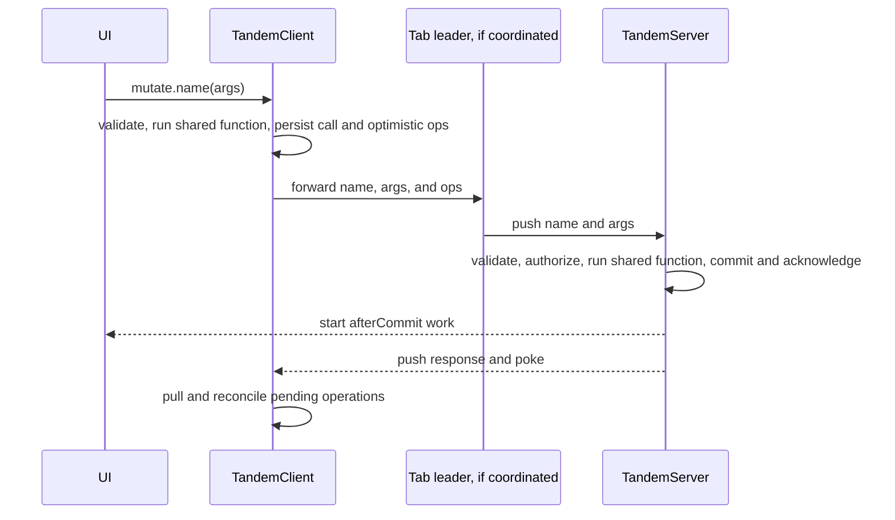

# Shared custom mutations

Status: implemented in draft PR #74. This spec describes the final API and the current replay limit.

## Problem overview

A raw operation push describes record changes but cannot express why they occurred. Apps that need authorization and server work after a commit otherwise have to inspect operations in transport code. Streaming chat also needs each model delta appended without starting another response.

## Solution overview

A shared mutator owns transactional database logic. Both the client and server import it. The client runs it optimistically and persists its name, JSON arguments, and recorded operations; the server validates the arguments and runs the shared function again. The server registration can add `authorize` and `afterCommit` next to that definition. Only the server can run the hooks.

```ts
// shared/mutations.ts
export const appendReply = defineMutator(schema, {
  args: z.object({ id: z.string(), text: z.string() }),
  run: async (tx, { id, text }) => {
    const message = await tx.get("messages", id)
    if (message) tx.set("messages", { ...message, text: message.text + text })
  },
})

export const mutators = { appendReply }

// server constructor
const tandem = new TandemServer({
  schema,
  relations: {},
  storage,
  mutators,
  hooks: (session: Session | undefined) => ({
    appendReply: {
      authorize: async (tx, { id }, ctx) => {
        const reply = await tx.get("messages", id)
        if (ctx.source === "client" &&
            !session?.threads.includes(reply?.threadId ?? ""))
          throw new Error("No access")
      },
      afterCommit: ({ id }) => notifyReply(id),
    },
  }),
})
await tandem.push(request, { context: authenticatedSession })
await tandem.mutate("appendReply", { id: replyId, text: delta })

// client
const client = new TandemClient({ schema, mutators, remote })
await client.ready
await client.mutate.appendReply({ id: replyId, text: "Hello" })
```

`defineMutators(schema, { name: { args, run } })` remains the compact form for a module with several definitions. `defineMutator` gives a separate file the same inferred transaction and argument types. Both definitions reject `authorize` and `afterCommit`, including hooks supplied by a spread. The constructor retains the shared registry type and copies only `authorize` and `afterCommit` from the hook map; hooks cannot replace `run`.



A rejected call is acknowledged without its writes. The client call rejects with `MutationRejectedError`, and a confirming pull removes its optimistic result. Raw operation pushes are refused when server mutators are supplied unless `allowOps: true` is set.

## Goals

- Shared, typed transactional logic and typed optimistic client calls.
- Request authorization before commit with transaction reads and session data.
- Best effort effects after a successful server commit, deduplicated across retried pushes in one server process.
- Named get/set append for server streams with derived compact delta pokes.
- Named calls survive client storage and coordinated tab forwarding.

## Limits

- A pending client mutation replays its recorded operations after a pull; Tandem does not rerun its function on rebase. The shared get/set mutator records a full set operation. Its optimistic value can temporarily cover a newer live append until confirmation. The server runs each named call against its current value in the serialized queue and supplies the final authoritative text.
- `afterCommit` is best effort and in memory. A crash after commit can lose an effect. A durable record and startup recovery remain the app's responsibility for work that must finish.
- A lost push response can reject a call even though its server transaction committed. Retry deduplication prevents repeating its writes or effect.

## ✅ Phase 1: Shared client definitions

**Today**

Clients can commit raw operations without a named business action.

**Proposed**

A shared definition validates JSON arguments, runs against typed collection operations, and records the call beside the optimistic operations.

```changes
4847cd4
```

```callstack
 TandemClient.mutate.name [[4847cd4:packages/core/src/TandemClient.ts#L291-L353]]
+├── validateMutatorArgs [[4847cd4:packages/core/src/mutator/Mutator.ts#L149-L174]] # validate the copied arguments
+├── clientMutatorTransaction [[4847cd4:packages/core/src/mutator/Mutator.ts#L176-L204]] # adapt synchronous reads and writes
+└── SyncEngine.commit [[4847cd4:packages/core/src/sync/SyncEngine.ts#L558-L592]] # persist name, arguments, and recorded writes
```

```ts
const args = await validateMutatorArgs(name, definition.args, copiedInput)
const tx = client.transact()
await definition.run(clientMutatorTransaction(tx), args, { location: "client" })
await syncEngine.commit(tx, { name, args: copiedInput })
```

## ✅ Phase 2: Server hooks and direct calls

**Today**

A push of raw writes cannot authorize a business action or start work after it commits.

**Proposed**

The server validates and authorizes the named call, always runs the shared function, commits it with the acknowledgement, then starts the registered effect. Direct server calls use the same execution and hooks.

```changes
4847cd4
```

```callstack
 TandemServer.push [[4847cd4:packages/server/src/TandemServer.ts#L433-L447]]
+└── applyMutator [[4847cd4:packages/server/src/TandemServer.ts#L635-L691]]
+    ├── authorize # read the transaction and request session
+    ├── run # execute shared database logic
+    ├── commitTransaction # commit writes and acknowledgement together
+    └── runEffect # start best effort work after commit
 TandemServer.mutate [[4847cd4:packages/server/src/TandemServer.ts#L373-L414]]
+└── run shared definition and hooks # server owned streaming call
```

```ts
const authorized = await definition.authorize?.(tx, args, context)
if (authorized instanceof Error) return authorized
const result = await definition.run(tx, args, context)
if (result instanceof Error) return result
const committed = await commitTransaction(tx)
if (committed instanceof Error) return committed
if (definition.afterCommit) runEffect(() => definition.afterCommit!(args, context))
```

## ✅ Phase 3: Coordinated tabs and named append

**Today**

A tab leader forwards operations.

**Proposed**

The tab protocol retains name and arguments across encoding, outbox persistence, handoff, and leader receipts. Shared get/set code runs on the client and server. The server derives live append deltas from committed before and after records.

```changes
4847cd4
```

```callstack
 TabSession.commit [[4847cd4:packages/core/src/tabs/TabSession.ts#L129-L144]]
+├── TabCodec.encodeMutation [[4847cd4:packages/core/src/tabs/TabProtocol.ts#L76-L105]] # keep the named call
+└── TabHub.commit [[4847cd4:packages/core/src/tabs/TabHub.ts#L385-L457]] # forward it to SyncEngine
 TandemServer.commitTransaction [[packages/server/src/TandemServer.ts#TandemServer.commitTransaction]] # infer lossless append deltas from final writes
```

```ts
const mutation = { id, ops, mutator: { name, args } }
leader.syncEngine.commit(replayOps(mutation.ops), mutation.mutator, tabReceipt)
```

## ✅ Phase 4: Consumer and simulation verification

**Today**

The exploratory agent chat manually filters operations and writes full reply snapshots. DST generates only raw client mutations.

**Proposed**

The chat example starts one response from `sendMessage.afterCommit` and invokes `appendReply` for every text delta. DST generates named appends, traces and replays them, and checks final server/client text and effect repetition under network faults and crashes.

```changes
4847cd4
```

```callstack
 ChatServer.startReply [[4847cd4:examples/agent-chat/apps/server/test/AgentChatMutators.e2e.spec.ts#L176-L184]]
+└── ChatServer.streamReply [[4847cd4:examples/agent-chat/apps/server/test/AgentChatMutators.e2e.spec.ts#L185-L232]]
+    └── TandemServer.mutate(appendReply) # one named append per delta
 DstSimulation.choose [[4847cd4:dst/DstSimulation.ts#L154-L284]]
+└── DstWorld.writeNamedAppend [[4847cd4:dst/DstWorld.ts#L1288-L1321]] # exercise the public client call
```

```ts
for await (const delta of result.textStream)
  await tandem.mutate("appendReply", { id, text: delta })
```

## ✅ Phase 5: Offset page scan-window repair

**Today**

A sole offset subscription can cache only the requested page. The local query applies the offset again and returns an empty result. This pre-existing defect also fails the scoped CI sweep.

**Implemented**

Pull scan windows include the matching prefix through `offset + limit`; the client applies the original query to those records. Live-poke membership still uses the requested page and offset shifts trigger a pull without sending prefix details. DST keeps a broad offset subscription in scoped sweeps and asserts the nonempty page through the public client API.

```changes
78e0ad4
```

```callstack
 TandemServer.readPull [[78e0ad4:packages/server/src/TandemServer.ts#L768-L785]]
+└── executeScanWindowAsync [[78e0ad4:packages/core/src/query/executeQuery.ts#L607-L620]]
+    └── collectScanWindow → windowQueryPrefix [[78e0ad4:packages/core/src/query/executeQuery.ts#L546-L601]] # include rows before the offset
 TandemServer.emitLivePokes [[78e0ad4:packages/server/src/TandemServer.ts#L923-L956]]
+├── selectScanWindowRecordsAsync [[78e0ad4:packages/core/src/query/executeQuery.ts#L640-L677]] # check the original page
+└── pokeClient # ask the client to pull when an offset page shifts
```

## ✅ Phase 6: Optional-string named append parity

**Today**

The earlier built-in append adapter needed parity for absent optional strings; the current shared get/set mutator handles this in app code.

**Implemented**

The shared mutator validates arguments, reads the record, and uses `(record.note ?? "") + text` on both client and server. A public `client.mutate.appendNote` test holds the push to verify the optimistic value before checking the server result and malformed numeric-text rejection. DST generates optional-field named appends and replays their traces under network faults and crashes.

```changes
be69e2e
```

```callstack
 TandemClient.mutate.appendNote [[be69e2e:packages/server/test/Mutators.spec.ts#L222-L258]]
+└── shared appendNote.run # validate arguments, read optional note, set the extended record
 DstSimulation.choose [[be69e2e:dst/DstSimulation.ts#L279-L301]]
+└── DstWorld.writeNamedAppend [[be69e2e:dst/DstWorld.ts#L1300-L1334]] # exercise note appends through the public client API
```

## ✅ Phase 7: App-defined append and derived live deltas

**Today**

The built-in append method stages changes separately from ordinary transaction writes.

**Implemented**

The built-in transaction append method and staging are removed. Shared named mutators append with `get` and `set`; the server reads each before image inside its commit queue and compares it with the final write. It emits compact deltas only when every changed field is a string extension and the suffix round trips through the collection codec. It sends a full set for new records, replacements, metadata changes, uncertain object equality, and codecs that cannot encode a suffix. Existing revision guards, visibility checks, and batching remain in the live-poke path.

```changes
2e27e75
```

```callstack
 TandemServer.commitTransaction [[2e27e75:packages/server/src/TandemServer.ts#L908-L1044]]
+├── read committed before images # compare against final transaction writes
+├── appendedFields # retain only lossless string extensions
+└── emitLivePokes # send a guarded append or full set
```

## ✅ Phase 8: Typed constructor registration and streaming paths

**Today**

Each push supplies a server mutator registry, and direct mutation requires the registry again. Hook args need an explicit `ServerMutatorsFor` assertion.

**Implemented**

The server constructor registers shared definitions once. Its hooks factory receives the trusted context supplied with each push, and `ServerMutatorHooks` infers args and transaction schema from the shared registry. Direct `mutate(name, args)` retains name and argument types. The server assigns client or server origin internally. The guide shows browser client streaming, server-hosted client streaming through sync, and direct server mutation.

```changes
0321658
```

```callstack
 TandemServer.push [[0321658:packages/server/src/TandemServer.ts#L551-L573]]
+└── registered # combine the shared definition with request-local hooks
    └── applyMutator # validate, authorize, commit, and start effect
 TandemServer.mutate [[0321658:packages/server/src/TandemServer.ts#L493-L540]]
+└── registered # direct call uses the constructor registry and server origin
```

```ts
const server = new TandemServer({ schema, relations, storage, mutators,
  hooks: (session: Session | undefined) => ({
    appendReply: { authorize: (tx, args, ctx) => checkAccess(tx, args, ctx, session) },
  }),
})
await server.push(request, { context: authenticatedSession })
await server.mutate("appendReply", { id, text: delta })
```

## References

- [Agent chat guide](../docs/agent-chat.md)
- [Append and batching](append-and-batching.md)
- [Deterministic simulation testing](deterministic-simulation-testing.md)
