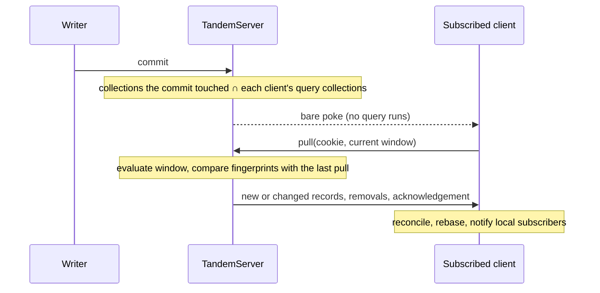

# Query and subscription efficiency

Tandem targets small apps: about ten simultaneous clients with around 500 records each. This spec makes sync cheaper at that size without changing the sync contract. Pulls still reconcile authoritative state, acknowledge mutations, update cookies and revisions, and rebase pending writes. Streaming text still shows at once.

## Problem overview

Four costs grow with the data rather than with what changed.

Subscription removal does not reach the server. `SyncEngine.subscribe` splices its query out of the window, but no pull follows, so the server keeps sending records for a page the user left. A repeated `destroy` splices index `-1`, which removes the last, unrelated query.

```callstack
 TandemClient.subscribe [[packages/core/src/TandemClient.ts#TandemClient.subscribe]]
 └── SyncEngine.subscribe [[packages/core/src/sync/SyncEngine.ts#SyncEngine.subscribe]]
     ├── scanWindow.push(query); queuePull()
     └── destroy → scanWindow.splice(indexOf(query), 1)   # no pull; indexOf -1 removes the last query
```

Every pull resends the whole window. `TandemServer.readPull` evaluates every query and returns every matching record, even when nothing changed since the client's last pull.

```callstack
 TandemServer.readPull [[packages/server/src/TandemServer.ts#TandemServer.readPull]]
 ├── executeScanWindowAsync          # reads every collection the window names
 └── patch.set = every record        # resent on each pull
```

Every commit runs every client's queries. `emitLivePokes` calls `selectScanWindowRecordsAsync` for each client, which rereads whole collections whenever a window has a limit, offset, or include.

```callstack
 TandemServer.commitTransaction [[packages/server/src/TandemServer.ts#TandemServer.commitTransaction]]
 └── emitLivePokes [[packages/server/src/TandemServer.ts#TandemServer.emitLivePokes]]
     └── for each client: bufferLiveChanges
         └── selectScanWindowRecordsAsync [[packages/core/src/query/executeQuery.ts#selectScanWindowRecordsAsync]]   # full window read per client per commit
```

Every query scans whole collections. `executeQuerySync` and `executeQueryAsync` load each collection the query names once, then filter the loaded target collection again for every parent row of an include.

```callstack
 executeQueryAsync [[packages/core/src/query/executeQuery.ts#executeQueryAsync]]
 ├── loadRecordsAsync                 # scan ["record", collection] for each collection
 └── executeLoadedQuery [[packages/core/src/query/executeQuery.ts#executeLoadedQuery]]
     └── per parent row: filter the whole target collection
```

## Solution overview



Streaming keeps its shortcut. When a commit only appends text to a string field the client already has, and that field cannot change which records the client's queries select or how they order them, the server sends the existing compact append payload. The quiet-period pull still confirms it.

```mermaid
sequenceDiagram
	participant R as Reply loop
	participant S as TandemServer
	participant C as Viewer
	R->>S: commit text append
	Note over S: field outside every where, order, and join of the client's queries;<br/>before-image matches what the client has
	S-->>C: append payload (batched each 50 ms)
	Note over C: show text now; pull after 200 ms quiet or 1 s
	C->>S: pull confirms
```

Queries read less. A full ID becomes a key read, includes read their targets once per query, and schema-declared indexes serve equality, range, and ordered-limit reads. Every plan falls back to the existing scan when it cannot prove the same result.

## Goals

- Adding or removing a subscription reaches the server promptly, including an empty window. Destroying one subscription never removes another.
- An ordinary commit runs no client query, scan, or page read to decide whom to poke. Clients whose queries read an affected collection get a bare poke; false positives within a collection are accepted.
- A pull with a recognized cookie returns only records that are new to the view or changed since the last pull, plus removals. A pull with nothing new returns an empty patch and still acknowledges mutations.
- Streaming appends stay compact, batched, and immediate, and never reveal text from a record whose membership or order might have changed.
- Queries with a full ID, ID-targeted includes, or a usable index avoid whole-collection reads on the client and the server, with identical results.

## Non-goals

- Exact affected-query or affected-client routing, reverse record-to-client maps, or a query invalidation compiler.
- Authoritative complete-view pokes, per-poke cookies, or pushed acknowledgements.
- Persisting views, distributed coordination, or more than one remembered pull per client. Unknown or stale cookies reset, as today.
- Skipping the read on pull. `storage.subscribe` does not promise to report every outside write, so each pull reads storage.
- Faster JSON file storage. Narrow reads still go through an adapter that parses and rewrites its whole file.
- A Postgres package, new database backends, or schema migrations for prerelease data.

## Implementation

### Phase 1: Subscription lifecycle

Subscriptions become handles, so removal is exact and idempotent, and both additions and removals queue a coalesced pull that carries the current list.

```callstack
 TandemClient.subscribe → destroy [[packages/core/src/TandemClient.ts#TandemClient.subscribe]]
 └── SyncEngine.subscribe [[packages/core/src/sync/SyncEngine.ts#SyncEngine.subscribe]]
-    └── scanWindow.splice(indexOf(query), 1)
+    ├── subscriptions.delete(handle)      # false on a second call: nothing else happens
+    └── queuePull()                       # TaskQueue coalesces with other pulls
 SyncEngine.pullFromRemote
-└── scanWindow: [...this.scanWindow]
+└── scanWindow: distinct encoded queries of the live handles, possibly []
```

The tab leader already keeps one engine subscription per distinct query of each tab session ([[packages/core/src/tabs/TabHub.ts#TabHub.subscribe]]), so its window stays the union of tab windows, and a tab's removal now reaches the server too. Pruning goes through the existing pull: a removal patch for a record with a pending write updates its base and replays the write.

- [x] `SyncEngine.subscribe` returns a handle-bound unsubscribe that queues a pull.
- [x] Tests: page change, empty window, duplicate and repeated destroy, change during an in-flight pull, pending writes outside every query, shared tabs.
- [x] DST: settled replicas must hold exactly the records their subscriptions cover (`replicaWindow`).

### Phase 2: Changed-only pulls

The server remembers one view per client from its last pull: each record's key and a fingerprint of its value, with the cookie. A recognized cookie gets the records whose fingerprint is new or different, and removals for keys no longer in view. Anything else resets with every matching record, as today.

```callstack
 TandemServer.readPull [[packages/server/src/TandemServer.ts#TandemServer.readPull]]
 ├── executeScanWindowAsync                       # still reads storage on every pull
+├── fingerprint each record
-├── patch.set = records
+├── patch.set = records whose key is new or fingerprint changed   # all on reset
 └── remove = previous keys not in view
```

```
fingerprint(value) = SHA-256(canonical(value))
canonical: tagged, length-prefixed encoding; object keys, Map entries, and Set
           members sorted; Date, Uint8Array, bigint, -0, and NaN distinguished;
           other values (class instances, cycles) have no fingerprint and resend
```

The client already handles partial patches: records absent from the patch keep their confirmed value, and a live value at or below the pull's revision falls back to its base, which is the last pulled value. A record that changed since that pull has a new fingerprint and arrives in the patch.

A restarted client must not diff against a saved replica. A crashed instance's save can land after the next instance loads, so the saved replica may not match the view its saved cookie names. Hydration drops the saved cookie, and the first pull after a restart is a reset ([[packages/core/src/Database.ts#Database.loadFromStorage]]).

- [x] `recordFingerprint` in the server package: a synchronous SHA-256, because Web Crypto resolves on a thread pool and broke deterministic simulation.
- [x] `SyncClientState` keeps `view: Map<recordId, { key, fingerprint }>` instead of `syncedRecords`.
- [x] Hydration drops the saved cookie.
- [x] Tests: changed-only patch, no-op pull with an acknowledgement, first pull and reset, new, removed, and overlapping subscriptions, stale cookie after a dropped response, server restart, direct storage writes without notification, runtime and codec values, a 500-record edit, and a reopened client whose saved replica lost a record.
- [x] DST counts partial and unchanged pull patches.

### Phase 3: Collection pokes and preserved streaming

At pull time the server stores the client's queries and the set of collections they read, including every nested include. After a commit it intersects the commit's collections with each client's set and sends bare pokes. No query runs.

```callstack
 TandemServer.commitTransaction
 └── emitLivePokes
-    └── selectScanWindowRecordsAsync per client
+    ├── dependent = client.collections ∩ changed collections
+    ├── append-only, safe, client not invalidated → buffer append payload
+    └── otherwise → flush buffered payload, bare poke, mark invalidated until next pull
```

An append is safe for a client when all of these hold:

```
safeAppend(client, record, fields, before):
  client pulled since the last poke it was sent for another change
  client has the record: its last known fingerprint == fingerprint(before)
  no appended field is a where, order, or join field of any query node on the record's collection
```

The pusher still gets a bare poke at once for its acknowledgement, with any safe appends flushed first. Storage notifications without detail poke every client, as today.

- [ ] Query metadata helper: collections and sensitive fields per collection, from normalized queries.
- [ ] Replace per-commit window reads in `emitLivePokes`.
- [ ] Tests: two clients with different collections, related-collection changes, latest-50 page, append to a filtered or ordered string field, agent-chat stream stays compact, pusher acknowledgement, lost and reordered pokes.

### Phase 4: Query planner and narrow reads

One executor serves the client's synchronous reads and the server's asynchronous reads. It plans each query node: a full `id` equality becomes a key read; a many-to-one include gathers distinct target IDs and reads them by key; a one-to-many include loads its target candidates once and groups them by the join field. Unplannable nodes scan as today.

Equality in `where` becomes strict: primitives compare with `===`, objects and arrays structurally. The current loose comparison matches `0` with `""` and `"5"` with `5`, which typed queries cannot ask for and no key or index read can reproduce.

- [ ] Shared generator-based executor with sync and async drivers.
- [ ] Key reads for full IDs, including compound IDs; batched include reads.
- [ ] Reference comparison tests and counting-storage tests.

### Phase 5: Index schema and write lifecycle

Collections declare indexes. Tandem writes index tuples with record writes in the same tuple commit, on the server through the app's storage adapter and on the client in memory, rebuilt on hydration.

- [ ] `collection(..., { indexes })` and typing.
- [ ] Index tuples `["index", collection, name, ...values, ...id]` maintained by a tuple-database wrapper around commit.
- [ ] Server index metadata: rebuild on definition change, after storage notifications, and through `TandemServer.rebuildIndexes()` after unnotified outside writes.
- [ ] Adapter typing and docs.

### Phase 6: Indexed execution

The planner uses an index whose leading fields match equality clauses, then a range or the first order field. Range and order use the index only when every entry under the equality prefix has the same comparable type (two one-entry reads check the first and last). Ordered limits stop after offset plus limit qualifying rows and the rest of their tie group. Mixed directions, mixed types, and residual-only plans fall back.

- [ ] Index selection and scans.
- [ ] Reference comparison tests across filters, order, limits, offsets, mixed values, compound IDs, relations, writes, rebase, and hydration.
- [ ] Counting-storage proof for 10 clients x 500 records and a larger dataset.

## References

- [`packages/core/src/sync/SyncEngine.ts`](../packages/core/src/sync/SyncEngine.ts) owns the client's subscriptions, pulls, and pokes.
- [`packages/server/src/TandemServer.ts`](../packages/server/src/TandemServer.ts) owns per-client views, pulls, and live payloads.
- [`packages/core/src/query/executeQuery.ts`](../packages/core/src/query/executeQuery.ts) executes queries and scan windows.
- [`specs/append-and-batching.md`](append-and-batching.md) describes append payloads and batching.
- [`specs/authoritative-storage-sync.md`](authoritative-storage-sync.md) describes storage notifications.
