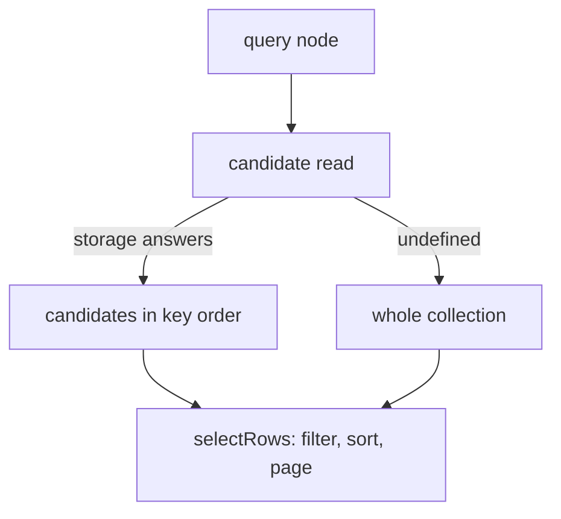

# Queries in SQL with native indexes

## Problem overview

`TandemServerSqlStorage` maps records onto application tables, but every query read the whole table. The query engine asked storage for a collection scan, the adapter ran `select * from table`, decoded every row, and the engine filtered, sorted, and paged the decoded records in JavaScript.

```callstack
 TandemServer.query / pull / subscribe
 └── executeQueryAsync / executeScanWindowAsync
     └── rootCandidates                     # no full-ID filter
         └── scanCollection                 # whole collection
             └── TandemServerSqlStorage.scan
                 └── select * from "messages"
```

A thread page of 50 messages read every message in the database. Indexes the application created on its tables went unused, and one-to-many includes read the whole target table too.

## Solution overview

The query engine asks storage for a node's candidates: a superset of the rows the node could return, in key order. Storage that cannot answer returns `undefined` and the engine scans as before. The engine still filters, sorts, and pages the candidates, so SQL only has to be right about which rows it leaves out.



`TandemServerSqlStorage.readCandidates` translates the clauses it can decide exactly:

```
readCandidates(read):
  mysql                                      -> undefined
  where clauses SQL decides exactly          -> WHERE (others dropped: superset)
  every clause pushed, leading number order  -> ORDER BY prefix LIMIT offset+limit
                                                + rows tied with the last row
  join (one-to-many include)                 -> col IN (parent values), chunked to the bind budget
  WHERE values alone exceed the bind budget  -> undefined
  nothing narrows the read                   -> undefined
```

The tie read keeps paging exact. SQL picks the top rows by the leading number fields, but Tandem breaks ties by record key in UTF-16 order, which SQL does not share. Reading every row tied with the boundary row gives the engine all rows it could choose between.

## Goals

- Run `server.query`, `server.subscribe`, and sync pulls through SQL with the application's own indexes.
- Return exactly what whole-table reads return, including ties, offsets, includes, Unicode, `NaN`, and hostile scan windows.
- Keep core free of SQL; keep non-SQL storage and clients unchanged.
- Measure latency, rows read, and how many indexes a workload needs.

## Non-goals

- Change feeds, durable acknowledgements, retries, and Tandem-managed tuple indexes (PRs 99 and 100).
- Creating indexes or tables. Indexes are application DDL.
- MySQL query translation.
- Per-parent limits inside includes.

## Implementation

### Phase 1: Candidate reads and their SQL translation

The planner yields a candidate read where it used to scan, and the async driver sends it to an optional storage method. The SQL adapter answers with parameterized SQL over declared fields. Status: committed on `michael/sql-query-pushdown`.

```callstack
 TandemServer.query / pull / subscribe [[dedb712fbc..7f300fc8b3:packages/server/src/TandemServer.ts#L703]]
 └── runAsync [[dedb712fbc..7f300fc8b3:packages/core/src/query/executeQuery.ts#L382]]
-    └── reader.scan(prefix)
+    ├── reader.scan(prefix, limit 0)         # registers subscription and conflict reads; no rows
+    └── candidates(read) [[dedb712fbc..7f300fc8b3:packages/core/src/query/executeQuery.ts#L410]]
+        └── TandemServerSqlStorage.readCandidates [[dedb712fbc..7f300fc8b3:packages/server/src/storage/TandemServerSqlStorage.ts#L207]]
+            ├── condition                    # exact comparisons only [[dedb712fbc..7f300fc8b3:packages/server/src/storage/TandemServerSqlStorage.ts#L340]]
+            └── readMatches                  # NaN probe, top rows, tied rows [[dedb712fbc..7f300fc8b3:packages/server/src/storage/TandemServerSqlStorage.ts#L269]]
```

Subscriptions on the server use tuple-database's read tracking. The candidate read first scans the collection with `limit: 0`, which registers a listener on the collection and reads no rows: `TandemServerSqlStorage.scan` returns `[]` for it without SQL. Queries inside `server.transact()` never pass `readCandidates`, so they see staged writes and keep conflict tracking.

What SQL decides, and why the rest stays in JavaScript:

| Clause | SQL | Reason |
| --- | --- | --- |
| `=` string | yes, `collate binary` on SQLite | lone surrogates and NUL excluded: drivers replace or truncate them |
| `=` number, ranges on numbers | yes, finite only | D1 binds `Infinity` as NULL; Postgres parameters cast to `bigint` or `double precision` |
| `=` boolean | yes | 0/1 on SQLite, `boolean` on Postgres |
| string ranges and order | no | Tandem compares UTF-16 code units; SQL collations do not |
| fields without a column | no | codecs and explicit mappings may store other values |
| Postgres `NaN` | handled | `>` excludes it, `<=` includes it; a probe drops LIMIT if an order field holds it |
| NULL in `nullable` fields | handled | ties like `NaN`: `gte`/`lte` add `is null`; the probe also checks `is null` |
| operators, directions, field names | whitelist, own properties | scan windows come from clients |
| limits and offsets | offset, limit, and their sum non-negative safe integers | other pages, such as offset -5, stay in the query engine, which slices them as arrays do |
| unknown collections | `undefined` | scans already read nothing for them |
| bound values | `maxParameters`: 100 on D1, 999 other SQLite, 65,535 otherwise | each statement reserves WHERE plus limit or tie values; joins chunk; filters that do not fit scan |

```changes
dedb712fbc..7f300fc8b3
```

DST used to wrap SQL storage in a class that forwarded only `scan` and `commit`, so its SQL seeds never reached SQL reads. The wrapper now forwards `readCandidates`, and `dst/sql.spec.ts` runs scoped views on PGlite and `node:sqlite` with declared fields and indexes.

```callstack
 DstWorld.start
 └── new DstServerStorage(external)
+    └── readCandidates = external.readCandidates [[dedb712fbc..7f300fc8b3:dst/DstWorld.ts#L166]]
```

- [x] `CandidateRead` and `readCandidates` in `packages/core/src/query/executeQuery.ts`; optional `readCandidates` on `TandemServerStorageApi`.
- [x] SQL translation, `fields` on `TandemSqlTable`, inferred fields for schema mappings without a codec.
- [x] Independent review fixes: own-property field lookup, unknown collections, client limits, nullable fields, Postgres column-type docs.
- [x] Limits only for pages that count leading rows, with `server.query` differential coverage for negative, fractional, NaN, and huge pages.
- [x] Bind budget (`maxParameters`), with a regression through a D1 binding that rejects more than 100 values, 150 parents, and a nested WHERE.
- [x] Differential tests against whole-table reads on node:sqlite, D1, PGlite, and Postgres 16 (`packages/server/test/SqlQueryPushdown.spec.ts`).
- [x] DST forwards the capability; seeds 1-40 pass on both dialects.
- [x] `docs/sql.md` describes what runs in SQL and how to choose indexes.

### Phase 2: Benchmark and report

`packages/server/benchmarks` seeds the same rows into SQLite and Postgres and times `TandemServer.query` under whole-table reads and SQL reads with 0, 1, and 2 secondary indexes, in shuffled rounds. A second script times initial sync and author-to-viewer updates for 5 and 10 in-memory clients. Status: committed on `michael/sql-query-pushdown-benchmark` and run on 2026-11-06; the full report and raw data stay on the VM, and the PR summarizes them.

At 100,000 messages, an indexed thread page took 0.4 to 1.9 ms against 0.8 to 1.1 s for whole-table reads, on SQLite and Postgres. One composite index, `messages (threadId, createdAt)`, served five of seven workloads; a second, `messages (createdAt)`, helped only the two queries with no thread filter. Paged client sync with 10 clients at 10,000 rows decoded 2,200 rows during updates instead of about one million. With the clients' sync interval at 0, paged updates took 17.8 ms against 854.4 ms on SQLite and 36.8 ms against 868.7 ms on Postgres; the original matrix used the 150 ms default, which hid most of that difference. Every sample matched whole-table reads. The query and original sync matrices ran at `0a4bd73` and the zero-interval controls at `1bfcbbd`; the later page check and bind budget commits change none of the SQL statements the workloads issue, and the budget check adds planning work that was not timed separately.

```changes
7f300fc8b3..f30a76565f
```

- [x] `sqlQueries.ts`, `sqlSync.ts`, `sqlBenchmarks.ts`, `sqlWorkload.ts`.
- [x] Full run, report, and served results.
- [x] `sqlSync.ts` takes the sync interval (default 0) and bounds waits; zero-interval controls at 10,000 rows and 10 clients on both databases.

## References

- [`packages/core/src/query/executeQuery.ts`](../packages/core/src/query/executeQuery.ts) — the query planner and its drivers.
- [`packages/server/src/storage/TandemServerSqlStorage.ts`](../packages/server/src/storage/TandemServerSqlStorage.ts) — the SQL adapter.
- [`docs/sql.md`](../docs/sql.md) — user docs for SQL storage.
