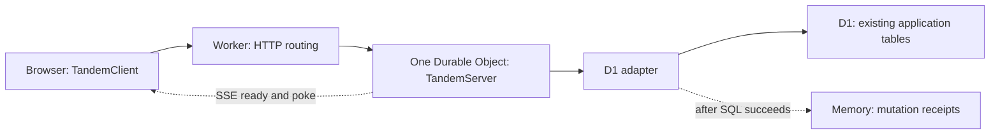
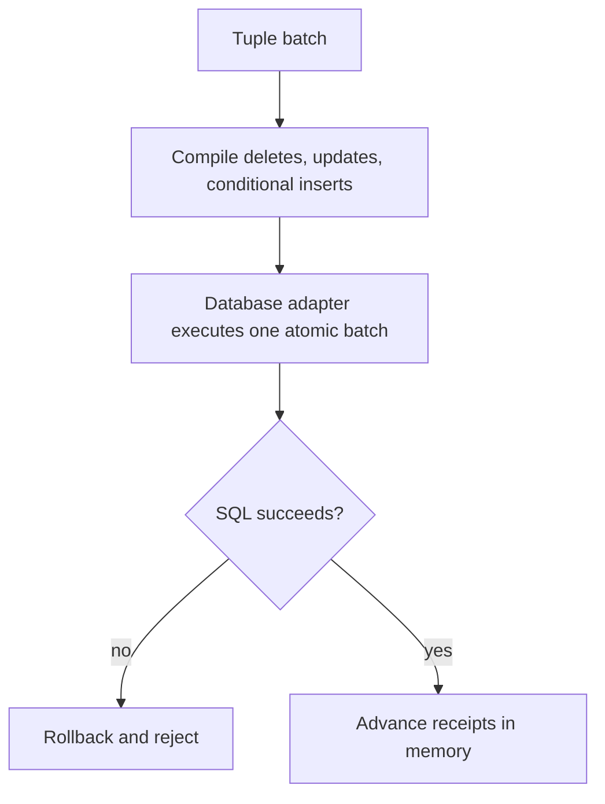
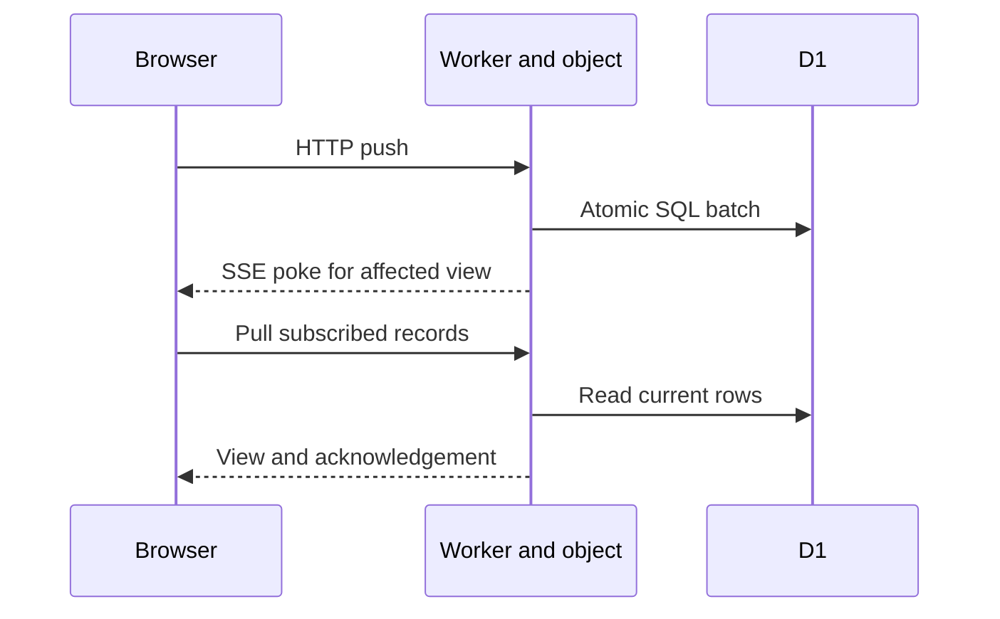

# Tandem SQL storage and Cloudflare sync

## Problem overview

Applications already own SQL tables, drivers, and HTTP routes. Tandem needs to sync those records without requiring a second application schema or hand-written SQL execution callbacks. [PR #91](https://github.com/tanishqkancharla/tandem/pull/91) supplies the storage adapters; [PR #92](https://github.com/tanishqkancharla/tandem/pull/92) supplies the Cloudflare example and guides.

## Solution overview

Use the same runtime schema on the client and server, then pass it and a database handle to the adapter:

```ts
const schema = defineSchema({
  tasks: collection({ id: t.id(), text: t.string(), done: t.boolean() }),
})
const storage = new TandemServerD1Storage({ schema, database: env.DB })
// Other hosts use TandemServerPostgresStorage or TandemServerMysqlStorage.
```

Collection names match table names, fields match columns, and the scalar primary key is `id`. A tuple remains an internal address, with no extra SQL columns:

```ts
// Internal address and domain record:
["record", "tasks", "task-123"]
{ id: "task-123", text: "Buy milk", done: false }
// Existing D1 row in tasks(id, text, done):
{ id: "task-123", text: "Buy milk", done: 0 }
```

The adapter translates that address and converts boolean values. Application records live in SQL; mutation receipts remain in memory until durable protocol state becomes a separate change.



## Goals

- Reuse runtime collection definitions for ordinary tables.
- Supply D1, PostgreSQL, and MySQL execution and atomic writes inside adapters.
- Preserve app-owned columns and keep database lifetime under the app's control.
- Retain the explicit mapping API for custom layouts, types, and compound IDs.
- Demonstrate one D1 database, one Durable Object, HTTP, and SSE.

## Non-goals

- Durable acknowledgement tables or restart-safe pending mutation recovery.
- General SQL query pushdown, external-write notifications, or tenant routing.
- Database migrations, WebSockets, or an R2 adapter.

## Implementation

### ✅ Phase 1: Reuse schemas and database handles — PR #91

Today

The original server storage contract accepts ordered tuple scans and write batches. The first SQL implementation made every application supply table mappings, row execution, and atomic commit callbacks, even for matching names and ordinary fields.

Proposed

Derive those mappings from runtime field definitions and supply database-specific adapters. Keep explicit mapping and execution available for custom schemas or drivers.

```changes
2016e73..d286e1b
```

The simple constructor accepts a runtime schema and an existing database handle. The concrete handle is a D1 binding, a `pg` pool, or a `mysql2` callback pool:

```ts
type StorageOptions<Schema, Database> = {
  schema: RuntimeSchemaDefinition<Schema>
  database: Database
}
type Statement = { sql: string; parameters: readonly unknown[] }
type D1DatabaseCapabilities = {
  prepare(sql: string): {
    bind(...parameters: unknown[]): PreparedStatement
    all(): Promise<{ results: Record<string, unknown>[] }>
  }
  batch(statements: PreparedStatement[]): Promise<unknown>
}
```

The [D1 contract](https://github.com/tanishqkancharla/tandem/blob/d286e1b/packages/server/src/storage/TandemServerD1Storage.ts) stays structural, so it accepts Cloudflare's existing binding. PostgreSQL and MySQL reuse Kysely's existing pool interfaces and drivers.

```callstack
 new TandemServerD1Storage [[d286e1b:packages/server/src/storage/TandemServerD1Storage.ts#L22-L43]]
+├── supply D1 reads and atomic batches inside the adapter
 └── new TandemServerSqlStorage [[d286e1b:packages/server/src/storage/TandemServerSqlStorage.ts#L114-L134]]
-   └── require mappings for every collection
+   └── tablesFromSchema [[d286e1b:packages/server/src/storage/TandemServerSqlStorage.ts#L267-L329]]
+      ├── derive matching table, id, and column names
+      └── convert supported field values
```

Runtime shapes retain types that TypeScript erases. The default mapping uses those shapes, omits undeclared app columns, and rejects collections that only supply field names:

```ts
function tablesFromSchema(schema, dialect, overrides) {
  for (const [name, collection] of schema.collections) {
    if (overrides[name]) use(overrides[name])
    else {
      requireSupportedScalarShape(collection.shape)
      use({
        table: name,
        idColumns: ["id"],
        encode: record => declaredFields(record, {
          boolean: value => dialect === "postgres" ? value : Number(value),
        }),
        decode: row => declaredFieldsWithTypeChecks(row, {
          boolean: value => value === 0 || value === 1 ? value === 1 : value,
        }),
      })
    }
  }
}
```

Reads constrain shared ID prefixes in SQL, then use a temporary tuple view to apply exact ordering, remaining bounds, and limits. General filters and relations still run in Tandem's query engine; large scans can require substantial memory.

```ts
async function scan(bounds) {
  const view = temporaryTupleView(clientReceipts)
  for (const table of matchingTables(commonPrefix(bounds))) {
    const rows = await query(compileSelect(table, bounds.idPrefix))
    for (const row of rows) {
      const record = table.decode(row)
      view.set(["record", table.collection, ...idParts(record.id)], record)
    }
  }
  return view.scan(bounds)
}
```

Writes update mapped columns by primary key, then insert only if that key is absent. This preserves required app-owned columns on existing rows and lets secondary unique conflicts fail without modifying another record.



D1 uses its native batch API. PostgreSQL and MySQL execute bound statements within Kysely's transaction on one pooled connection:

```ts
async function commit(statements) {
  await database.transaction().execute(async transaction => {
    for (const statement of statements)
      await transaction.executeQuery(statement)
  })
}
// Only after that succeeds:
clientReceipts.apply(writes.clientReceipts)
```

Kysely supplies the dialect compilers and the pool drivers; Tandem supplies no custom SQL grammar. Closing storage leaves app-owned database handles open. Custom drivers can still use the low-level `{ dialect, schema, tables?, query, commit }` contract; explicit mappings support compound keys and custom codecs.

Validation passed 25 focused cases across local D1, PGlite, live PostgreSQL 17, and MySQL 8.4. The full default server suite passed 95 tests; live pool cases run when their connection URLs are set. All 145 simulation tests passed, including five SQL-backed fault/crash seeds and exact replays that now exercise default mappings for projects and comments.

### ✅ Phase 2: Host sync on Cloudflare — PR #92

Today

Applications need a host for the server and routes for push, pull, and live events. The existing SSE helpers already reconnect and pull subscribed records.

Proposed

Supply a runnable Worker example and setup guides using one object, one D1 binding, and the new schema-based adapter.

```changes
d286e1b..de7db28
```

The shared schema defines the same task fields as the SQL table. The object constructs one server with its D1 binding:

```ts
type Task = { id: string; text: string; done: boolean }
type Env = { DB: D1Database; SYNC: DurableObjectNamespace }
type SyncRequest =
  | { action: "push"; args: Parameters<RemoteApi<AppSchema>["push"]>[0] }
  | { action: "pull"; args: Parameters<RemoteApi<AppSchema>["pull"]>[0] }

this.server = new TandemServer({
  schema,
  relations: {},
  storage: new TandemServerD1Storage({ schema, database: env.DB }),
})
```

HTTP requests still enter the ordinary server API. SQL strings and tuple keys stay on the server:

```callstack
 TandemClient.commit [[packages/core/src/TandemClient.ts#TandemClient.commit]]
+└── createRemote.push [[d286e1b..de7db28:examples/cloudflare/apps/server/src/remote.ts#L40-L46]]
+   └── Worker.fetch [[de7db28:examples/cloudflare/apps/server/src/index.ts#L92-L98]]
+      └── SyncObject.fetch [[de7db28:examples/cloudflare/apps/server/src/index.ts#L62-L89]]
          └── TandemServer.push [[packages/server/src/TandemServer.ts#TandemServer.push]]
+            └── TandemServerSqlStorage.commit [[2016e73..d286e1b:packages/server/src/storage/TandemServerSqlStorage.ts#L176-L191]]
+               └── commit through D1.batch inside the adapter [[d286e1b:packages/server/src/storage/TandemServerD1Storage.ts#L36-L42]]
```

The Worker routes sync traffic to one named object. The object validates request envelopes, decodes mutations with the schema codec, and returns the existing SSE response:

```ts
// Worker:
return env.SYNC.getByName("app").fetch(request)
// Object:
// GET events -> createTandemEventStreamResponse({ remote: server, schema, ... })
// POST push  -> decode mutations, then server.push(args)
// POST pull  -> server.pull(args)
```

A successful commit reaches the other subscribed client through the existing live-event path:



Ready events start a fresh pull after reconnect; there is no replay of missed SSE messages. Database persistence and connection recovery do not preserve mutation receipts across an object restart. App authentication, migrations, and file handling remain app-owned.

The actual Worker passed the local D1/DO/SSE integration test, Wrangler deployment dry run, lint, and type checks. The revised guides passed their production build and desktop/mobile viewport inspection. Package publication smoke tests imported the packed `/sql` entry successfully.

## References

- [PR #91 — SQL adapters](https://github.com/tanishqkancharla/tandem/pull/91)
- [PR #92 — Cloudflare guide and example](https://github.com/tanishqkancharla/tandem/pull/92)
- [[de7db28:docs/sql.md#L1-L132]]
- [[de7db28:docs/cloudflare.md#L1-L158]]
- [Whiteboard stack overview](whiteboard:board/1c05cfe6-dd74-4b8f-892d-0d2579628ae6)
