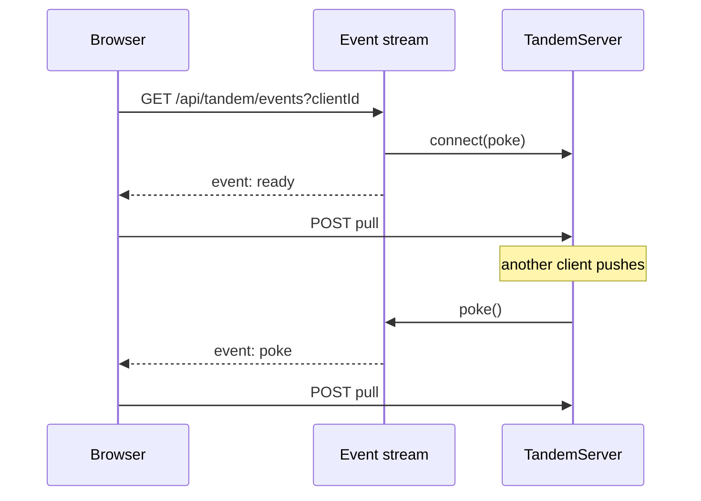

# SSE sync

## Problem overview

Browser clients learn about new server data only by polling. The todo example pulls every second, which is wasteful when idle and still up to a second late. `TandemServer` already pokes connected clients after every commit and storage notification, but those pokes stay inside the server process.

## Solution overview

Deliver pokes to browsers over server-sent events and keep HTTP POST push and pull as the only data path. A poke carries no data; it tells the client to pull. This is the Replicache model: SSE hint, then a normal pull, with a background pull every 60 seconds to check for missed updates. Electric uses SSE to stream data itself, which would duplicate Tandem's pull protocol.

## Goals

- A reusable server helper that turns any remote's `connect` into an SSE `Response`, independent of Hono.
- A reusable browser helper that turns the stream into `poke` calls, pulls after every (re)connection, and pulls every 60 seconds as a fallback.
- Heartbeats, no-buffer and no-cache headers, and disposal that unregisters, clears timers, and closes streams exactly once.
- No leaked or duplicate registrations across reconnects, StrictMode, and `clear()`.
- The todo example syncs live between browsers.

## Non-goals

- WebSockets or an external pub/sub service.
- Multi-process fanout. Pokes reach only streams connected to the process that committed or received a storage notification; other processes rely on the fallback pull until storage notifications or shared fanout exist ([docs/roadmap.md](../docs/roadmap.md)).
- Durable or replayable events. A missed poke delays a pull; it never loses data.

## Implementation

### ✅ Phase 1: One live registration per connection

**Today**

`TandemServer` keeps one poke slot per client. If a stale stream's request lands after its replacement registered, the stale stream takes the slot, and closing it clears the slot, so the live stream stops receiving pokes. `SyncEngine.disconnect` only unregisters a connection that already resolved, so React StrictMode's connect, disconnect, connect leaves two transports registered.

**Proposed**

Make the registration one-per-connection on both sides, so a stale connection can only ever remove itself. This closes the race before any stream is layered on top of it.

```changes
e9b8420
```

The server stores a set of poke callbacks per client. Each `connect` registers its own wrapper and its disconnect removes only that wrapper:

```callstack
 TandemServer.connect [[e9b8420:packages/server/src/TandemServer.ts#L218-L227]]
+├── add a per-connection wrapper to client.pokes # each disconnect deletes only its own entry
 TandemServer.emitPokes [[e9b8420:packages/server/src/TandemServer.ts#L467-L478]]
+└── call every poke in client.pokes
```

`SyncEngine` advances a connection generation on every disconnect. A connect that resolves after a disconnect unregisters itself, and a newer connection replaces any older one:

```callstack
 SyncEngine.connect
 └── SyncEngine.connectToRemote [[e9b8420:packages/core/src/sync/SyncEngine.ts#L202-L216]]
     ├── remote.connect
+    ├── unregister and return if disconnect ran meanwhile
+    └── replace and unregister the previous registration
 SyncEngine.disconnect [[e9b8420:packages/core/src/sync/SyncEngine.ts#L220-L226]]
+└── advance connectionGeneration before unregistering
```

### ✅ Phase 2: SSE helpers

**Today**

Remotes call `poke` from any signal they choose. The quickstart and todo example poll every second. Tandem ships no SSE transport.

**Proposed**

Ship one helper per side: the server turns a remote's `connect` into an SSE `Response`, and the browser turns that stream back into `poke` calls. Pokes stay data-free, so the pull protocol is unchanged and a dropped poke only delays a pull.

```changes
e9b8420..26125dc
```

`createTandemEventStreamResponse` in `@tanishqkancharla/tandem-server` turns a remote's `connect` into a web-standard `Response`. It registers the poke callback first, then writes `ready`, so a pull started from `ready` sees every write committed after registration:

```callstack
 createTandemEventStreamResponse [[e9b8420..26125dc:packages/server/src/TandemEventStream.ts#L31-L109]]
 ├── remote.connect({ clientId, poke }) [[e9b8420..26125dc:packages/server/src/TandemEventStream.ts#L68-L78]] # 503 if registration fails, cause logged
 ├── setInterval(heartbeat) [[e9b8420..26125dc:packages/server/src/TandemEventStream.ts#L80-L83]] # ": keep-alive" every 15 s, skipped while the reader is behind
 ├── enqueue("event: ready") [[e9b8420..26125dc:packages/server/src/TandemEventStream.ts#L96-L100]]
 └── close on signal abort or body cancel [[e9b8420..26125dc:packages/server/src/TandemEventStream.ts#L84-L94]] # clear timer, unregister once
```

`poke` only enqueues a frame, so commits never wait on a browser. When the reader is behind, pokes collapse into one pending frame that `pull` writes next, and heartbeats are skipped because queued frames already keep the connection busy. A stalled response holds at most the ready event and one poke:

```ts
const poke = () => {
	if (hasCapacity()) enqueue(pokeFrame)
	else pokePending = true
	return Promise.resolve()
}
setInterval(() => {
	if (hasCapacity()) enqueue(heartbeatFrame)
}, heartbeatInterval)
```

`connectTandemEventSource` in `@tanishqkancharla/tandem-core` is the browser side. It pulls on `ready`, on `poke`, and every 60 seconds. Native EventSource retries dropped streams; when the browser gives up (a non-200 response), the helper reopens after 5 seconds:

```callstack
 connectTandemEventSource [[e9b8420..26125dc:packages/core/src/sync/TandemEventSource.ts#L22-L63]]
 ├── open: new EventSource(url) [[e9b8420..26125dc:packages/core/src/sync/TandemEventSource.ts#L38-L44]]
 │   ├── on ready → poke() # pull after every (re)connection
 │   ├── on poke → poke()
 │   └── on error with readyState CLOSED → reopen after reconnectDelay
 ├── setInterval(poke, pullInterval) # fallback, null disables
 └── return unsubscribe [[e9b8420..26125dc:packages/core/src/sync/TandemEventSource.ts#L57-L62]] # close source, clear both timers
```



### ✅ Phase 3: Todo example over SSE

**Today**

`TodoHttpRemote.connect` polls with `setInterval(poke, 1000)`. The Hono server has only `POST /api/tandem`.

**Proposed**

Serve the stream from the example's Hono app and consume it from its remote, replacing the polling timer. This exercises both helpers in a real browser rather than only in unit tests.

```changes
c1bc9ba
```

The Hono app serves `GET /api/tandem/events` with the server helper. It combines the request signal with an app-wide shutdown signal, because open streams otherwise keep `nodeServer.close` waiting forever:

```callstack
 createTodoApp [[c1bc9ba:examples/todo/apps/server/src/app.ts#L125-L146]]
+├── app.get("/api/tandem/events") # 400 without clientId
+│   └── createTandemEventStreamResponse(signal: request ∪ shutdown)
 start → shutdown [[c1bc9ba:examples/todo/apps/server/src/index.ts#L71-L85]]
 ├── nodeServer.close
+└── service.endEventStreams
```

The browser remote returns `connectTandemEventSource` from `connect`. It keeps the local poke after a successful push so the pushing client acknowledges its own write without waiting for the stream:

```callstack
 TodoHttpRemote.connect [[c1bc9ba:examples/todo/apps/web/src/TodoHttpRemote.ts#L78-L89]]
-├── setInterval(poke, 1000)
+└── connectTandemEventSource({ url: /api/tandem/events?clientId, poke })
 TodoHttpRemote.push [[c1bc9ba:examples/todo/apps/web/src/TodoHttpRemote.ts#L91-L101]]
 └── poke() # unchanged prompt acknowledgement
```

Playwright covers the real browser path: two browsers sync without polling, a browser whose stream was refused catches a missed write after the stream reconnects, and a browser with no stream catches up when its clock passes the 60 second fallback.

## References

- [Replicache: poke](https://doc.replicache.dev/concepts/how-it-works#poke-optional) and [`pullInterval`](https://doc.replicache.dev/api/interfaces/ReplicacheOptions#pullinterval).
- [Electric live mode](https://electric.ax/docs/sync/api/http#live-mode): `live_sse`, keep-alive every 21 seconds.
- [WHATWG server-sent events](https://html.spec.whatwg.org/multipage/server-sent-events.html).
- [docs/server.md](../docs/server.md), [docs/quickstart.md](../docs/quickstart.md), [docs/sync.md](../docs/sync.md), [docs/custom-remote.md](../docs/custom-remote.md).
