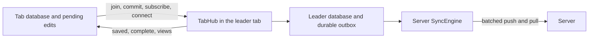

# Shared tab coordination

Tabs of one origin share IndexedDB. Clients that share named client storage elect one leader tab. The leader owns the persisted replica and the only server `SyncEngine`. Every tab keeps an in-memory database for synchronous queries, transactions, and immediate local edits, and exchanges direct commands and views with the leader.

## Problem overview

Two clients writing one IndexedDB store would reuse one client ID and mutation counter, so the server would skip one tab's writes as duplicates. Each tab also needs its own data, because `client.query()` is synchronous and a tab cannot read another tab's memory.

An earlier version of this pull request ran a second sync engine in every tab, with the leader acting as that engine's server: pushes, pulls, pokes, cookies, and patches crossed the channel. A tab's `commit()` resolved when the leader saved the write, not when the server accepted it as in a single tab. That design was replaced before merge; only its election and storage plumbing remain.

## Solution overview



`commit()` keeps the standalone contract. It applies the edit synchronously. While the tab wants the server, it resolves after the server accepts the push that carried the write, and rejects if that push fails. While the tab is deliberately offline, it resolves after the leader saves the write. `flushClientStorage()` waits for the leader's save and never for the server.

```ts
const tx = client.transact()
tx.set("todos", todo)
const committed = client.commit(tx)

client.query({ collection: "todos" }) // already includes the edit
await client.flushClientStorage() // leader storage holds the edit
await committed // connected: the server accepted the push carrying it
```

## Goals

- Give server synchronization one owner and keep synchronous local reads and edits.
- Keep `commit()` completion and failure semantics, and keep saving and other tabs independent of a stalled server push.
- Apply each tab write to the server once across resends and leader crashes.
- Preserve query coverage, codecs, readiness, and takeover.
- Exercise tabs in the deterministic simulation with checks stronger than final convergence.

## Non-goals

- A shared worker, delta views between tabs, or network retry timers.
- Changes to server transports, conflict rules, or `clear()` semantics.
- React changes. `useTransaction` flushes after `commit()`, as for a standalone client.

## Implementation

### ✅ Phase 1: Elect a leader and share its storage

**Today**

A client owned its storage alone, so two tabs with the same storage corrupted each other's client identity.

**Proposed**

A client with a storage name and a tab environment requests a Web Lock named after the storage. The holder leads. `InMemoryTabs` provides the same locks and channels for tests and non-browser hosts.

```changes
92dee88
```

```callstack
 TandemClient constructor [[packages/core/src/TandemClient.ts#TandemClient]]
+├── resolveTabs # named storage plus a browser or explicit environment [[packages/core/src/TandemClient.ts#resolveTabs]]
+└── TabSession # requests the leader lock and a lifetime lock [[packages/core/src/tabs/TabSession.ts#TabSession]]
+    └── lead(channel) # builds the persisted Database and a TabHub
```

This phase also adds the storage plumbing the coordinator reuses: collection codecs that carry values across channels, IndexedDB storage that can be shared and cleared while another tab holds it, session markers in `Database`, synchronous scan windows, and a visibility-aware timer for a leader in a hidden tab.

### ✅ Phase 2: Coordinate tabs with direct commands and views

**Today**

Each tab ran a follower `SyncEngine` against the leader.

**Proposed**

`TabSession` sends commands; `TabHub` answers them and publishes views.

```changes
9584cef
```

```callstack
 TandemClient.commit [[packages/core/src/TandemClient.ts#TandemClient.commit]]
+└── TabSession.commit # retry older unsaved writes, apply locally, send [[packages/core/src/tabs/TabSession.ts#TabSession.commit]]
+    └── TabHub.commit # dedupe by session marker and receipt [[packages/core/src/tabs/TabHub.ts#TabHub.commit]]
+        ├── SyncEngine.commit(tx, forwarded) # outbox, marker, and receipt in one tuple transaction [[packages/core/src/sync/SyncEngine.ts#SyncEngine.commit]]
+        ├── Database.flushClientStorage # reply "saved"
+        └── TabHub.awaitServer # reply "complete" with the push result [[packages/core/src/tabs/TabHub.ts#TabHub.awaitServer]]
```

The receipt `["tab-write", tabClientId, tabMutationId]` maps a tab mutation to the leader mutation that carries it, so a resend finds it instead of committing again. The hub wraps the remote's `push` to record the response promise for each leader mutation a tab waits on. Completion never sends a second push. It pushes only when no push carried the write: the original commit ran before the leader connected, or a replacement leader inherited the write.

```ts
awaitServer(mutationId, attempt):
	if no push carried it yet:
		await the leader connection // a failed connect completes offline
		if still uncarried and still in the outbox: await queuePush()
	await attempt.response // the latest push that carried it
	error response -> Remote push failed
```

The leader publishes views on a microtask-throttled queue after record changes. A view holds a revision, the tab's scan-window records, and the tab's saved-mutation marker. Each view is flushed to storage first, skipped when unchanged for that tab, and broadcast once for every tab with an identical view. A tab replaces its confirmed records with a view and replays its own pending edits through `Database.applyTabView`, which shares its reconciliation with `applyPull`. Records the join restored stay in later views until the tab's subscriptions cover them or they are deleted.

```callstack
+TabHub.publishViews [[packages/core/src/tabs/TabHub.ts#TabHub.publishViews]]
+├── TabHub.captureView # records and marker from one database state [[packages/core/src/tabs/TabHub.ts#TabHub.captureView]]
+├── Database.flushClientStorage # never acknowledge what the leader could lose
+└── post one message per group of identical views
 TabSession.applyView # ignore older revisions [[packages/core/src/tabs/TabSession.ts#TabSession.applyView]]
+└── Database.applyTabView [[packages/core/src/Database.ts#Database.applyTabView]]
```

Takeover rules:

- A tab sends pending writes in mutation order when it joins a leader, after queuing writes whose save failed. A leader without the tab's marker accepts the first write it receives.
- A hub that sees a join addressed to another leader announces itself again, so a late announcement from a crashed leader cannot strand a tab.
- A tab applies views from its current leader before the join reply arrives.
- A failed join fails the requests waiting on it, and the next request joins again. A tab that failed to lead joins whichever tab leads after it.
- A pending `clear` fails when the leader changes, so it never runs twice.

```callstack
+TabSession.join [[packages/core/src/tabs/TabSession.ts#TabSession.join]]
+├── Database.applyTabView # initial view
+├── TabSession.retryWrites # queue unsaved outbox entries [[packages/core/src/tabs/TabSession.ts#TabSession.retryWrites]]
+└── resend pending requests, writes in mutation order
```

### ✅ Phase 3: Remove what the coordinator does not need

**Today**

The folded branch still carried additions made for the follower engine.

**Proposed**

Keep core changes to what the coordinator uses.

```changes
3cb1ac6..bba19ea
```

Against `main`, `SyncEngine.ts` gains only three things:

- `commit(tx, forwarded)`, so the marker and receipt are written with the leader mutation;
- `queuePush()`, for mutations committed while disconnected or inherited from a crashed leader;
- dropping a pull response that arrives after disconnect, which also keeps a stopped leader from saving a late pull.

The hub tracks its own connection. It learns the remote's answer through its wrapper, so `SyncEngine` gets no connection options or state getters. A disconnect settles a connect the server has not answered and disconnects at once, and a clear whose reconnect fails marks the hub disconnected and reconnects if tabs want it. The `TaskTimer` export and unused internal exports are removed.

Server pokes from `main` can carry the records a commit changed. They reach the leader's `SyncEngine`, which shows them as live values in the leader database, so the next view carries them to the tabs before the leader's pull confirms them. Tab databases never receive pokes; a view passes neither a cookie nor a revision to the shared reconciliation.

Review found more takeover races, fixed here with tests. After `clear()`, a tab now leaves its previous session only after that session's requests settle, so a resent write still finds its receipt. A late leader announcement from a closed leader is covered by a test that delays it across the handoff. A tab that failed to lead joins the next leader. A leader that closes while a clear reconnects no longer writes shared storage after the next leader loaded it. A clear that overtakes the leader's save of a forwarded write no longer reports the write saved: the leader checks its replica after each flush, so the commit reports the clear, views are taken again, and the tab resends the write.

### ⏳ Phase 4: Simulate tabs in the deterministic simulation

The next pull request in this stack adds tab groups to `dst/`.

### Benchmark

`packages/core/benchmarks/tabs.ts` runs one Node process with `fake-indexeddb`, in-memory tabs whose channels structured-clone messages, and a memory server whose push waits 5 ms. A writer tab updates one record per sample while another tab subscribes to it. It measures:

- the synchronous `commit()` work;
- `flushClientStorage()`;
- when the observing tab sees the edit;
- when the server applies the push;
- when the public `commit()` promise settles;
- channel messages and JSON-encoded bytes.

The `churn` workload resubscribes the observer for every sample. Three warmup samples are discarded. The same file ran at `67e2f17`, the follower-engine design, and at `3cb1ac6`, alternating, five times per configuration:

```sh
pnpm --filter tandem-dst exec tsx ../packages/core/benchmarks/tabs.ts 100 3 30 5 stable
```

#### 100 rows, 3 tabs, stable subscriptions

| Measure (median of 5 runs) | Baseline p50 | Coordinator p50 | Baseline p95 | Coordinator p95 |
| --- | --- | --- | --- | --- |
| local ms | 0.16 | 0.23 | 0.27 | 0.32 |
| saved ms | 13.47 | 12.61 | 18.85 | 17.72 |
| observed ms | 8.54 | 6.01 | 13.44 | 10.10 |
| server ms | 13.62 | 10.00 | 16.94 | 14.69 |
| commit ms | 6.66 | 12.85 | 10.99 | 19.49 |
| messages (whole run) | 462 | 270 | | |
| encodedBytes (whole run) | 1,486,422 | 896,211 | | |

#### 100 rows, 3 tabs, churn subscriptions

| Measure (median of 5 runs) | Baseline p50 | Coordinator p50 | Baseline p95 | Coordinator p95 |
| --- | --- | --- | --- | --- |
| local ms | 0.14 | 0.18 | 0.29 | 0.28 |
| saved ms | 14.73 | 12.12 | 22.32 | 24.90 |
| observed ms | 12.61 | 5.98 | 18.27 | 10.20 |
| server ms | 15.67 | 10.31 | 21.32 | 20.41 |
| commit ms | 8.33 | 13.58 | 12.79 | 25.03 |
| messages (whole run) | 476 | 330 | | |
| encodedBytes (whole run) | 1,688,525 | 1,336,868 | | |

#### 3000 rows, 5 tabs, stable subscriptions

| Measure (median of 5 runs) | Baseline p50 | Coordinator p50 | Baseline p95 | Coordinator p95 |
| --- | --- | --- | --- | --- |
| local ms | 1.34 | 1.69 | 3.77 | 4.43 |
| saved ms | 537.21 | 512.40 | 630.94 | 581.38 |
| observed ms | 257.55 | 169.92 | 336.08 | 223.06 |
| server ms | 420.15 | 377.63 | 493.13 | 449.02 |
| commit ms | 205.14 | 512.47 | 278.48 | 581.46 |
| messages (whole run) | 696 | 270 | | |
| encodedBytes (whole run) | 70,402,125 | 26,073,002 | | |

#### 3000 rows, 5 tabs, churn subscriptions

| Measure (median of 5 runs) | Baseline p50 | Coordinator p50 | Baseline p95 | Coordinator p95 |
| --- | --- | --- | --- | --- |
| local ms | 1.83 | 1.83 | 5.36 | 5.22 |
| saved ms | 567.91 | 575.85 | 714.14 | 664.51 |
| observed ms | 275.51 | 209.22 | 378.81 | 257.68 |
| server ms | 450.19 | 436.47 | 581.12 | 518.94 |
| commit ms | 216.93 | 575.94 | 303.82 | 664.60 |
| messages (whole run) | 695 | 330 | | |
| encodedBytes (whole run) | 70,402,088 | 39,101,575 | | |

The coordinator shows the edit in the other tab 24 to 53 percent sooner at the median, and the server applies it sooner or about as soon. It sends 31 to 61 percent fewer messages and 21 to 63 percent fewer channel bytes; resubscribing costs more, because each subscription change returns a complete view. The synchronous commit costs up to 0.07 ms more at 100 rows and 0.35 ms more at 3000 rows, from resend bookkeeping and encoding the mutation in the tab. Tail latencies of the large churn workload varied between repeated sweeps.

`commit` is not comparable between the columns. The follower engine resolved after the leader's save; the coordinator resolves after the server response while connected, as a standalone client does. The `server` row measures the actual push response in both. These numbers compare two implementations in one process. They do not predict browser IndexedDB, BroadcastChannel, or network latency.

## References

- [[packages/core/src/tabs/AGENTS.md]] — current behavior and limits.
- [[packages/core/src/tabs/TabSession.ts]] — tab-side commands, retries, and views.
- [[packages/core/src/tabs/TabHub.ts]] — leader commands, push observation, and view publication.
- [[packages/core/src/tabs/TabProtocol.ts]] — messages and codecs.
- [[packages/core/test/tabs.spec.ts]] — tab workflows.
- [[packages/core/benchmarks/tabs.ts]] — the benchmark.
- [[docs/sync.md]] — the consumer-facing description.
