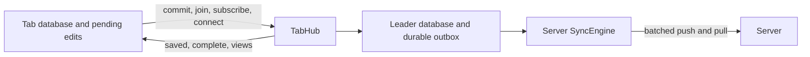

# Tab coordination with one server sync owner

Shared tabs keep a database in every tab for synchronous queries, transactions, and immediate local edits. One elected leader owns the persisted replica and the only server `SyncEngine`. Tabs talk to it with direct commands and receive complete views, instead of running a second sync engine against the leader. `SyncEngine.ts` is unchanged.

## Problem overview

Before this work, every tab ran a `SyncEngine` whose remote was `TabSession`. The leader owned another database and another `SyncEngine`, whose remote was the server. The tab-facing path duplicated mutation IDs, cookies, pushes, pulls, pokes, and reconciliation.

```callstack
-TandemClient.commit
-└── SyncEngine.commit # apply locally and schedule delivery to the leader
-    └── TabSession.push
-        └── TabHub.push
-            ├── SyncEngine.commit # schedule delivery to the server without awaiting it
-            └── Database.flushClientStorage # reply after local persistence
```

A tab's `commit()` therefore resolved after the leader's save, while a connected standalone client's `commit()` resolves after the server push response. Server updates reached a tab through poke, pull, and patch round trips across the channel.

## Solution overview

Keep leader election, the persisted replica, codecs, and the server `SyncEngine`. Each tab keeps its memory database, pending edits, subscriptions, connection wish, and outstanding requests. The leader answers writes and publishes views directly.



`commit()` keeps its standalone contract. It applies the edit synchronously. While the tab wants the server, it resolves after the server push response that carried the write, and rejects if that push fails. While the tab is deliberately offline, it resolves after the leader saves the write. `flushClientStorage()` waits for the leader save and never for the server.

```ts
const tx = client.transact()
tx.set("todos", todo)
const committed = client.commit(tx)

client.query({ collection: "todos" }) // already includes the edit
await client.flushClientStorage() // leader storage holds the edit
await committed // connected: the server accepted the push carrying it
```

## Goals

- Give server synchronization one owner and keep synchronous local reads and edits.
- Preserve `commit()` completion and failure semantics, and keep saving and other tabs independent of a stalled server push.
- Save a forwarded write and its deduplication receipt together, and apply each tab write to the server once.
- Preserve query coverage, codecs, readiness, and takeover behavior.
- Show correctness under lost replies, failed saves, reordered messages, and leader crashes with checks stronger than final convergence.

## Non-goals

- Change `SyncEngine`, server transports, conflict rules, or `clear()` semantics.
- Add a shared worker, automatic network retry timers, or delta views between tabs.
- Change the React bindings. `useTransaction` already flushes after `commit()`, as in a standalone client.

## Implementation

### ✅ Phase 1: Publish tab views from the leader

**Today**

The leader stored a cookie and sent-record map per tab, poked tabs after commits, and computed a pull patch when a tab asked.

**Proposed**

The leader publishes complete views. A view holds a revision, the session's scan-window records, and the session's last forwarded mutation. Tabs replace their base with it and replay their own pending edits.

```changes
ded3fdc
```

```changes
57071bc
```

`Database.applyPull` and the new `Database.applyTabView` share one reconciliation body. Only the server path writes a cookie.

```callstack
 Database.applyPull [[ded3fdc:packages/core/src/Database.ts#L446-L448]]
+└── Database.reconcile # replace confirmed records, prune acknowledged outbox, replay pending edits [[ded3fdc:packages/core/src/Database.ts#L461-L506]]
+Database.applyTabView # same reconciliation, no cookie [[ded3fdc:packages/core/src/Database.ts#L451-L459]]
```

`TabHub.publishViews` runs on a microtask-throttled queue after record changes. It captures every live session's view, flushes storage once, skips views unchanged since the last one sent to that session, and broadcasts identical views once with all their session IDs.

```ts
publishViews():
	views = sessions.map(captureView) // records and marker from one database state
	await flushClientStorage() // never show an acknowledgement the leader could lose
	for each group of identical views:
		post({ type: "view", sessionIds, view })
```

The join view restores the whole replica. Later views keep carrying restored records outside the tab's scan window, with current values, until the window covers them or they are deleted, so a narrower view does not remove them ([[57071bc:packages/core/src/tabs/TabHub.ts]]).

A tab ignores views with an older revision, so a delayed view cannot replace a newer one or erase a pending edit. It applies views from its current leader before the join reply arrives, because the leader does not resend a view it already published.

### ✅ Phase 2: Commit directly and complete on the server response

**Today**

A follower `SyncEngine` pushed to the leader, and the leader replied after saving.

**Proposed**

`TabSession.commit` applies the transaction to the memory database and sends the encoded mutation with `waitForServer`. The hub commits it once and answers twice: `saved` after a flush, `complete` after the server push response.

```changes
ded3fdc
```

```callstack
 TandemClient.commit [[ded3fdc:packages/core/src/TandemClient.ts#L281-L306]]
-└── SyncEngine.commit # follower engine with the leader as remote
+└── TabSession.commit # apply locally, then send the mutation [[ded3fdc:packages/core/src/tabs/TabSession.ts#L127-L137]]
+    └── TabHub.commit # one leader mutation per tab mutation [[ded3fdc:packages/core/src/tabs/TabHub.ts#L309-L372]]
+        ├── SyncEngine.commit(transaction, forwarded) # writes marker and receipt atomically
+        ├── Database.flushClientStorage # then reply "saved"
+        └── TabHub.awaitServer # then reply "complete" with the push result [[ded3fdc:packages/core/src/tabs/TabHub.ts#L387-L415]]
```

The receipt `["tab-write", tabClientId, tabMutationId]` maps a tab mutation to the leader mutation that carries it. A resend at or below the session marker finds the receipt instead of committing again.

The hub constructs its `SyncEngine` around a wrapper of the remote whose `push` records the response promise for each leader mutation a tab waits on. Completion never issues a second push for a write a push already carried.

```ts
awaitServer(mutationId, attempt):
	if no push carried it yet:
		await the leader connection // a failed connect completes offline
		if still uncarried and still in the outbox: await queuePush()
	await attempt.response // the latest push that carried it
	error response -> Remote push failed
```

The original commit can skip its push while the first connection is still pending, and a replacement leader inherits a mutation without its commit. Both wait for the connection and push once. The completion awaits the response promise, not a flag, because another push may already be in flight when the commit continues.

### ✅ Phase 3: Resend unsaved writes and recover takeover

**Today**

A failed leader save left the edit in the tab's outbox with no path to resend it.

**Proposed**

A session tracks the last mutation the leader saved, from `saved` replies and view markers. It resends outbox entries above that watermark that no request carries.

```changes
ded3fdc
```

```callstack
 TabSession.commit
+├── TabSession.retryWrites # older unsaved writes go first [[ded3fdc:packages/core/src/tabs/TabSession.ts#L263-L273]]
 └── TabSession.submit
+TabSession.flush # retry, then await every saved reply
+TabSession.connect # retry after the leader reconnects
+TabSession.join # queue retries, then resend in mutation order [[ded3fdc:packages/core/src/tabs/TabSession.ts#L356-L396]]
```

The tab retires a receipt with `finishWrite` only after a confirmed save, so a resend after a failed save or a takeover still finds it. Deterministic simulation found three takeover bugs, fixed here:

- A late `leader` announcement from a previous leader redirected a tab to it. A hub that sees a join addressed to another leader announces itself again.
- After a takeover, a tab resent newer pending writes before an older unsaved one. A leader without the tab's marker accepted the newer one first and dropped the older one. Rejoin now queues retries first and sends writes in mutation order.
- A failed rejoin left a tab unjoined forever. It now fails the requests waiting for it, which stay in the outbox, and the next request joins again.

The leader also watches each tab's lifetime lock, so a crashed tab's subscriptions, receipts, and connection wish are dropped without heartbeats.

### ✅ Phase 4: Simulate shared tabs deterministically

**Today**

`dst/` drove two standalone clients and could not exercise leadership, tab messages, or takeover.

**Proposed**

A separate seeded tab world runs real `TandemClient`s and a `TandemServer` over one shared client storage. Every channel delivery, network request, reply, poke, leader storage commit, and timer tick waits as a named step until the run chooses it.

```changes
4ec5a73
```

```callstack
+TabSimulation.execute # choose one possible event per step
+├── TabSimulation.choose # open, close, crash, write, flush, toggle, advance, fault [[4ec5a73:dst/TabSimulation.ts#L103-L152]]
+├── TabWorld.apply
+│   ├── TabWorld.write # checks completion against the server and storage [[4ec5a73:dst/TabWorld.ts#L538-L593]]
+│   ├── TabWorld.crash # drops the tab's steps and undelivered messages [[4ec5a73:dst/TabWorld.ts#L496-L510]]
+│   ├── TabWorld.broadcast # per sender and receiver queues [[4ec5a73:dst/TabWorld.ts#L399-L410]]
+│   └── TabWorld.remoteFor # held requests, replies, pokes, and loss [[4ec5a73:dst/TabWorld.ts#L707-L794]]
+└── TabWorld.finish # heal, then check what must have survived [[4ec5a73:dst/TabWorld.ts#L330-L387]]
+replayTabs # apply a recorded trace with no random choices [[4ec5a73:dst/TabSimulation.ts#L169-L194]]
```

Each write creates a unique record, so the oracles can name what went wrong:

| Oracle | Checked |
| --- | --- |
| `completedBeforeServer` | When a commit completes, the server holds the write, unless the writing tab or every tab gave up the server, or a leader connection failed on a failed save (observed through the leader's log) |
| `completedBeforeSave`, `flushedBeforeSave` | When a commit or flush completes, shared storage holds the writes |
| `lostAcknowledgedWrite` | After healing, the server holds every write whose commit or later flush completed |
| `lostRetainedWrite` | After healing, the server holds every write of a tab that is still open |
| `writeAppliedTwice` | No record reaches the server in two different leader mutations |
| `tabDiverged` | After healing, every open tab shows exactly the server's records |

Runs report coverage: takeovers while another tab had a pending commit, accepted pushes whose reply was lost, failed saves, and server completions. Connection requests are never lost, so the completion oracle stays strict; a failed save schedules a leader crash a few steps later half the time, so failed saves meet takeovers.

Results on the final code, 200 seeds by 300 steps per configuration, all without violations:

| Configuration | Takeovers with pending commits | Accepted replies lost | Failed saves |
| --- | --- | --- | --- |
| No faults | 104 | 0 | 0 |
| `--fault-rate 0.1 --crash-rate 0.02` | 111 | 130 | 0 |
| `--save-fault-rate 0.05 --crash-rate 0.02` | 192 | 0 | 601 |
| All three | 181 | 74 | 598 |

The simulation found the dropped view described in phase 1 and the three takeover bugs described in phase 3. `dst/regressions/tabs-*.jsonl` keep two traces that failed before their fixes and replay cleanly after them. Reverting individual fixes shows what catches them:

| Reverted behavior | Caught by |
| --- | --- |
| Receipt deduplication | Random sweeps, 25 to 42 of 100 seeds |
| Awaiting the server after the original commit | Random sweeps, 1 to 6 of 100 seeds |
| Stale leader re-announcement, views before join | Random sweeps and regression traces |
| Retrying unsaved writes, mutation-order resend | Explicit scenario in `dst/TabSimulation.spec.ts`; rare in random sweeps |

The simulation does not yet drive `clear`, updates and removes of shared records, or subscription changes; `packages/core/test/tabs.spec.ts` covers those.

### ✅ Phase 5: Compare the coordinator with the follower engine

`packages/core/benchmarks/tabs.ts` runs one Node process with `fake-indexeddb`, in-memory tabs whose channels structured-clone messages, and a memory server whose push waits 5 ms. A writer tab updates one record per sample while another tab subscribes to it. The run measures:

- the synchronous `commit()` work;
- `flushClientStorage()`;
- when the observing tab sees the edit;
- when the server applies the push;
- when the public `commit()` promise settles;
- channel messages and JSON-encoded bytes.

The `churn` workload resubscribes the observer for every sample. Three warmup samples are discarded.

The same file ran in a worktree of `67e2f17` (the follower engine) and on this branch, alternating, five times per configuration:

```sh
pnpm --filter tandem-dst exec tsx ../packages/core/benchmarks/tabs.ts 100 3 30 5 stable
```

#### 100 rows, 3 tabs, stable subscriptions

| Measure (median of 5 runs) | Baseline p50 | Coordinator p50 | Baseline p95 | Coordinator p95 |
| --- | --- | --- | --- | --- |
| local ms | 0.16 | 0.19 | 0.36 | 0.30 |
| saved ms | 13.34 | 11.89 | 18.79 | 18.13 |
| observed ms | 8.57 | 5.58 | 14.04 | 9.88 |
| server ms | 13.12 | 9.74 | 16.98 | 13.93 |
| commit ms | 6.61 | 12.05 | 10.31 | 18.22 |
| messages (whole run) | 464 | 270 | | |
| encodedBytes (whole run) | 1,486,359 | 896,213 | | |

#### 100 rows, 3 tabs, churn subscriptions

| Measure (median of 5 runs) | Baseline p50 | Coordinator p50 | Baseline p95 | Coordinator p95 |
| --- | --- | --- | --- | --- |
| local ms | 0.13 | 0.20 | 0.25 | 0.39 |
| saved ms | 14.21 | 13.64 | 21.75 | 18.59 |
| observed ms | 12.29 | 6.97 | 18.51 | 11.37 |
| server ms | 14.81 | 11.14 | 20.88 | 16.26 |
| commit ms | 8.09 | 13.93 | 13.12 | 18.64 |
| messages (whole run) | 472 | 330 | | |
| encodedBytes (whole run) | 1,702,806 | 1,336,562 | | |

#### 3000 rows, 5 tabs, stable subscriptions

| Measure (median of 5 runs) | Baseline p50 | Coordinator p50 | Baseline p95 | Coordinator p95 |
| --- | --- | --- | --- | --- |
| local ms | 1.54 | 1.71 | 5.43 | 4.39 |
| saved ms | 562.14 | 529.18 | 696.26 | 640.75 |
| observed ms | 274.00 | 169.64 | 354.56 | 240.64 |
| server ms | 439.97 | 385.92 | 558.57 | 474.49 |
| commit ms | 222.03 | 529.24 | 275.62 | 640.81 |
| messages (whole run) | 696 | 270 | | |
| encodedBytes (whole run) | 70,402,363 | 26,073,002 | | |

#### 3000 rows, 5 tabs, churn subscriptions

| Measure (median of 5 runs) | Baseline p50 | Coordinator p50 | Baseline p95 | Coordinator p95 |
| --- | --- | --- | --- | --- |
| local ms | 1.68 | 1.61 | 5.25 | 6.47 |
| saved ms | 559.95 | 588.30 | 693.47 | 895.21 |
| observed ms | 273.62 | 209.47 | 353.32 | 334.01 |
| server ms | 449.72 | 443.62 | 552.17 | 677.95 |
| commit ms | 211.25 | 588.38 | 299.36 | 895.30 |
| messages (whole run) | 700 | 330 | | |
| encodedBytes (whole run) | 69,535,206 | 39,101,688 | | |

`commit` is not comparable between the columns: the follower engine resolved after the leader's save, and the coordinator resolves after the server response while connected, which matches a standalone client. The `server` row measures the actual push response in both. The coordinator shows the edit in the other tab 23 to 43 percent sooner at the median. Server delivery is faster or level, from 25 percent sooner at 100 rows to level in the large churn workload. It sends 30 to 61 percent fewer messages and 21 to 63 percent fewer channel bytes; resubscribing costs more, because each subscription change returns a complete view. The synchronous commit costs slightly more (about 0.04 ms at 100 rows), from resend bookkeeping and encoding the mutation in the tab. Tail latencies in the large churn workload varied between repeated sweeps: the coordinator's `saved` p95 was 615 ms in one sweep and 895 ms in the other. The benchmark ran before 57071bc, which keeps restored records in views. Its tabs subscribe to every record, so the change only adds a check of an empty set. These numbers compare two implementations in one process. They do not predict browser IndexedDB, real BroadcastChannel, or network latency.

## References

- [[packages/core/src/tabs/TabSession.ts]] — tab-side commands, retries, and views.
- [[packages/core/src/tabs/TabHub.ts]] — leader commands, push observation, and view publication.
- [[packages/core/src/tabs/TabProtocol.ts]] — messages and codecs.
- [[packages/core/src/Database.ts]] — receipts and shared reconciliation.
- [[packages/core/test/tabs.spec.ts]] — tab workflows.
- [[packages/core/src/tabs/AGENTS.md]] — current behavior and limits.
- [[dst/TabWorld.ts]] — the shared tab simulation and its oracles.
- [[packages/core/benchmarks/tabs.ts]] — the benchmark.
